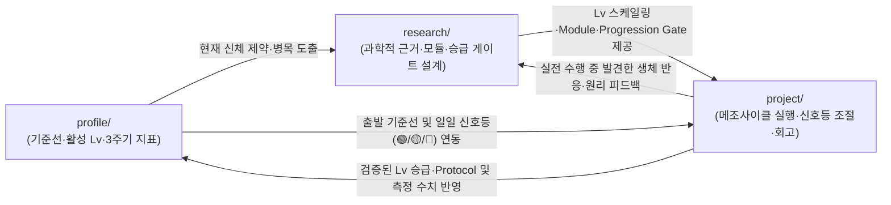

# Personal Health & Recomposition Repository

3대 대사 질환(당뇨 전단계·지방간·고지혈증) 역전과 칼리스데닉스·러닝 기반의 강인한 신체 재구성을 위해, **현재 활성 상태 및 3주기 생체 지표(`profile`)**, **과학적 메커니즘과 도메인 운영 아키텍처(`research`)**, 그리고 **메조사이클·레벨 승급 실행(`project`)**을 통합 운영하는 적응형 건강 관리 저장소입니다.

---

## 🧭 3축 아키텍처 및 적응형 선순환 흐름 (Adaptive Health OS)

### 1. [`profile/`](./profile/) (현재 상태 제어판 & 3주기 생체 지표)
- [`overview.md`](./profile/overview.md): 기본 신체 프로필, 의학적/대사적 맥락, 장기 건강 지향점(North Star) 및 핵심 우선순위
- [`protocols.md`](./profile/protocols.md): **현재 활성 레벨(`Lv`) 대시보드**, 주간 운영 모드(`병행 모드` vs `유산소 집중 모드`), 24시간 일주기 마스터 앵커, 아침 3단계 회복 신호등(`Readiness Traffic Light`), 4슬롯 상시 서플리먼트 및 검증된 일상 `Protocol`
- [`measurements.md`](./profile/measurements.md): **3주기 생체·퍼포먼스 지표 요약표**
  - **주간(Weekly)**: 체중(7일 이동평균), 허리둘레, 골격근량/체지방률, 야간 RHR·HRV·실수면(TST)·수면효율(SE)·최저 SpO2, 혈압
  - **메조사이클(4~8주)**: 칼리스데닉스 6대 트랙 `Lv` 및 수행 기록, 러닝 `Lv`·연속 주행·Zone 2 페이스/EF·심박 드리프트(%), 식단·수면 `Lv` 준수율
  - **분기(3~6개월)**: 공복혈당·인슐린·HOMA-IR, HbA1c, TG/HDL 비율, LDL·ApoB, AST/ALT/GGT, hs-CRP, 요산, 비타민 D·페리틴
- [`snapshots/`](./profile/snapshots/): 종합건강검진, 정밀 혈액검사, 인바디, 메조사이클 전후 정밀 측정 등 특정 일자(`YYYY-MM-DD`)의 상세 원본 기록 ([`_template.md`](./profile/snapshots/_template.md))

### 2. [`research/`](./research/) (과학적 근거 & 4대 도메인 마스터 아키텍처)
단순 문헌 요약을 넘어, 내 상태(`profile`)에 맞춘 **단계별 스케일링 매트릭스(`Lv 0~4`), 상황별 선택형 모듈(`Session`/`Meal`/`Recovery Module`), 객관적 승급 관문(`Progression Gate`), 3단계 신호등(`Readiness Traffic Light`)**을 정의합니다. ([`_template.md`](./research/_template.md))

- **4대 코어 도메인 아키텍처 (Evergreen Blueprints)**:
  1. 🤸 **[기능적 맨몸 훈련(Calisthenics) 아키텍처](./research/functional-calisthenics-architecture.md)**: 3대 근력(Push/Pull/Lower) & 3축 무브먼트 `Lv 1~4` 매트릭스, 10/30/60분 `Session Module`, 좌식 4대 프리헵 이중 내재화, 4중 `Progression Gate` 및 관절 신호등
  2. 🏃 **[심폐·대사 러닝(Running) 아키텍처](./research/cardio-metabolic-running-architecture.md)**: 고중량 보호 `Lv 0~4` Run-Walk 매트릭스, `%HRR` 5-Zone 및 심박 드리프트 브레이크, 15/35~45/60분 러닝 `Session Module`, 병행 vs 유산소 집중 2원화 모드, 5중 `Progression Gate`
  3. 🥗 **[대사 영양 및 체성분 재구성(Nutrition) 아키텍처](./research/metabolic-nutrition-recomposition-architecture.md)**: 메타볼릭 데이/휴식일 탄수화물 사이클링, `18:30~19:00` eTRF/mTRF 및 5단계 식사 순서, 4대 `Meal Module`, 외식/회식 디펜스, 4슬롯 서플리먼트, 4중 `Progression Gate`
  4. 🌙 **[수면·일주기 리듬 및 회복(Sleep & Recovery) 아키텍처](./research/sleep-circadian-metabolic-recovery-architecture.md)**: 고중량 4단계 상기도 안전 사다리, `06:00` 기상 / `22:30` 취침 24시간 마스터 타임라인, 5대 `Recovery Module`, 워치 7대 지표 기반 아침 `Readiness Traffic Light`(`🟢/🟡/🔴`), 4중 `Progression Gate`

### 3. [`project/`](./project/) (메조사이클 & 가설 검증 실행 단위)
- `project/YYYY-MM-<슬러그>/` 디렉토리 단위로 운영합니다. (예: 4주/8주 온보딩 메조사이클, 특정 레벨 승급 캠페인, 또는 특정 병목 해결 실험)
- [`README.md`](./project/_template/README.md): 프로젝트 배경, 목표 레벨(`Lv` Before → After) 및 가설, 주간 모듈 배치 계획, `Progression Gate` 달성 체크리스트, 최종 회고 및 종료 절차
- [`log.md`](./project/_template/log.md): 일일 아침 회복 신호등(`🟢/🟡/🔴`), 수행 모듈(`Session`/`Meal`/`Recovery`), 식사 마감 시각, 관절 통증(NRS 0~10) 및 주간 준수율(`≥85%`) 기록

---

## 🔄 운영 규칙 (Operational Workflow)

1. **도메인 아키텍처 설계 및 보완 (`research/`)**:
   - 새로운 건강 과제가 생기거나 기존 4대 도메인의 세부 근거가 필요할 때 [`research/_template.md`](./research/_template.md)를 기반으로 조사·설계합니다.
2. **메조사이클 / 프로젝트 착수 (`project/`)**:
   - [`profile/`](./profile/)의 현재 활성 레벨(`Lv`)과 [`research/`](./research/)의 로드맵을 바탕으로 [`project/_template/`](./project/_template/)을 복사해 `project/YYYY-MM-<슬러그>/`를 생성합니다.
   - 기간 중 매일 아침 `Readiness Traffic Light`(`🟢 Green / 🟡 Yellow / 🔴 Red`)를 판정하여 당일 컨디션과 가용 시간에 맞는 `Session Module`, `Meal Module`, `Recovery Module`을 실행하고 [`log.md`](./project/_template/log.md)에 기록합니다.
3. **종료, `Progression Gate` 심사 및 `Profile` 승격**:
   - 프로젝트(메조사이클) 기간이 끝나면 각 트랙의 객관적 `Progression Gate`(수행 볼륨/RIR, 24~48h 무통증 NRS 0~1, 최근 14일 중 12일 `≥85%` 준수율, 최소 체류 기간) 통과 여부를 판정합니다.
   - 측정된 수치 변화를 [`profile/measurements.md`](./profile/measurements.md)(및 필요시 [`profile/snapshots/`](./profile/snapshots/))에 기록합니다.
   - 통과한 트랙의 새로운 레벨(`Lv`)과 일상에서 상시 유지하기로 확정한 루틴을 [`profile/protocols.md`](./profile/protocols.md)로 승격(Commit)합니다.
   - 직접 겪으며 새로 발견한 생체 반응이나 예외 처리 규칙은 관련 [`research/`](./research/) 아키텍처 문서에 보완합니다.

---

## 📚 참고 문서

- 도메인 용어 정의: [`GLOSSARY.md`](./GLOSSARY.md)
- 아키텍처 결정 기록(ADR):
  - [`0001-profile-hybrid-time-series.md`](./docs/adr/0001-profile-hybrid-time-series.md)
  - [`0002-adaptive-health-os-and-three-pillar-refinement.md`](./docs/adr/0002-adaptive-health-os-and-three-pillar-refinement.md)
