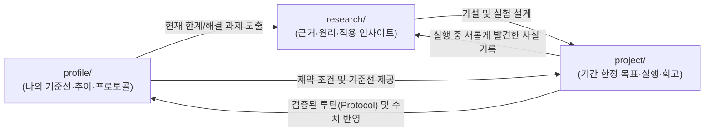

# Fitness & Health Repository

나의 건강 개선을 위해 **현재 상태(`profile`)**, **과학적·경험적 근거(`research`)**, 그리고 **기간 한정 실험 및 실행(`project`)**을 통합 관리하는 저장소입니다.

---

## 🧭 3축 아키텍처 및 선순환 흐름

1. **[`profile/`](./profile/) (나의 기준선과 현재 상태)**
   - [`overview.md`](./profile/overview.md): 기본 신체 정보, 체질, 병력/주의사항, 장기 건강 지향점 및 현재 상태 요약
   - [`protocols.md`](./profile/protocols.md): 검증을 거쳐 일상에서 상시 유지 중인 기본 루틴 (영양제, 식단, 운동, 수면)
   - [`measurements.md`](./profile/measurements.md): 체성분, 핵심 혈액 지표 등의 일자별 추이 요약표 (Table)
   - [`snapshots/`](./profile/snapshots/): 종합건강검진, 정밀 혈액검사, 프로젝트 전후 정밀 측정 등 특정 일자(`YYYY-MM-DD`)의 상세 원본 기록 ([`_template.md`](./profile/snapshots/_template.md))

2. **[`research/`](./research/) (조사 및 연구)**
   - 하위 폴더 없이 `research/<주제-슬러그>.md` 형태로 주제/질문당 하나의 마크다운 파일로 기록합니다.
   - 단순 정보 요약을 넘어 **"내 상태(`profile`)에 어떻게 적용할 것인가"**를 반드시 포함합니다. ([`_template.md`](./research/_template.md))

3. **[`project/`](./project/) (기간 한정 목표, 실행, 회고)**
   - `project/YYYY-MM-<프로젝트명>/` 디렉토리 단위로 운영합니다.
   - [`README.md`](./project/_template/README.md): 프로젝트 배경, 목표 및 가설, 실행 계획, 최종 회고, 그리고 종료 체크리스트
   - [`log.md`](./project/_template/log.md): 기간 중 일별/주별 실행 내역 및 생체 반응 관찰 기록

---

## 🔄 운영 규칙 (Workflow)

1. **새로운 조사 시작**: 궁금한 주제나 해결하고 싶은 건강 이슈가 생기면 [`research/_template.md`](./research/_template.md)를 복사해 조사 내용을 정리합니다.
2. **프로젝트 시작**: `research/`의 근거와 `profile/`의 현재 상태를 바탕으로 [`project/_template/`](./project/_template/)을 복사해 `project/YYYY-MM-<슬러그>/`를 생성합니다.
3. **프로젝트 종료 및 승격**: 프로젝트 기간이 끝나면 `README.md`의 회고를 작성하고, 아래 종료 절차를 수행합니다.
   - 측정된 수치 변화를 [`profile/measurements.md`](./profile/measurements.md)(및 필요시 [`profile/snapshots/`](./profile/snapshots/))에 기록
   - 앞으로도 계속 유지할 성공적인 루틴은 [`profile/protocols.md`](./profile/protocols.md)로 승격
   - 직접 겪으며 새로 알게 된 원리나 주의점은 [`research/`](./research/) 문서에 보완

---

## 📚 참고 문서

- 도메인 용어 정의: [`GLOSSARY.md`](./GLOSSARY.md)
- 아키텍처 결정 기록(ADR): [`docs/adr/`](./docs/adr/)
