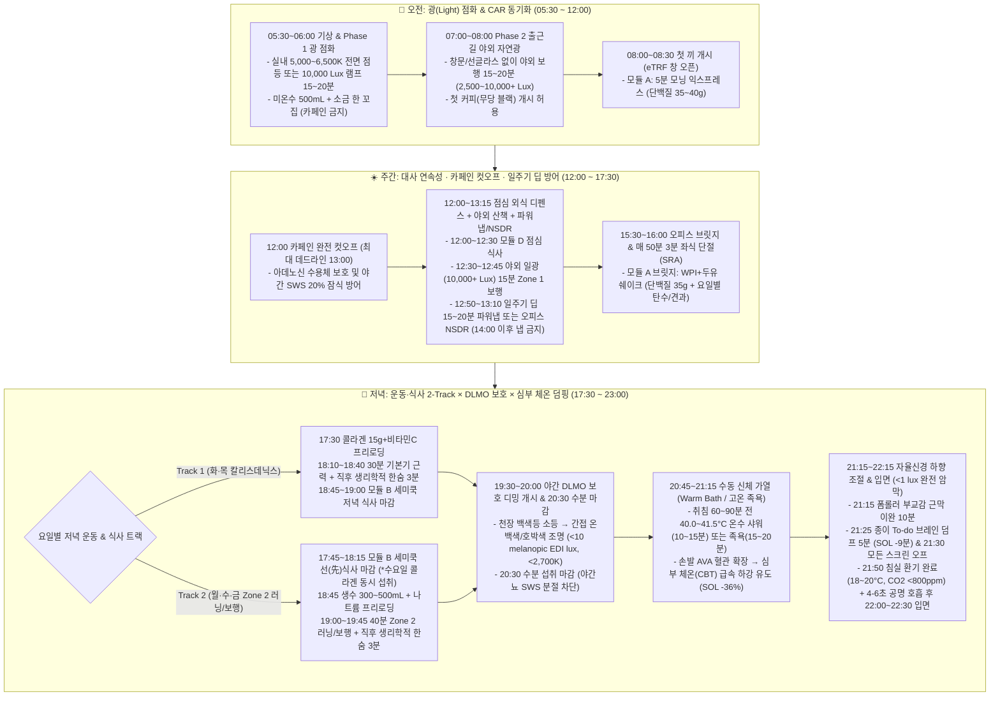

# 조기 기상·취침(`05:30~06:30` 기상 · `22:00~23:00` 취침) 크로노타입 기반 광·체온·자율신경 동기화 및 저녁 운동·식단 연계 아키텍처

## 1. 배경 및 핵심 질문 (Why & Question)

- **왜 이 주제를 조사하는가?**:
  - [`Profile`](../profile/overview.md) 기준 현재 **22:00 ~ 23:00 취침 / 05:30 ~ 06:30 기상(약 7.5~8시간의 규칙적인 조기 크로노타입 리듬)**을 보유하고 있으나, **하루 10시간 이상의 고강도 좌식 웹 개발 근무(인지적·시각적 교감신경 과각성 및 실내 광 결핍)**와 **체중 98.2kg(BMI 32.8)·3대 대사 질환(당뇨 전단계·비알코올성 지방간·고지혈증)** 상태가 공존한다.
  - 또한 선행 수립된 [`기능적 맨몸 훈련(Functional Calisthenics) 아키텍처`](./functional-calisthenics-architecture.md), [`심폐·대사 개선을 위한 러닝(Cardio-Metabolic Running) 아키텍처`](./cardio-metabolic-running-architecture.md), [`영양·식단(Metabolic Nutrition & Recomposition) 아키텍처`](./metabolic-nutrition-recomposition-architecture.md)에 따라 평일 퇴근 후 저녁 시간대(`17:45~19:45`)에 운동(`Session Module`)과 식사(`Meal Module`)가 집중 배치된다.
  - 만약 ① 한국 추동계 일출 전 기상(`05:30~06:30`) 구간의 광 결핍과 야간 청색광 노출로 인해 **시교차상핵(SCN) 위상 및 야간 멜라토닌 분비 개시(DLMO, `19:30~20:30`)가 교란**되거나, ② 저녁 운동·식사로 상승한 **심부 체온(Core Body Temperature, CBT)과 교감신경 잔열**이 `22:00~23:00` 입면 시점까지 해소되지 않거나, ③ 오후 늦은 카페인·장시간 낮잠·주말 늦잠(Social Jetlag)으로 인해 **수면 압력(Process S)과 생체시계(Process C)가 붕괴**되면, **전반부 서파 수면(Slow-Wave Sleep, SWS) 및 성장호르몬(GH) 펄스 감소, 건·근육 재생 지연, 익일 아침 코르티솔 과잉과 간 당신생(공복 고혈당) 악화**로 직결된다.
- **해결하려는 핵심 질문**:
  1. 한국 사계절(특히 추동계 일출 `06:45~07:45`) 환경에서 `05:30~06:30` 기상자의 **코르티솔 각성 반응(CAR) 점화 및 SCN 위상 고정을 위한 2단계 아침 광 노출 프로토콜**과, `22:00~23:00` 취침자의 **DLMO(`19:30~20:30`) 보호를 위한 국제 기준(Melanopic EDI Lux) 야간 조도·색온도·디스플레이 차단 규칙**은 무엇인가?
  2. 평일 저녁 운동·식사 2-Track(`Track 1: 18:10~18:40 근력 → 19:00 식사 마감` / `Track 2: 18:15 식사 마감 → 19:00~19:45 Zone 2 러닝`)이 유발하는 심부 체온 상승을 역전시켜 입면 잠복기를 단축하고 서파 수면(SWS)을 극대화하는 **수동 신체 가열(Warm Bath / 고온 족욕) 타이밍·수온 프로토콜** 및 **침실 미기후(온도·습도·$\text{CO}_2$ 환기) 정량 기준**은 무엇인가?
  3. 10시간 좌식 개발자의 뇌·자율신경 과각성을 끄는 **호흡법(생리학적 한숨·공명 호흡)·NSDR·근막 이완·자이가르닉 브레인 덤프 프로토콜**, 야간 수면 압력을 해치지 않는 **일주기 딥(`12:00~13:30`) 파워냅 및 카페인 컷오프(`12:00`) 데드라인**, 그리고 **주말 사회적 시차(Social Jetlag) 방어(`±60분` 앵커) 원칙**은 무엇인가?

---

## 2. 핵심 요약 (TL;DR)

- **ipRGCs 멜라놉신 기반 2단계 아침 광 동기화 & CIE S 026 야간 DLMO 보호**: 한국 추동계 일출 전(`05:30~06:30`) 기상 시 어둠으로 인한 위상 지연을 막기 위해 **① 기상 직후(`05:30~06:30`) 실내 고조도 주광색 조명(`5,000~6,500K`, `≥250 melanopic EDI lux`) 또는 `10,000 Lux` 광치료 램프(30~50cm 거리, 15~20분)로 1차 코르티솔 각성 반응(CAR)을 점화**하고, **② 일출 직후·출근길 보행(`07:00~08:00`) 시 창문·선글라스 없는 야외 자연광(`2,500~10,000+ Lux`, 15~20분)으로 시교차상핵(SCN) 주시계를 완전 고정**한다. 반대로 취침 3시간 전(`19:30~`)부터는 국제 전문가 합의(Brown et al., 2022)에 따라 **`< 10 melanopic EDI lux`(간접 온백색/오렌지 조명 `< 2,700K`)**, 취침 시 **`< 1 melanopic EDI lux`(완전 암막)**를 적용하며 **`21:00` 나이트 시프트 및 `21:30` 스크린 오프**로 DLMO(`19:30~20:30`)를 보호한다.
- **저녁 2-Track 운동 후 수동 가열(`20:45~21:15`) 심부 체온 덤핑 & 침실 미기후(`18~20°C`, $\text{CO}_2 < 800\text{ ppm}$)**: 평일 저녁 운동(`Track 1` 18:40 종료 / `Track 2` 19:45 종료)과 식사(`18:30~19:00` 마감) 후 잔존하는 심부 체온(CBT)을 입면(`22:00~23:00`) 전까지 급속 하강시키기 위해, **취침 60~90분 전(`20:45~21:15`)에 `40.0~41.5°C` 온수 샤워/반신욕(10~15분) 또는 무욕조 환경용 고온 족욕(`40~42°C`, 복사뼈 위 10~15cm 깊이, 15~20분)**을 수행한다(Haghayegh et al., 2019: 손발 동정맥 문합 AVA 확장 → 심부 열 발산 → **입면 잠복기 36% 단축[약 -10분] 및 전반부 SWS 증대**). 침실은 **실내 온도 `18~20°C`, 상대습도 `40~60%`, 취침 전 환기를 통한 실내 $\text{CO}_2 < 800\sim1,000\text{ ppm}$**으로 유지한다(Strøm-Tejsen et al., 2016).
- **자율신경 4종 스위치(생리학적 한숨 · 공명 호흡 · NSDR · 브레인 덤프)**: 코딩 스트레스 및 운동 직후 급성 교감신경 과각성은 **생리학적 한숨(Physiological Sigh: 코 이중 흡기 + 입 긴 호기, 3~5분 — Balban et al., 2023 RCT 최고 효능)**으로 즉시 차단하고, 취침 전에는 **분당 5.5~6회 공명 호흡(4초 흡기 : 6초 호기)**으로 압수용체 반사(Baroreflex)와 미주신경 톤(HRV RMSSD)을 극대화한다. 오후 인지 피로 시에는 **15~20분 NSDR(Yoga Nidra — Kjaer et al., 2002: 선조체 도파민 기저치 65% 회복 및 세타파 전환)**을 활용하며, **`21:30`에 5분간 익일 미완성 과제(To-do List)를 종이에 적는 브레인 덤프**로 입면 잠복기를 평균 9분 단축한다(Scullin et al., 2018).
- **카페인 `12:00` 컷오프 · 일주기 딥(`12:00~13:30`) 냅 데드라인 & 주말 사회적 시차(`±60분`) 방어**: 아데노신 수용체 길항에 의한 서파 수면(SWS) 20% 잠식을 막기 위해 **카페인 섭취를 기상 90~120분 후(`07:00~08:00`)로 지연하고 정오 `12:00`(최대 데드라인 `13:00`)에 완전 마감**한다(Drake et al., 2013). 낮잠은 기상 후 6.5~8시간 뒤 찾아오는 **일주기 딥(`12:00~13:30`) 구간에 `15~20분` 이내**로만 허용하며 `14:00` 이후에는 금지한다. 주말에는 평일-주말 수면 중간점 편차(Social Jetlag)로 인한 대사증후군·인슐린 저항성 악화를 막기 위해 **기상 시각을 평일 대비 `±60분 이내`(최대 `06:30~07:00`)로 고정**하고 수면 부채는 취침 시각을 30~60분 앞당겨 보충한다(Roenneberg et al., 2012; Parsons et al., 2015).

---

## 3. 상세 조사 내용 및 메커니즘 (Findings & Evidence)

### 3.1. 조기 기상(`05:30~06:30`) 크로노타입의 광(Light) 주기 동기화 및 야간 DLMO 보호 기전

#### 1) 망막 ipRGCs 멜라놉신(`~480 nm`) — 시교차상핵(SCN) — CAR 및 멜라토닌 타이머 기전
1. **비시각적 광수용체(ipRGCs)와 시교차상핵(SCN) 마스터 시계**:
   - 인간 망막의 내인성 감광 신경절 세포(**ipRGCs**, Intrinsically Photosensitive Retinal Ganglion Cells)에 존재하는 광색소 **멜라놉신(Melanopsin, $\text{OPN4}$)**은 **청록색 단파장 광선(`460 ~ 490 nm`, 피크 감도 `~480 nm`)**에 선택적으로 반응하며, 망막시상하부로(Retinohypothalamic Tract, RHT)를 통해 시상하부의 주시계인 **시교차상핵(Suprachiasmatic Nucleus, SCN)**으로 직접 신호를 전달한다(Berson et al., 2002; Hattar et al., 2002).
   - ipRGCs는 자극 역치가 높고 공간적·시간적 적분(Integration) 특성을 가지므로, 아침에 SCN의 시계 유전자(`PER1/2`, `CRY1/2`) 발현을 위상 전진(Phase Advance)시키고 주간 각성도를 높이려면 **높은 분광 복사조도(Melanopic irradiance)와 최소 15~30분 이상의 지속 노출**이 요구된다.
2. **코르티솔 각성 반응(CAR) 증폭 및 15~16시간 후 멜라토닌 분비 예약**:
   - 기상 후 **30 ~ 45분 사이**에 혈중 코르티솔이 기저치 대비 **50 ~ 75% 이상 급격히 치솟는 현상을 코르티솔 각성 반응(Cortisol Awakening Response, CAR)**이라 한다(Clow et al., 2010; Fries et al., 2009). CAR는 해마-시교차상핵-시상하부-뇌하수체-부신 축(HPA axis)을 통해 전신 말초 시계(간·근육·지방조직)를 기상 모드로 일제히 동기화하고, 주간 뇌 각성과 면역·대사 준비를 완료시킨다.
   - 기상 직후 첫 1시간 동안 눈으로 충분한 청색광 스펙트럼(고조도 주광색 광원 또는 자연광)이 들어오면 송과선(Pineal gland)의 멜라토닌 분비가 즉각 중단되고 **CAR 진폭이 35 ~ 50% 이상 유의하게 증폭**된다(Scheer & Buijs, 1999; Leproult et al., 2001). 동시에 이 아침 광 신호는 SCN의 카운트다운 타이머를 작동시켜 **약 14 ~ 16시간 후(`20:00 ~ 22:00`경)에 야간 멜라토닌 분비가 정확히 재개**되도록 고정한다.

#### 2) 한국 사계절(추동계 일출 지연) 기준 `05:30~06:30` 기상자의 2단계 아침 광 노출 프로토콜
- **한국 서울(북위 37.5°) 계절별 일출 시각 문제**:
  - 하계(5~7월)에는 일출 시각이 `05:10 ~ 05:30`이므로 기상 즉시 야외 자연광을 받을 수 있으나, **추동계(10월 중순 ~ 3월 초)에는 일출 시각이 `06:40 ~ 07:47`로 지연**된다.
  - 따라서 `05:30 ~ 06:30`에 기상하는 조기 크로노타입이 일출 전 어두운 실내(`10 ~ 50 lux` 미만)에 머물면, 기상과 동시에 점화되어야 할 CAR가 둔화되고 생체시계가 매일 15~30분씩 뒤로 밀리는 **내인성 위상 지연(Phase Delay)**이 발생한다. 이를 해결하기 위해 **기상 직후 인공 광원과 일출 직후 자연광을 결합한 2단계(Dual-Phase) 광 동기화 프로토콜**을 적용한다.

| 단계 및 시간대 | 목표 생리 기전 | 정량 광원 스펙 (조도 · 색온도 · 거리 · 시간) | 실전 수행 지침 (웹 개발자 출근 루틴 연동) |
| :--- | :--- | :--- | :--- |
| **Phase 1: 기상 직후 1차 점화** (`05:30 ~ 06:30`, 기상 후 5~30분 이내 — 추동계 박명/어둠 구간) | - 야간 잔여 멜라토닌 즉각 소거 - **1차 CAR(코르티솔 각성 반응) 점화** - 심부 체온 상승 개시 | - **옵션 A (전용 광치료 램프 권장)**: **`10,000 Photopic Lux` (색온도 `5,000 ~ 6,500K`, UV-free)** 라이트박스를 눈높이 약간 위쪽(시선 15~30° 상방, 하부 망막 ipRGCs 집중 분포 영역), **거리 `30 ~ 50 cm`에 두고 `15 ~ 20분`간 간접 주시** - **옵션 B (실내 천장 주광색 조명 전면 점등)**: 거실·서재의 **`5,000 ~ 6,500K` 주광색 LED 조명을 모두 켜서 눈높이 수직 조도 `≥ 250 ~ 500 melanopic EDI lux` 확보 (`20 ~ 30분`)** | - 알람 직후 침대에서 스마트폰을 보는 대신 즉시 일어나 거실/서재 조명을 최대로 켜고, **미온수 `500 mL` + 소금 한 꼬집**을 마시며 라이트박스 앞에서 모닝 루틴(수분 보충·가벼운 모빌리티·일정 점검) 수행 |
| **Phase 2: 일출 직후 2차 고정** (`07:00 ~ 08:00`, 출근길 도보 또는 모닝 산책 구간) | - **SCN 마스터 시계 위상 완전 고정(Phase-Lock)** - 세로토닌 합성 촉진(야간 멜라토닌 전구체 비축) - 15~16시간 후(`21:30~22:30`) 수면 개시 타이머 고정 | - **야외 자연광 직접 노출**:   - 흐린 날 야외: **`2,500 ~ 5,000+ Lux`**   - 맑은 날 그늘/직사광: **`10,000 ~ 50,000+ Lux`** - **노출 시간**: **`15 ~ 20분` 이상** - **필수 조건**: **창문(유리창은 단파장 광선 및 조도를 50~90% 감쇠) 및 선글라스·변색렌즈 미착용** 상태에서 하늘/주변의 확산 일광 수용 (태양 직시 금지) | - [`Profile`](../profile/overview.md)의 기존 대중교통 출퇴근 보행(일 6,000보)을 활용하여, **`07:15 ~ 08:00` 출근 이동 시 지하철역 1정거장 전 하차 또는 지상 구간 `15 ~ 20분` Zone 1~2 보행**으로 자연광과 아침 대사 각성을 동시에 확보 |
| **Phase 3: 주간 오피스 광 유지** (`09:00 ~ 17:00`, 좌식 근무 중) | - 주간 각성도 유지 및 오후 졸음 감소 - **야간 빛 민감도 둔화(Photic History Buffering)**: 낮 동안 충분한 광 노출을 축적하면 밤 시간대 인공조명에 의한 멜라토닌 억제 폭이 유의하게 완화됨(Hébert et al., 2002; Chang et al., 2011) | - **실내 근무 조도**: 눈높이 수직면 기준 **`≥ 250 melanopic EDI lux`** (창가 좌석 배치 또는 데스크 주광색 조명 활용) - **점심 식후 야외 광 노출 (`12:30 ~ 12:50`)**: **`10,000 ~ 50,000+ Lux` 야외 일광 `15분`** | - [`영양·식단 지침`](./metabolic-nutrition-recomposition-architecture.md)의 **점심 식후 15분 Zone 1 혈당 방어 산책(`12:30~12:45`)**을 반드시 빌딩 밖 야외에서 수행하여 혈당 하강과 주간 광 이력(Photic history) 축적을 동시 달성 |

#### 3) `22:00~23:00` 취침자의 저녁 DLMO(`19:30~20:30`) 보호를 위한 국제 합의 기준 (Brown et al., 2022)
1. **`22:30` 취침 앵커 기준 야간 멜라토닌 분비 개시(DLMO) 시각 역산**:
   - 안정적인 일주기 리듬을 가진 성인에서 **어두운 환경 하의 멜라토닌 분비 개시 시각(Dim Light Melatonin Onset, DLMO)**은 습관적 입면 시각보다 **약 2 ~ 3시간 앞서** 나타난다(Burgess & Fogg, 2008; Pandi-Perumal et al., 2007).
   - 따라서 `22:00 ~ 23:00`(중앙 앵커 `22:30`)에 취침하는 크로노타입의 내인성 **DLMO는 저녁 `19:30 ~ 20:30` 구간**이다. 이 시간대 이후에 일반적인 한국 아파트 거실의 백색 천장 형광등/LED(`5,000 ~ 6,500K`, `150 ~ 300 photopic lux`, 약 `130 ~ 280 melanopic EDI lux`)나 근거리 스마트폰·모니터 청색광에 노출되면, **멜라토닌 분비가 50 ~ 85% 이상 억제되고 DLMO 위상이 1 ~ 1.5시간 뒤로 밀려** 입면 잠복기 연장과 전반부 서파 수면(SWS) 파괴를 초래한다(Gooley et al., 2011; Cajochen et al., 2011; Chang et al., 2015).
   - 더욱이 [`영양·식단 지침`](./metabolic-nutrition-recomposition-architecture.md)에서 확인했듯, 멜라토닌이 분비되는 `19:30` 이후에는 췌장 베타세포의 `MTNR1B` 수용체가 인슐린 분비를 억제하므로 **`18:30 ~ 19:00` 식사 마감**과 **`19:30` 야간 조명 디밍 개시**는 생리학적으로 완벽한 한 쌍(Coupled Anchor)을 이룬다.
2. **국제조명위원회(CIE S 026) 및 제2차 국제 생체리듬 조명 전문가 합의 기준 (Brown et al., 2022, *PLOS Biology*)**:
   - 세계 생체리듬·수면 생리학 석학 18인이 확립한 국제 합의안은 인간의 눈높이(바닥으로부터 약 1.2m 수직면)에서 측정한 **멜라놉신 등가 주광 조도(Melanopic Equivalent Daylight Illuminance, `melanopic EDI lux`)**를 기준으로 아래 3단계 정량 커트라인을 제시한다:

| 시간대 구분 (`22:30` 취침 앵커 기준) | 국제 합의 정량 기준 (`Melanopic EDI`) | 색온도(CCT) 및 광원 배치 원칙 | 실전 행동 및 디바이스 제어 프로토콜 |
| :--- | :--- | :--- | :--- |
| **주간 각성 구간** (`06:00 ~ 18:00`) | **`≥ 250 melanopic EDI lux`** *(최소 기준, 높을수록 유리)* | - `5,000 ~ 6,500K` 주광색(Daylight) 스펙트럼 및 자연 채광 최대화 | - 기상 직후 라이트박스/주광색 전면 점등 + 출근길·점심 산책 야외 자연광 노출 |
| **저녁 DLMO 보호 구간** (`19:30 ~ 22:30`, **취침 최소 3시간 전~**) | **`≤ 10 melanopic EDI lux`** *(일반 조도계 기준 약 `< 15 ~ 30 photopic lux` 이하)* | - **천장 직접 백색광(`5,000~6,500K`) 완전 소등** - 눈높이보다 낮은 **바닥/협탁 스탠드 간접 조명**만 사용 - 색온도 **`< 2,200 ~ 2,700K` (전구색 · 호박색 Amber · 적색 파장 위주)** | - **`19:30` (또는 Track 2 운동 귀가 직후 `20:00`)**: 거실/침실 천장 주광색 메인등을 끄고 간접 온백색/오렌지 무드등으로 전환 - **`20:00`**: PC 모니터(`f.lux` / Windows Night Light) 및 스마트폰(`Night Shift`) 색온도를 **`1,900 ~ 2,200K` 최대 온색 + 밝기 `30%` 이하**로 자동 전환 - **`21:00`**: 고인지 코딩·업무 슬랙·자극적 영상 시청 종료 - **`21:30` (취침 60분 전)**: **모든 발광 스크린(스마트폰·PC·TV) 완전 오프(Screen Curfew)** 및 스마트폰 침실 외부(거실) 충전 거치 |
| **야간 수면 구간** (`22:00/23:00 ~ 05:30/06:30`) | **`< 1 melanopic EDI lux`** *(실질적 완전 암흑)* | - 암막 커튼(Blackout curtains) 및 가전제품 대기전력 LED(청색/녹색 표시등) 완전 차폐 - 야간 화장실 이동 시 천장등 점등 금지 → 바닥 센서 호박색/적색 미등(`< 1 lux`, `600nm+`)만 허용 | - 수면 중 약한 실내 빛(`5 ~ 100 lux`) 노출만으로도 야간 심박수 상승, HRV 저하, **익일 아침 인슐린 저항성(HOMA-IR)이 15~25% 급증**하므로(Mason et al., 2022, *PNAS*), 당뇨 전단계 역전을 위해 **암막 커튼 + 수면 안대**로 `< 1 lux` 완전 암흑을 사수한다. |

---

### 3.2. 저녁 운동(`Session Module`)·식사(`Meal Module`) 후 심부 체온(Core Temp) 하강 및 침실 미기후 제어

#### 1) 입면 및 서파 수면(SWS)의 열역학적 스위치: 심부-말초 온도 기울기(Distal-Proximal Skin Temperature Gradient, DPG)
1. **심부 체온(CBT) 하강과 수면 개시 메커니즘**:
   - 인간의 심부 체온(Core Body Temperature, CBT)은 일주기 리듬에 따라 늦은 오후~초저녁(`17:00 ~ 19:00`, 약 `37.2°C`)에 정점을 찍은 뒤, 입면 약 2시간 전부터 가파르게 하강하기 시작하여 새벽 `04:00 ~ 04:30`(최저 체온점, $\text{CBT}_{\text{min}}$, 약 `36.2°C`)에 최저치에 도달한다.
   - 시상하부 시각전영역(Preoptic Area, POA)의 온민감성 뉴런(Warm-sensitive neurons)이 활성화되어 입면을 유도하고 전반부 **서파 수면(Slow-Wave Sleep, N3 SWS)**으로 진입하려면, **심부 체온이 최소 `0.5 ~ 1.0°C` 빠르게 하강**해야 한다(Kräuchi et al., 1999, *Nature*; Harding et al., 2019).
   - 이때 심부의 열이 외부로 빠져나가는 유일한 고속 통로는 **손바닥과 발바닥의 털 없는 피부(Glabrous skin)에 고밀도로 분포한 동정맥 문합(Arteriovenous Anastomoses, AVA)**이다. 손발 말초 혈관이 확장되어 따뜻한 중심부 혈액이 손발 피부로 몰리고 외기로 열을 방출할 때, 즉 **말초(손발) 피부 온도와 근위부 피부 온도 간의 차이(DPG)가 0에 가까워질수록 입면 잠복기(Sleep Onset Latency, SOL)가 가장 강력하게 단축**된다(Kräuchi et al., 1999, 2000).
2. **저녁 운동(`18:10~19:45`) 및 저녁 식사(`18:30~19:00`)가 유발하는 열적 지연(Thermal Lag) 문제**:
   - 선행 지침의 평일 저녁 2-Track 루틴에서 **`Track 1`(`18:10~18:40` 칼리스데닉스 근력 → `18:45~19:00` 세미쿡 식사)**과 **`Track 2`(`17:45~18:15` 선식사 → `19:00~19:45` Zone 2 러닝/보행)**는 대사 질환 개선과 근력 향상에 최적화된 시간대이지만, 운동 대사열(Metabolic heat production)과 식사성 열발생(Diet-Induced Thermogenesis, DIT)으로 인해 **운동 종료 직후 심부 체온이 `0.5 ~ 1.2°C` 상승하고 교감신경 피부 혈관 수축 긴장이 60 ~ 90분간 잔존**한다(Stutz et al., 2019, *Sports Medicine*).
   - 비만(BMI 32.8, 체지방률 36.3%) 상태에서는 피하지방층의 열전도율이 근육의 약 1/3에 불과하여 자연 상태에서의 심부 열 발산(Heat dissipation) 속도가 마른 체형보다 느리다. 따라서 저녁 운동 후 자연 냉각에만 의존하거나 반대로 취침 직전(`21:45~22:15`)에 너무 뜨거운 목욕을 하면 심부 체온이 높은 채로 침대에 눕게 되어 입면이 지연되고 전반부 SWS가 감소한다.

#### 2) 수동 신체 가열(Passive Body Heating / Warm Bath Effect)을 통한 심부 체온 강제 덤핑 (Haghayegh et al., 2019)
1. **임상 메타분석 근거 (Haghayegh et al., 2019, *Sleep Medicine Reviews*)**:
   - 텍사스 대학교 오스틴(UT Austin) 연구팀이 5,322편의 문헌 중 17개 정량 임상시험을 체계적 고찰 및 메타분석한 결과, **취침 `1 ~ 2시간 전(최적 스윗스팟 60 ~ 90분 전)`에 `40.0 ~ 42.5°C`(`40.0 ~ 41.5°C` 권장)의 온수로 `10 ~ 20분`간 샤워·목욕 또는 족욕(Water-based Passive Body Heating, PBH)**을 수행할 경우:
     - 손발의 동정맥 문합(AVA)이 강력하게 확장되어 목욕/샤워 직후 침실 서늘한 공기와 만나면서 **심부 체온(CBT) 하강 기울기가 급격히 가팔라진다**.
     - 그 결과 **입면 잠복기(SOL)가 평균 `36%` 단축(절대 시간 기준 약 `10분` 조기 입면)**되고, **수면 효율(Sleep Efficiency) 증가, 야간 각성 감소, 그리고 수면 전반부 서파 수면(SWS) 비중 및 뇌파 델타 파워(Delta power)가 유의하게 향상**되었다.
   - 반면 취침 **30분 이내(`≤ 30분`)**에 고온 목욕/샤워를 하면 심부 열이 미처 빠져나가기 전에 눕게 되어 오히려 입면을 방해할 수 있으므로, **`22:00~23:00` 취침자(중앙 `22:15~22:30`)에게는 운동 쿨다운 직후가 아닌 `20:45 ~ 21:15` 구간이 열역학적 골든타임**이다.
2. **한국 주거 환경(무욕조/샤워부스) 맞춤형 2가지 수동 가열 옵션**:
   - **옵션 A — `40.0 ~ 41.5°C` 온수 전신 샤워 (`10 ~ 15분`)**:
     - 저녁 운동 종료 후 땀이 식고 심박수가 완전히 안정된 **`20:45 ~ 21:15`**에 `40.0 ~ 41.5°C` 온수로 목 뒤(경추·상부승모근), 등(흉추 부교감 신경절 주변), 그리고 손·발 말초 부위를 충분히 적시며 **10 ~ 15분간 온수 샤워**를 수행한다.
     - *참고 (운동 직후 땀 처리)*: `Track 2` 러닝이 `19:45`에 끝나 땀을 바로 씻어야 하는 경우에는, `19:50`에 **`36 ~ 38°C` 미온수**로 3~5분간 가볍게 땀만 헹궈 피부 혈관 수축(냉수 샤워 금기)을 막고, **`20:50 ~ 21:10`에 아래 옵션 B(무욕조 고온 족욕)를 수행**하면 이중 샤워 번거로움 없이 최고의 체온 하강 곡선을 얻을 수 있다.
   - **옵션 B — 무욕조 환경 특화 고온 족욕 (`Footbath Protocol`: `40.0 ~ 42.0°C`, 복사뼈 위 `10 ~ 15 cm` 깊이, `15 ~ 20분`)**:
     - 욕조가 없는 일반 아파트/오피스텔 샤워실 환경에서 반신욕과 동등하거나 오히려 심장 부담 없이 말초 AVA만 선택적으로 열어주는 대안은 **깊은 대야/족욕기를 활용한 고온 족욕**이다(Sung & Tochihara, 2000; Liao et al., 2013).
     - `20:45 ~ 21:15`에 **`40.0 ~ 42.0°C` 온수를 복사뼈 위 `10 ~ 15 cm`(종아리 하부 가자미근 포함) 높이까지 채워 `15 ~ 20분`간 족욕**을 수행한다. 이는 낮 동안 10시간 좌식 근무로 정체된 하지 정맥혈과 러닝/칼리스데닉스 후 가자미근·아킬레스건 주변 미세순환을 회복시키면서 발바닥 AVA를 최대로 확장시켜, 족욕 종료 후 60분 동안 심부 체온을 급속 덤핑시킨다.
   - **야간 냉수 샤워(Cold Plunge / Cold Shower) 금기 원칙**:
     - 저녁 운동 후 열을 식히겠다며 `15~20°C` 이하의 찬물로 냉수 샤워를 하면, 노르에피네프린(교감신경)이 급증하고 **피부 말초 혈관이 강력하게 수축(Vasoconstriction)하여 오히려 심부 열이 몸 안에 갇히며(Core Heat Trapping)**, 수 시간 뒤 반동성 체온 상승이 일어나 서파 수면을 해친다. 따라서 저녁에는 반드시 **온수(Warm water)를 통한 말초 혈관 확장 → 외기 열 발산** 원리를 사용해야 한다.

#### 3) 침실 미기후(Bedroom Microclimate): 온도 · 습도 · 통기성 침구 및 실내 $\text{CO}_2$ 환기 기준
수동 가열로 확장된 손발 말초 혈관에서 방출되는 열이 실제로 공기 중으로 빠져나가려면 침실이 열 싱크(Heat Sink) 역할을 해 주어야 한다.

| 미기후 파라미터 | 최적 정량 타겟 | 수면 생리학적 메커니즘 및 임상 근거 | 실전 세팅 프로토콜 |
| :--- | :--- | :--- | :--- |
| **침실 실내 온도** (Ambient Temp) | **`18.0 ~ 20.0°C`** *(허용 범위 `17 ~ 21°C`)* | - 외기 온도가 `> 24°C`를 넘으면 말초 피부와 공기 간 온도 구배가 사라져 심부 열 발산이 둔화되고 **SWS(서파 수면) 및 REM 수면이 유의하게 감소**함(Okamoto-Mizuno & Mizuno, 2012; Haskell et al., 1981). - 특히 체지방률 36.3%의 고중량 체형은 단열 효과가 커서 일반 권장 온도 상한(`22°C`)에서도 야간 발한과 각성이 쉽게 일어나므로 **`18 ~ 20°C`의 서늘한 침실**이 필수적이다. | - 하계/초추계: 취침 1시간 전(`21:00`) 침실 에어컨을 `19 ~ 20°C`(무풍/간접풍)로 가동하여 벽면·매트리스 복사열을 미리 제거 - 동계: 난방 과열(`> 22°C`) 및 고온 전기장판 밤새 가동 금지(입면 전 예열 후 전원을 끄거나 1단 이하 유지) |
| **침실 상대습도** (Relative Humidity) | **`40 ~ 60%`** *(최적 `50%` 내외)* | - **고습도(`> 65~70%`)**: 땀의 증발 잠열(Evaporative heat loss) 방출을 차단하여 이불 속 미기후 온도를 상승시키고 야간 각성 유발. - **저습도(`< 35%`, 동계)**: 상기도 점막 건조 및 비강 저항 증가로 **수면 중 구강 호흡(Mouth breathing)·코골이·무호흡을 유발**하여 교감신경 미세각성(Micro-arousal) 폭증. | - 여름철 제습기/에어컨으로 `50%` 유지, 겨울철 가습기(초음파식보다 세균 비산이 없는 가열식/기화식 권장)로 `45 ~ 55%` 유지 + 코호흡 유지를 위한 비강 생리식염수 세척 |
| **침구 미기후 및 손발 노출** (Bedding & Distal Exposure) | **이불 속 미기후 `32 ~ 34°C`** 통기성 천연 소재 + **발 노출** | - 열이 갇히는 폴리에스테르 극세사 이불이나통기성 없는 메모리폼 매트리스는 수면 후반부 체온 반등을 일으킴. - 취침 시 **양말을 벗고 발을 이불 밖으로 살짝 내놓거나(또는 입면 전까지만 수면양말로 발을 데운 뒤 입면 직전 탈의)** 하면 발바닥 AVA의 열 방출 효율이 극대화됨. | - 순면(Cotton)·텐셀(Lyocell)·린넨 소재 침구 사용 - 수동 가열(족욕/샤워) 직후부터 `22:00` 입면 전까지는 체온 유지를 위해 양말을 신되, **침대에 누울 때는 양말을 벗어 열 발산 통로를 개방** |
| **실내 환기 및 $\text{CO}_2$ 농도** (Indoor Air Quality) | **`< 800 ~ 1,000 ppm`** *(악화 임계치 `> 1,500 ~ 2,500 ppm`)* | - 문을 닫고 자는 밀폐된 침실에서는 수면 2~3시간 만에 호흡 배출 $\text{CO}_2$가 **`2,000 ~ 3,000 ppm` 이상**으로 치솟음. - **Strøm-Tejsen et al. (2016, *Indoor Air*) RCT**: 침실 환기를 통해 야간 평균 $\text{CO}_2$를 `2,400~2,600 ppm`에서 **`660 ~ 835 ppm`으로 낮췄을 때 액티그래피로 측정한 객관적 수면 효율·수면 깊이가 유의하게 향상되고, 다음 날 주간 졸음 감소 및 논리적 인지 테스트 수행 능력이 뚜렷하게 개선**됨(Mishra et al., 2018 교차 검증: `~717 ppm` vs `~1,150 ppm`에서 수면 깊이 향상 및 각성 횟수 감소). | - **취침 30분 전(`21:30~21:45`) 10~15분간 맞통풍 환기**로 침실 초기 $\text{CO}_2$를 외기 수준(`420~500 ppm`)으로 리셋 - 야간 수면 중에는 **침실 방문을 `3 ~ 5 cm` 살짝 열어 두거나 전열교환기(환기시스템)를 저소음 1단(`< 30 dB`)으로 가동**하여 아침 기상 시까지 `< 1,000 ppm` 유지 |

---

### 3.3. 자율신경 다운레귤레이션(NSDR·호흡·브레인 덤프), 오후 파워냅/카페인 데드라인 및 사회적 시차(Social Jetlag) 방어

#### 1) 자율신경 하향 조절(Autonomic Downregulation) 5대 과학적 도구: 호흡 · NSDR · 근막 이완 · 브레인 덤프
하루 10시간 이상의 고집중 웹 개발(디버깅·아키텍처 설계)과 저녁 운동(`18:10~19:45`)을 수행하면 뇌 피질의 베타파($\beta$-wave)와 교감신경 긴장이 밤까지 이어지기 쉽다. 이를 의지력이 아닌 **신경생리학적 반사 회로(Bottom-up & Top-down Pathway)**로 즉시 종료하는 5대 프로토콜은 다음과 같다.

| 프로토콜 명칭 | 핵심 신경생리학적 기전 및 임상 근거 (Primary Evidence) | 정량 수행 방법 및 배치 타이밍 |
| :--- | :--- | :--- |
| **1. 생리학적 한숨** (**Physiological Sigh** / Cyclic Sighing) | - **기전**: 코를 통한 **연속 이중 흡기(첫 번째 깊은 들숨 + 폐포를 최대로 팽창시키는 짧은 추가 들숨)**로 미세하게 짜부라진 폐포(Atelectasis)를 재개방하여 혈중 $\text{CO}_2$ 배출 면적을 극대화한 뒤, **입을 통한 길고 느린 완전 호기**를 수행하면 횡격막 상승과 심장 용적 감소가 일어나 **미주신경(Vagus nerve)의 동방결절 아세틸콜린 분비가 즉각 활성화되어 실시간으로 심박수가 하강(호흡성 동성 부정맥, RSA)**한다. - **임상 근거 (Balban, Huberman et al., 2023, *Cell Reports Medicine*)**: 스탠퍼드 의대 연구진이 111명을 대상으로 1개월간 수행한 RCT에서, 하루 **5분간의 생리학적 한숨(Cyclic Sighing)**은 마음챙김 명상(Mindfulness meditation), 박스 호흡(Box breathing), 과환기 호흡 대비 **호흡수 감소(자율신경 각성 저하) 및 긍정적 정서 회복 효과가 통계적으로 가장 우수**했다. | - **패턴**: `코로 깊게 흡기(2~3초, 폐 용량 80%) → 멈추지 않고 코로 짧게 추가 흡기(1초, 100% 확장) → 입술을 오므리고 길고 부드럽게 완전 호기(6~8초)` - **배치 타이밍**:   ① **주간 코딩 스트레스/회의 직후**: `3 ~ 5회` 즉시 실행 (1분 리셋)   ② **저녁 운동(`Track 1` 18:40 / `Track 2` 19:45) 종료 직후**: 쿨다운 마지막에 **`3 ~ 5분`** 수행하여 운동성 교감신경 흥분을 부교감 회복 모드로 즉각 스위치 |
| **2. 공명 주파수 호흡 & 4-7-8 호흡** (**Resonance Frequency Breathing** / `0.1 Hz`) | - **기전**: 호흡 주기를 **분당 `5.5 ~ 6회` (1주기 `10초`, `0.1 Hz`)**, 특히 **들숨보다 날숨을 길게(`4초 코 흡기 : 6초 코/입 호기`)** 유지하면 호흡에 따른 심박 변동 주기와 혈압 압수용체 반사(Baroreflex)의 고유 진동수(`~0.1 Hz`)가 위상 공명(Phase resonance)을 일으켜 **심박변이도(HRV RMSSD 및 HF 파워) 진폭이 생리적 최대치로 증폭**되고 뇌간 청반핵(Locus Coeruleus)의 노르에피네프린 발화가 억제된다(Lehrer & Gevirtz, 2014; Laborde et al., 2022). - *4-7-8 호흡 변형*: 입면 직전 과각성이 심한 날에는 `4초 코 흡기 - 7초 숨 참기(동맥혈 약한 고탄산혈증 유도 및 미주신경 톤 강화) - 8초 입 호기` × 4~6사이클을 활용한다. | - **패턴 (표준 공명 호흡)**: **`4초 코 들숨 — 멈춤 없음 — 6초 느린 날숨` (분당 6회, `5 ~ 10분`)** - **배치 타이밍**: **`21:50 ~ 22:00` (침대에 누운 직후 입면 유도 루틴)** — 10분간 수행 시 부교감 신경 우위 전환 및 입면 잠복기 단축 |
| **3. 비수면 깊은 휴식** (**NSDR** / **Yoga Nidra**) | - **기전**: 안내 오디오를 따라 신체 각 부위의 감각을 순차적으로 스캔(Body scan)하고 호흡에 주의를 두는 **NSDR(Non-Sleep Deep Rest / Yoga Nidra)**은 전전두엽의 실행 통제 피로를 끄고 대뇌 피질 뇌파를 각성 베타파($13\text{-}30\text{ Hz}$)에서 **알파파($8\text{-}12\text{ Hz}$) 및 깊은 세타파($4\text{-}8\text{ Hz}$)로 강하**시킨다. - **임상 근거 (Kjaer et al., 2002, *Cognitive Brain Research*; Datta et al., 2022)**: $^{11}\text{C-raclopride}$ PET 뇌영상 연구에서 Yoga Nidra 수행 중 복측 선조체(Ventral Striatum)의 라클로프라이드 결합이 7.9% 감소하여 **내인성 도파민(Dopamine) 기저 분비량이 평상시 각성 대비 `65%` 증가**함이 입증되었으며, 만성 불면 및 주간 피로 환자에서 수면 잠복기 단축·코르티솔 감소·서파 수면 비중 증가가 확인되었다. | - **수행 시간**: **`10 ~ 20분`** (안내 음성 오디오 활용, 눈을 감고 누운 자세 또는 오피스 리클라이닝/데스크 엎드린 자세) - **배치 타이밍**:   ① **평일 점심 식후 일주기 딥(`12:45 ~ 13:15`)**: 낮잠이 어려운 오피스 환경에서 파워냅 대체 카드로 수행하여 오후 코딩 집중력 및 도파민 기저치 65% 재충전   ② **야간 각성 또는 입면 지연 시**: 밤에 자다 깨서 15분 이상 잠이 오지 않을 때 스마트폰을 보는 대신 침대에서 NSDR 바디스캔 수행 |
| **4. 저녁 부교감 근막 이완** (**Parasympathetic Myofascial Release**) | - **기전**: 근육과 근막에 분포한 **루피니 소체(Ruffini endings)와 간질 수용체(Interstitial receptors, 제3·4형 구심성 신경섬유)**에 느리고 지속적인 전단 압박을 가하면, 골지건기관(GTO)을 통한 알파 운동뉴런 억제뿐 아니라 **시상하부-자율신경 중추를 거쳐 전신 미주신경 활성(HRV 상승)과 혈중 코르티솔 감소, 동맥 경직도 완화**가 유도된다(Schleip, 2003; Okamoto et al., 2014). | - **수행 방법**: **`21:15 ~ 21:30` (온수 샤워/족욕 직후 몸이 따뜻할 때 `10분`)** — 폼롤러 위에서 호흡을 길게 내쉬며 **흉추(상부 등) · 광배근 · 둔근 · 종아리(가자미근)**를 부위당 60~90초씩 매우 느리게 압박 이완 (통증 NRS 3~4 이하의 부드러운 압력 엄수) |
| **5. 자이가르닉 브레인 덤프** (**Bedtime To-Do List Offloading**) | - **기전**: 인간의 작업 기억(Working memory)은 완료된 과제보다 **'아직 끝내지 못한 미완성 과제(Unfinished tasks)'를 계속 반추하며 각성 루프를 돌리는 자이가르닉 효과(Zeigarnik Effect)**를 갖는다. 특히 웹 개발자는 미해결 버그나 내일 구현할 로직이 수면 중에도 전전두엽을 자극한다. - **임상 근거 (Scullin et al., 2018, *Journal of Experimental Psychology: General*)**: 수면다원검사(PSG)를 이용한 임상시험에서 취침 전 **5분 동안 '내일 및 향후 며칠간 해야 할 구체적인 To-do List(미완성 과제)'를 종이에 적은 그룹**은 '이미 완료한 일(Completed tasks)'을 적은 그룹 대비 **객관적 입면 잠복기(SOL)가 평균 `9분` 단축(`16분` vs `25분`)**되었으며, 할 일 목록을 구체적으로 적을수록 더 빨리 잠들었다. | - **수행 방법**: **`21:25 ~ 21:30` (`21:30` 스크린 오프 직전 5분)** — 디지털 기기가 아닌 **아날로그 종이 노트와 펜**으로 내일 처리할 코딩 태스크·개인 일정을 구체적인 불릿 포인트(10~15개 항목)로 쏟아내어 뇌의 인지 백그라운드 프로세스를 강제 종료(Cognitive Offloading) |

#### 2) 오후 일주기 딥(`12:00~13:30`) 파워냅 vs NSDR 기준 및 카페인 컷오프(`12:00`) 데드라인
1. **`05:30~06:30` 기상자의 일주기 딥(Circadian Dip) 시간대 역산과 파워냅 규칙**:
   - 생체리듬의 각성 신호는 기상 후 **약 `6.5 ~ 8시간`이 경과한 시점(정오 무렵)**에 일시적으로 꺾이는 **오후 일주기 딥(Post-prandial / Afternoon Circadian Dip)**을 겪는다(Broughton, 1998).
   - `05:30 ~ 06:30`(중앙 `06:00`) 기상자의 일주기 딥은 일반 늦잠 크로노타입(`14:00~16:00`)보다 2시간 빠른 **`12:00 ~ 13:30` 구간(점심 식사 직후)**에 정확히 위치한다.
   - **파워냅 정량 수칙 (`15 ~ 20분` 상한 & `13:30` 종료 데드라인)**:
     - 낮잠 시간이 **20분을 초과하여 30~60분에 이르면 뇌가 깊은 서파 수면(N3 SWS)으로 진입**한다. 이 상태에서 깨어나면 기상 후 30~60분 동안 전전두엽 기능이 마비되는 **심각한 수면 관성(Sleep Inertia)**이 발생할 뿐 아니라, 낮 동안 쌓아 온 **수면 항상성 압력(Process S — 세포외 아데노신 축적량)을 조기에 소진시켜 밤 `22:00~23:00` 입면 잠복기를 연장하고 야간 SWS를 훼손**한다(Lovato & Lack, 2010; Brooks & Lack, 2006).
     - 따라서 점심 식사(`12:00~12:25`) 및 식후 15분 야외 산책(`12:25~12:40`) 직후인 **`12:45 ~ 13:15` 사이에 알람을 `20분`(실제 수면 `15~18분`, N1~N2 경수면 유지)으로 맞춰 파워냅**을 취하거나, 수면이 불편한 오피스에서는 **15~20분 이어폰 `NSDR` 바디스캔**으로 대체한다. **`14:00` 이후의 모든 낮잠은 야간 수면 보호를 위해 전면 금지**한다.
2. **카페인 약동학(반감기 5~6시간) · 아데노신 SWS 잠식 방어를 위한 `12:00` 컷오프**:
   - 카페인은 뇌의 $\text{A}_1$ 및 $\text{A}_{2\text{A}}$ **아데노신 수용체(Adenosine Receptor)에 경쟁적 길항제**로 결합하여 피로 신호를 가릴 뿐 아데노신 자체를 제거하지 않는다. 성인에서 카페인의 평균 혈중 반감기($t_{1/2}$)는 **`5 ~ 6시간`**(4분의 1로 줄어드는 사감기 $t_{1/4}$는 **`10 ~ 12시간`**)이며, 간 대사 효소 `CYP1A2` 느린 대사자(Slow metabolizer)나 비만·지방간 환경에서는 배설이 **8 ~ 10시간 이상** 지연된다(Institute of Medicine, 2001; Nehlig, 2018).
   - **Drake et al. (2013, *Journal of Clinical Sleep Medicine*) 임상시험**: 취침 **6시간 전**에 카페인(400mg)을 섭취한 경우에도, 피험자 본인은 잠드는 데 큰 문제를 느끼지 못하더라도 수면다원검사(PSG)상 **총 수면 시간이 1시간 이상 단축되고 특히 뇌와 대사를 회복시키는 깊은 서파 수면(SWS) 뇌파 활동이 20% 이상 심각하게 파괴**됨이 입증되었다. 또한 기상 직후 코르티솔(CAR)이 최고조인 첫 60~90분 내에 공복 고농도 카페인을 마시면 코르티솔 과잉 스파이크(간의 포도당 방출로 인한 공복 혈당 상승)와 오후 아데노신 크래시(Afternoon Crash)를 유발한다.
   - **3대 카페인 운영 철칙 (`First Cup Delay` & `12:00 Hard Cutoff`)**:
     1. **첫 잔 지연 (`07:00 ~ 08:00` 개시)**: 기상 직후(`05:30~06:30`) 첫 90분은 **미온수 `500 mL` + 소금 한 꼬집**과 아침 광 노출로 내인성 CAR 및 아데노신 청소를 먼저 완료한 뒤, **`07:00 ~ 08:00` 이후에 첫 커피(무당 블랙 아메리카노/에스프레소)**를 마신다.
     2. **정오 `12:00` 완전 컷오프 (최대 데드라인 `13:00`, 일일 총량 `≤ 200 mg` [아메리카노 1~2잔 이내])**: 밤 `22:00~23:00` 입면 시점에 혈중 카페인 잔류량을 기저 수준으로 떨어뜨리기 위해 **정오 `12:00`(늦어도 `13:00`) 이후에는 커피·에너지드링크·홍차·녹차·마테차·고카페인 초콜릿을 100% 차단**하고, 오후에는 루이보스티·보리차·캐모마일·페퍼민트·탄산수로 전환한다.
     3. **오후 커피냅(Coffee Nap) 금지 및 조건부 허용 범위**: 흔히 알려진 오후 15~16시 커피냅은 `22:00~23:00` 조기 취침자의 야간 SWS를 직접 파괴하므로 **오후 시간대 커피냅은 금지**한다. 만약 점심 직후 극심한 피로로 커피냅이 꼭 필요한 날에는 카페인 데드라인 직전인 **`12:15 ~ 12:30`에 에스프레소 1샷(`≤ 75 mg`)을 마신 직후 즉시 `15 ~ 20분` 파워냅(카페인 위장 흡수에 걸리는 20분 동안 뇌 아데노신을 낮잠으로 비워내고 기상 시점에 카페인이 수용체에 결합 — Hayashi et al., 2003; Reyner & Horne, 1997)**을 취하는 형태로만 제한 허용한다.

#### 3) 주말 사회적 시차(Social Jetlag) 방어 및 회식 익일 수면 부채 복구 프로토콜
1. **사회적 시차(Social Jetlag)가 당뇨 전단계·비만·지방간에 미치는 대사적 타격**:
   - **사회적 시차(Social Jetlag)**란 평일(Workdays)의 수면 중간점(Mid-sleep point: 예컨대 `22:30 ~ 06:00` 수면 시 새벽 `02:15`)과 주말(Free days)의 수면 중간점(예컨대 `00:30 ~ 09:00` 수면 시 새벽 `04:45`) 간의 시간 편차($\Delta \text{MS}$)를 뜻한다(Wittmann et al., 2006).
   - **임상 역학 근거**:
     - **Roenneberg et al. (2012, *Current Biology*, $N > 65,000$)**: 수면 시간 총량과 무관하게 평일-주말 수면 중간점 편차(사회적 시차)가 클수록 과체중·비만(BMI) 위험이 급격히 상승하며, 사회적 시차가 1시간 늘어날 때마다 비만 확률이 약 **33%씩 증가**함이 입증되었다.
     - **Parsons et al. (2015, *International Journal of Obesity*, Dunedin 코호트) & Wong et al. (2015, *JCEM*)**: 사회적 시차가 **1 ~ 2시간 이상**인 성인은 평일-주말 리듬이 일정한 성인 대비 **당화혈색소(HbA1c) 상승, 공복 인슐린 저항성(HOMA-IR) 악화, 고중성지방혈증, 저HDL 콜레스테롤혈증, 전신 염증(hs-CRP) 및 대사증후군 유병률이 최대 2배 증가**했다. 주말에 2~3시간 늦게 자고 늦게 일어나면 월요일 아침 SCN 시계와 말초 장기(간·췌장) 시계가 탈동기화되어 월~화요일 내내 식후 혈당 스파이크와 코르티솔 저항성이 발생하는 것이다.
2. **주말 기상 앵커(`±60분 이내`) 및 수면 부채(Sleep Debt) 안전 복구 3원칙**:
   - **원칙 1 — 주말 기상 시각 `±60분 이내` 고정 (`06:30 ~ 07:00` 데드라인)**:
     - 평일 `05:30 ~ 06:30` 기상자는 토·일요일에도 기상 시각을 **평일 대비 최대 `+60분` 이내인 `06:30 ~ 07:00` 이전**으로 고정한다. 이로써 수면 중간점 편차($\Delta \text{MS}$)를 `< 45 ~ 60분` 이내로 묶어 주말 사회적 시차를 원천 차단한다.
   - **원칙 2 — 주중 수면 부채는 '늦잠'이 아닌 '조기 취침(`-30~60분`)' 또는 '주말 정오 20분 냅'으로 보충**:
     - 평일 업무로 수면이 부족했을 때 주말 아침 `08:30 ~ 09:30`까지 몰아서 자면 아침 광 노출 구간(`07:00~08:00`)을 놓쳐 일요일 밤 불면증(Sunday night insomnia)으로 이어진다. 대신 금·토요일 밤 **취침 시각을 평소보다 30~60분 앞당기거나(`21:30 ~ 22:00` 취침)**, 기상은 `06:30~07:00`에 하되 **주말 점심 식후(`12:30~13:00`)에 20분 파워냅/NSDR**을 추가하여 SCN 위상 흔들림 없이 수면 시간을 보충한다.
   - **원칙 3 — 주말 오전 야외 `Session Module` 연동 광 고정**:
     - 토요일 오전 [`60분 확장 칼리스데닉스 Session Module`](./functional-calisthenics-architecture.md) 전후 산책이나 일요일 오전 [`60분 주말 스태미나 러닝/보행 Session Module`](./cardio-metabolic-running-architecture.md)을 **`07:30 ~ 09:30` 야외 자연광 아래에서 수행**하여, 주말 동안 오히려 한 주간 흐트러진 생체시계 진폭(Circadian Amplitude)을 가장 강력하게 재강화한다.

---

## 4. 개인화 통합 아키텍처 및 운영 지침 (Personal Application)

### 4.1. 평일 `24시간 생체리듬 × 운동(Session Module) × 식단(Meal Module)` 마스터 타임라인

[`Profile`](../profile/overview.md)의 조기 크로노타입(`05:30~06:30 기상 / 22:00~23:00 취침`)과 선행 3대 지침(칼리스데닉스·러닝·식단)을 광·체온·자율신경 곡선 위에 완벽히 동기화한 일일 운영 설계도이다.

#### 저녁 2-Track 운동·식사 후 입면까지의 분 단위 브릿지 비교표

| 시각 | **Track 1 수행일 (`화·목` 칼리스데닉스 근력)** | **Track 2 수행일 (`월·수·금` Zone 2 러닝/보행)** | 핵심 생리·체온·자율신경 타겟 |
| :--- | :--- | :--- | :--- |
| **`17:30 ~ 18:15`** | `17:30` 콜라겐 15g + 비타민 C 100mg 섭취 후 귀가 | **`17:45 ~ 18:15` `모듈 B 세미쿡` 선(先)식사 완료** *(수요일 Walk-Jog일: 18:15 콜라겐 15g 동시 섭취)* | Track 2 식사 조기 마감으로 `19:00` 러닝 시 위장 장애 예방 및 `18:30` 단식 창 고정 |
| **`18:10 ~ 19:00`** | **`18:10 ~ 18:40` `30분 기본기 Session Module`** → `18:40` **생리학적 한숨 3분** (교감신경 오프) → **`18:45 ~ 19:00` `모듈 B 세미쿡` 후(後)식사 마감** | `18:15 ~ 18:45` 소화 및 러닝 기어 착용 `18:45` 무열량 생수 `300~500mL` + 나트륨 `200~300mg` | Track 1 근력 직후 GLUT4 창에 리차지 탄수화물 공급 & `19:00` 이전 전 요일 식사 마감 완성 |
| **`19:00 ~ 19:50`** | 소화 및 가벼운 실내 정리 (앉거나 눕지 않고 가벼운 활동 유지) | **`19:00 ~ 19:45` `35~45분 데일리 Zone 2 Session Module`** → `19:45` **생리학적 한숨 3분** + 종아리 정적 이완 | 식후 혈당 스파이크 즉각 소거 & `20:00` 이전 모든 중강도 운동 종료 (수면 최소 2.5시간 전) |
| **`19:30 ~ 20:30`** | **`19:30` 거실/침실 천장 백색등 소등 → 간접 전구색/호박색 조명(`< 10 melanopic EDI lux`, `< 2,700K`) 전환** *(Track 2 날에는 `19:50` 귀가 즉시 간접등만 점등 및 필요시 `37°C` 미온수 3분 땀 헹굼)* **`20:30` 일일 수분 섭취 완전 마감** | 내인성 **DLMO(`19:30~20:30`) 멜라토닌 분비 개시 보호** 및 야간뇨에 의한 수면 분절 차단 |
| **`20:45 ~ 21:15`** | **수동 신체 가열 (Warm Bath Effect)**: **`40.0 ~ 41.5°C` 온수 샤워(10~15분)** 또는 **고온 족욕(`40~42°C`, 복사뼈 위 10~15cm, 15~20분)** | 손발 동정맥 문합(AVA) 확장 → 운동·식사 후 잔류 심부 체온(CBT) 급속 배출 스위치 점화 |
| **`21:15 ~ 21:30`** | **부교감 폼롤러 근막 이완(10분)** + **아날로그 노트 익일 To-do 브레인 덤프(5분)** + **마그네슘 비스글리시네이트 `300~400mg` 복용(물 50mL)** | 근막 루피니 수용체 자극 및 자이가르닉 미완성 과제 오프로딩 (입면 잠복기 -9분) |
| **`21:30 ~ 22:30`** | **`21:30` 모든 스크린 완전 오프(스마트폰 거실 거치)** & 침실 맞통풍 환기 마감(`18~20°C`, 습도 `50%`, $\text{CO}_2 < 800\text{ ppm}$) **`21:50` 양말 탈의 후 입실 (`< 1 lux` 완전 암막)** → **`4초 흡기 : 6초 호기` 공명 호흡 10분** → **`22:00 ~ 22:30` 입면** | 전반부 **서파 수면(SWS) 및 성장호르몬(GH) 펄스 극대화** (건 콜라겐 합성 및 간 대사 재생) |

---

### 4.2. 4단계 생체리듬·수면 최적화 스케일링(`Lv 1 ~ Lv 4`) 및 객관적 4중 승급 게이트

#### 1) 4단계 수면·생체리듬 적응 스케일링 매트릭스 (`Lv 1 ~ Lv 4`)
선행 운동·식단 지침의 4단계 레벨 체계와 주차별로 동기화하여 환경 세팅부터 정밀 자율신경 제어까지 단계적으로 내재화한다.

| 레벨 | 단계 명칭 및 권장 주차 | 핵심 환경 · 광 · 체온 · 자율신경 프로토콜 (누적 적용) |
| :--- | :--- | :--- |
| **`Lv 1`** | **생체시계 양단 앵커링 & 카페인·수분 데드라인** *(1 ~ 2주차 입문)* | 1) **기상·취침 앵커 고정**: 평일·주말 기상 편차 **`±60분 이내`(`05:30~06:30` 평일 / 주말 최대 `07:00`)** 및 `22:00~23:00` 취침 고정 2) **아침 1차·2차 광 노출**: 기상 직후 실내 주광색 전면 점등 + 출근길 `07:00~08:00` 야외 자연광 `15~20분` 보행 3) **카페인 `12:00` 컷오프 & 수분 `20:30` 마감**: 첫 커피는 기상 90분 후(`07:00~`), 정오 `12:00` 이후 무카페인 전환, `20:30` 수분 마감 |
| **`Lv 2`** | **야간 DLMO 광 디밍 & 침실 미기후(`18~20°C` · 환기) 구축** *(3 ~ 4주차)* | 1) **야간 3단계 광 디밍**: `19:30` 거실/침실 천장 백색등 소등 → 간접 전구색/호박색 조명(`< 10 melanopic EDI lux`, `< 2,700K`) 전환, `21:00` 나이트 시프트 최대, **`21:30` 모든 스크린 오프 및 스마트폰 침실 밖 거치** 2) **침실 미기후 완성**: 암막 커튼/안대(`< 1 lux`), 온도 **`18 ~ 20°C`**, 습도 **`40 ~ 60%`**, 취침 전 환기 및 방문 3~5cm 개방으로 **야간 $\text{CO}_2 < 800\sim1,000\text{ ppm}$** 유지 |
| **`Lv 3`** | **저녁 운동 후 수동 가열(Warm Bath/족욕) & 브레인 덤프 자동화** *(5 ~ 6주차 ~ 상시 기본값)* | 1) **수동 신체 가열(`20:45~21:15`)**: 저녁 `Track 1` / `Track 2` 운동 후 취침 60~90분 전 **`40.0~41.5°C` 온수 샤워(10~15분) 또는 고온 족욕(`40~42°C`, 15~20분)** 상시화 2) **인지·근막 감압 루틴**: `21:15` 부교감 폼롤러 이완(10분) + **`21:25` 종이 노트 익일 To-do 브레인 덤프(5분)** + 취침 전 마그네슘 비스글리시네이트 `300~400mg` 결합 |
| **`Lv 4`** | **호흡법·NSDR 자율신경 마스터리 & HRV 바이오피드백 통합** *(7 ~ 8주차 ~ 완성형)* | 1) **실시간 자율신경 스위치**: 운동 직후 및 주간 코딩 스트레스 시 **생리학적 한숨(3~5분)**, 침대 입면 시 **분당 6회 공명 호흡(`4초 흡기 : 6초 호기`, 10분)**, 점심 일주기 딥(`12:45~13:15`) **15~20분 파워냅 또는 오피스 NSDR** 완전 체화 2) **추동계 라이트박스 & HRV 연동**: 일출이 늦은 추동계(10~3월) 기상 직후 `10,000 Lux` 광치료 램프 가동 및 기상 직후 스마트워치 **야간 HRV(RMSSD)·안정시 심박수($\text{RHR}$) 기반 운동·식단 신호등 자동 조율** |

#### 2) 객관적 4중 수면·생체리듬 승급 게이트 (4-Gate Circadian Progression Rule)
1. **게이트 1 — 광·카페인·스크린 커퓨 실행률 (`≥ 85%`, 14일 중 12일 이상)**:
   - 직전 2주간 아침 야외 광 노출(`15분+`), 정오 `12:00` 카페인 컷오프, `19:30` 야간 조명 디밍, `21:30` 스크린 오프 및 주말 기상 앵커(`07:00` 이전) 준수율이 **14일 중 12일 이상**이어야 한다.
2. **게이트 2 — 입면 잠복기(SOL) 및 야간 수면 연속성 게이트**:
   - 침대에 누운 후 **입면 잠복기(SOL) `≤ 15 ~ 20분`**, 야간 화장실 각성 **`0 ~ 1회` 이내(중도 각성 후 재입면 `≤ 10분`)**, 총 수면 시간 **`7.0 ~ 8.0시간`(스마트워치 수면 효율 `≥ 85%`)**을 2주 평균으로 달성해야 한다.
3. **게이트 3 — 자율신경 회복 지표(`RHR` & `HRV`) 안정성 게이트**:
   - 기상 직후 안정시 심박수($\text{RHR}$)가 본인 14일 이동평균 대비 **`+3 bpm` 이내**로 안정적이며, 야간 평균 심박변이도(HRV RMSSD)가 기저선 코리도 내에서 유지되거나 우상향 추세를 보여야 한다.
4. **게이트 4 — 주간 각성도 및 식후 무졸음 게이트 (`Daytime Alertness`)**:
   - 기상 후 30분 내 개운함 점수(주관적 수면 회복감 `≥ 4/5점`)를 유지하고, 오후 카페인 없이도 `14:00 ~ 17:00` 코딩 근무 중 병적 졸음이나 반응성 저혈당 갈망이 없어야 한다.

---

### 4.3. 3단계 자율신경·수면 신호등(Green / Yellow / Red) 및 운동·식단 자동 연동 프로토콜

스마트워치 수면 지표와 아침 생리 신호를 통해 전날의 저녁 운동·식사 부하가 수면을 침해했는지 판별하고, 당일 [`칼리스데닉스`](./functional-calisthenics-architecture.md) · [`러닝`](./cardio-metabolic-running-architecture.md) · [`식단`](./metabolic-nutrition-recomposition-architecture.md) 강도를 자동 조절한다.

| 상태 등급 | 객관적 판정 기준 (기상 직후 점검) | 즉각 조치 및 당일 운동(`Session Module`) · 식단(`Meal Module`) 연동 규칙 |
| :--- | :--- | :--- |
| **🟢 Green** (최적 동기화) | - 총 수면 **`7.0 ~ 8.0시간`**, 입면 잠복기 **`≤ 15분`**, 야간 각성 `0~1회` - 기상 $\text{RHR}$: 14일 평균 대비 **`±2 bpm` 이내** - 야간 HRV(RMSSD): 14일 평균 범위 내 또는 상승 - 아침 기상 시 구강 건조·두통 없음 | - 계획된 주간 근력(`화·목·토`) 및 러닝(`월·수·금·일`), 식단 `Tier A / Tier B` 표준 실행 |
| **🟡 Yellow** (교감신경 잔류 / 경미한 수면 부채) | - 총 수면 **`6.0 ~ 6.5시간`** 또는 입면 잠복기 **`> 30분`** (저녁 운동 열감 잔류) - 기상 $\text{RHR}$: 14일 평균 대비 **`+4 ~ +6 bpm` 상승** - 야간 HRV: 평균 대비 **`10 ~ 15%` 하락** - 야간 2회 이상 각성 또는 아침 피로감 | 1) **당일 운동 다운시프트**:    - 러닝일인 경우: 충격성 `Walk-Jog`를 취소하고 **100% 무충격 `Lv 0` 평지 Zone 1~2 보행(30분)**으로 전환    - 칼리스데닉스일인 경우: `30분 기본기` 세트를 3세트에서 **2세트(RIR 3~4)**로 축소하거나 `10분 익스프레스`로 대체 2) **낮 시간 회복 보강**: 점심 식후(`12:50~13:10`) **20분 NSDR 또는 파워냅 필수 수행** (단, 카페인 추가 섭취 절대 금지) 3) **당일 저녁 체온·식단 교정**: 저녁 식사를 `18:15` 이전에 조기 마감하고, 저녁 탄수화물에 **복합 탄수화물 `+15~20g`(세로토닌/트립토판 뇌 유입 보조)**을 배치하며, `20:45` 고온 족욕(20분) + 침실 온도 `18°C` 세팅 철저 이행 |
| **🔴 Red** (자율신경 과부하 / 심각한 수면 붕괴) | - 총 수면 **`< 5.5 ~ 6.0시간`** 또는 밤새 잦은 각성 - 기상 $\text{RHR}$: 평균 대비 **`+7 bpm 이상` 급등** (또는 2일 연속 Yellow 지속) - 야간 HRV: 평균 대비 **`> 20%` 급락** - 수면 중 심한 코골이·구강 호흡·새벽 두통·현기증 동반 | 1) **당일 고부하 운동 전면 중단 (Active Parasympathetic Recovery Day)**:    - 근력 세션 및 조깅을 100% 중단하고, 야외 자연광 산책(Zone 1, 20~30분) + 폼롤러 근막 이완(15분) + **20분 NSDR**만 수행 2) **식단 코르티솔 방어**: 수면 부족 상태에서는 그렐린(Ghrelin)이 폭증하고 인슐린 감수성이 25~30% 급락하므로(Spiegel et al., 1999; Buxton et al., 2010), 극단적 저탄수화물이나 결식을 피하고 **식전 차전자피+ACV 프리로딩과 식사 순서를 엄격히 지켜 혈당 스파이크만 방어**하되 저녁 취침 시각을 **`21:30`으로 30~60분 앞당겨 조기 입면** 3) **코골이/무호흡 점검**: 체중 98.2kg(BMI 32.8) 상태에서는 기도 주변 지방 침착으로 폐쇄성 수면무호흡(OSA) 위험이 존재하므로, 충분한 수면 시간에도 기상 시 구강 건조·아침 두통·주간 졸음이 지속되면 **측와위(옆으로 누운 자세) 수면**을 적용하고 필요시 수면다원검사(PSG)를 확인한다. |

---

### 4.4. 초보자 8주 생체리듬·체온·자율신경 동기화 로드맵 (8-Week Onboarding Roadmap)

| 주차 | 단계 및 핵심 테마 | 주간 핵심 실행 과제 (Action Items) | 주간 성공 검증 지표 (KPI) |
| :--- | :--- | :--- | :--- |
| **1~2주차** | **`Lv 1` 아침·밤 광 앵커링 & 카페인·수분 커퓨** | - 평일 `05:30~06:30` / 주말 `≤ 07:00` 기상 앵커 고정 - 기상 직후 미온수 500mL+소금 & 주광색 조명/라이트박스 점등 + `07:15~07:45` 출근길 야외 자연광 15~20분 보행 - 첫 커피 기상 90분 후(`07:00~`) 지연 & **정오 `12:00` 카페인 완전 컷오프** - `18:30~19:00` 저녁 식사 마감 & **`20:30` 수분 섭취 마감** | - 14일 중 12일 이상 `12:00` 카페인 컷오프 및 `19:00` 식사 마감 달성 - 야간뇨 각성 `≤ 1회`로 감소 - 주말 기상 시각 `07:00` 이전 사수 (Social Jetlag `< 1시간`) |
| **3~4주차** | **`Lv 2` 야간 DLMO 보호 디밍 & 침실 미기후 완성** | - **`19:30` 천장 백색등 소등 → 간접 전구색/호박색 조명(`< 10 melanopic EDI lux`) 전환** - `20:00` PC/스마트폰 블루라이트 필터 최대화 → **`21:30` 모든 스크린 완전 오프(침실 밖 충전)** - 침실 암막(`< 1 lux`), 온도 **`18~20°C`**, 습도 **`40~60%`**, 취침 전 15분 환기 및 방문 3~5cm 개방(`CO2 < 800~1,000 ppm`) 세팅 | - `21:30` 스크린 오프 및 침실 외부 거치 85% 이상 달성 - 침실 온도 `18~20°C` 및 암막 환경 상시화 - 입면 잠복기(SOL) `≤ 20분` 진입 |
| **5~6주차** | **`Lv 3` 저녁 2-Track 운동 후 수동 가열 & 브레인 덤프** | - 평일 저녁 운동(`Track 1` 화·목 근력 / `Track 2` 월·수·금 러닝) 종료 직후 **생리학적 한숨 3분** 수행 - **`20:45 ~ 21:15` (취침 60~90분 전) `40.0~41.5°C` 온수 샤워(10~15분) 또는 고온 족욕(15~20분)**으로 심부 체온 강제 덤핑 - `21:15` 폼롤러 부교감 이완(10분) + **`21:25` 아날로그 노트 To-do 브레인 덤프(5분)** | - 저녁 운동일에도 입면 지연 없이 **`22:00~22:30` 입면(SOL `≤ 15분`)** 달성 - 스마트워치 전반부 깊은 수면(SWS) 비중 및 수면 점수 상승 확인 |
| **7~8주차** | **`Lv 4` 공명 호흡·NSDR 마스터리 & HRV 신호등 자동화** | - 점심 식후 일주기 딥(`12:45~13:15`)에 **15~20분 파워냅 또는 오피스 NSDR** 정착 (오후 코딩 도파민 65% 리셋) - 침대 입실 직후(`21:50~22:00`) **`4초 흡기 : 6초 호기` 공명 호흡 10분** 상시화 - 기상 직후 스마트워치 $\text{RHR}$·HRV 기반 **Green/Yellow/Red 신호등 자율 조절** 완성 | - 8주간 주간 평균 수면 `7.5시간`, 수면 효율 `≥ 88%` 안착 - 기상 안정시 심박수($\text{RHR}$) 기저치 `3~5 bpm` 하락 및 야간 HRV 우상향 - 공복 혈당 및 간 대사 지표 개선 시너지 달성 |

---

## 5. 출처 및 참고 자료 (References)

1. **생체리듬 광 동기화 (ipRGCs · Melanopic EDI · CAR · 야간 광 노출과 대사)**:
   - Brown, T. M., Brainard, G. C., Cajochen, C., Czeisler, C. A., Hanifin, J. P., Lockley, S. W., ... & Wright, K. P. (2022). Recommendations for daytime, evening, and nighttime indoor light exposure to best support physiology, sleep, and wakefulness in healthy adults. *PLOS Biology*, 20(3), e3001571. https://doi.org/10.1371/journal.pbio.3001571
   - Berson, D. M., Dunn, F. A., & Takao, M. (2002). Phototransduction by retinal ganglion cells that set the circadian clock. *Science*, 295(5557), 1070-1073.
   - Clow, A., Hucklebridge, F., Stalder, T., Evans, P., & Thorn, L. (2010). The cortisol awakening response: More than a measure of HPA axis function. *Neuroscience & Biobehavioral Reviews*, 35(1), 97-103.
   - Gooley, J. J., Chamberlain, K., Smith, K. A., Khalsa, S. B. S., Rajaratnam, S. M., Van Reen, E., ... & Lockley, S. W. (2011). Exposure to room light before bedtime suppresses melatonin onset and shortens melatonin duration in humans. *The Journal of Clinical Endocrinology & Metabolism*, 96(3), E463-E472.
   - Chang, A. M., Aeschbach, D., Duffy, J. F., & Czeisler, C. A. (2015). Evening use of light-emitting eReaders negatively affects sleep, circadian timing, and next-morning alertness. *Proceedings of the National Academy of Sciences (PNAS)*, 112(4), 1232-1237.
   - Mason, I. C., Grimaldi, D., Reid, K. J., Warlick, C. D., Malkani, R. G., Abbott, S. M., & Zee, P. C. (2022). Light exposure during sleep impairs cardiometabolic function. *Proceedings of the National Academy of Sciences (PNAS)*, 119(12), e2113290119.
2. **심부 체온(CBT) · 수동 신체 가열(Warm Bath / Footbath) · 저녁 운동 및 침실 미기후($\text{CO}_2$)**:
   - Haghayegh, S., Khoshnevis, S., Smolensky, M. H., Diller, K. R., & Castriotta, R. J. (2019). Before-bedtime passive body heating by warm shower or bath to improve sleep: A systematic review and meta-analysis. *Sleep Medicine Reviews*, 46, 124-135. https://doi.org/10.1016/j.smrv.2019.04.008
   - Kräuchi, K., Cajochen, C., Werth, E., & Wirz-Justice, A. (1999). Warm feet promote the rapid onset of sleep. *Nature*, 401(6748), 36-37.
   - Stutz, J., Eiholzer, R., & Spengler, C. M. (2019). Effects of evening exercise on sleep in healthy participants: A systematic review and meta-analysis. *Sports Medicine*, 49(2), 269-287.
   - Sung, E. J., & Tochihara, Y. (2000). Effects of bathing and hot footbath on sleep in winter. *Journal of Physiological Anthropology and Applied Human Science*, 19(1), 21-27.
   - Okamoto-Mizuno, K., & Mizuno, K. (2012). Effects of thermal environment on sleep and circadian rhythm. *Journal of Physiological Anthropology*, 31(1), 14.
   - Strøm-Tejsen, P., Zukowska, D., Wargocki, P., & Wyon, D. P. (2016). The effects of bedroom air quality on sleep and next-day performance. *Indoor Air*, 26(5), 679-686. https://doi.org/10.1111/ina.12254
3. **자율신경 하향 조절 (생리학적 한숨 · 공명 호흡 · NSDR · 브레인 덤프) · 카페인 · 사회적 시차**:
   - Balban, M. Y., Neri, E., Kogon, M. M., Weed, L., Nouriani, B., Jo, B., ... & Huberman, A. D. (2023). Brief structured respiration practices enhance mood and reduce physiological arousal. *Cell Reports Medicine*, 4(1), 100895. https://doi.org/10.1016/j.xcrm.2022.100895
   - Lehrer, P. M., & Gevirtz, R. (2014). Heart rate variability biofeedback: how and why does it work? *Frontiers in Psychology*, 5, 756.
   - Kjaer, T. W., Bertelsen, C., Piccini, P., Brooks, D., Alving, J., & Lou, H. C. (2002). Increased dopamine tone during meditation-induced change of consciousness. *Cognitive Brain Research*, 13(2), 255-259. https://doi.org/10.1016/S0926-6410(01)00106-9
   - Scullin, M. K., Krueger, M. L., Ballard, H. K., Pruett, N., & Bliwise, D. L. (2018). The effects of bedtime writing on difficulty falling asleep: A polysomnographic study comparing to-do lists and completed activity lists. *Journal of Experimental Psychology: General*, 147(1), 139-146. https://doi.org/10.1037/xge0000374
   - Drake, C., Roehrs, T., Shambroom, J., & Roth, T. (2013). Caffeine effects on sleep taken 0, 3, or 6 hours before going to bed. *Journal of Clinical Sleep Medicine*, 9(11), 1195-1200.
   - Hayashi, M., Masuda, A., & Hori, T. (2003). The alerting effects of caffeine, bright light and face washing after a short daytime nap. *Clinical Neurophysiology*, 114(12), 2268-2278.
   - Roenneberg, T., Allebrandt, K. V., Merrow, M., & Vetter, C. (2012). Social jetlag and obesity. *Current Biology*, 22(10), 939-943. https://doi.org/10.1016/j.cub.2012.03.038
   - Parsons, M. J., Moffitt, T. E., Gregory, A. M., Goldman-Mellor, S., Nolan, P. M., Poulton, R., & Caspi, A. (2015). Social jetlag, obesity and metabolic disorder: investigation in a cohort study. *International Journal of Obesity*, 39(5), 842-848. https://doi.org/10.1038/ijo.2014.201
   - Spiegel, K., Leproult, R., & Van Cauter, E. (1999). Impact of sleep debt on metabolic and endocrine function. *The Lancet*, 354(9188), 1435-1439.
