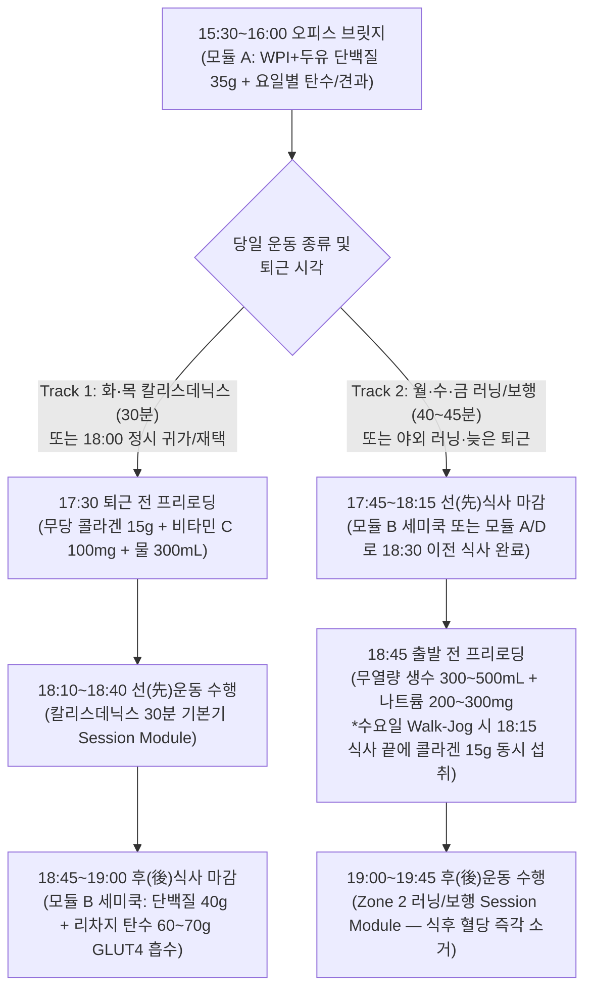

# 비만 대사 개선 및 체성분 재구성을 위한 영양·식단(Metabolic Nutrition & Recomposition) 아키텍처 및 운영 지침

## 1. 배경 및 핵심 질문 (Why & Question)

- **왜 이 주제를 조사하는가?**:
  - [`Profile`](../profile/overview.md) 기준 현재 체중 **98.2kg(신장 173cm, BMI 32.8, 체지방률 36.3%, 추정 제지방량 ~62.6kg)**, 하루 **10시간 이상의 좌식 웹 개발 근무**, 잦은 배달음식 섭취, 그리고 **당뇨 전단계·비알코올성 지방간(MASLD)·고지혈증(이상지질혈증)**의 3대 대사 질환 경고가 동시에 존재하는 상태에서, 호르몬·대사 지표를 역전시키고 제지방(근육·건·골격) 손실 없이 체지방만 선택적으로 감축하기 위한 영구 참고용 영양·식단 설계 지침(`Research`)이 필요하다.
  - 일반적인 다이어트 통념(무작정 1,200~1,500 kcal 초저열량 절식, 총체중 98.2kg 기준 단백질 200g+ 과잉 섭취, 저탄수화물 명목의 삼겹살·버터·계란 노른자 다량 섭취, 아침을 굶고 밤 20시까지 먹는 `12:00~20:00` 후기 간헐적 단식, 운동 일정과 무관한 고정 저탄수화물 식단 등)을 그대로 적용하면 **근손실·기초대사량 급락(Adaptive Thermogenesis), 담즙 정체로 인한 담석증(Cholelithiasis), 간내 포화지방/세라마이드 축적 및 LDL-C·ApoB 폭증, 야간 멜라토닌(`MTNR1B`) 충돌에 따른 식후 고혈당과 수면 질 저하**로 이어진다.
  - 또한 선행 수립된 [`기능적 맨몸 훈련(Functional Calisthenics) 아키텍처 및 운영 지침`](./functional-calisthenics-architecture.md) 및 [`심폐·대사 개선을 위한 러닝(Cardio-Metabolic Running) 아키텍처 및 운영 지침`](./cardio-metabolic-running-architecture.md)과 주간 단위로 유기적으로 결합하여, 근력 세션일의 글리코겐·건 콜라겐 합성과 유산소 세션일의 지방 산화(FatMax)·간 지방(IHTG) 청소를 동시에 뒷받침해야 한다.
- **해결하려는 핵심 질문**:
  1. 98.2kg(제지방량 ~62.6kg) 및 3대 대사 질환(당뇨 전단계·지방간·고지혈증) 상태에서 근손실과 담석증을 예방하면서 내장·간 지방과 LDL-C/ApoB를 감축하기 위한 **일일 칼로리 적자, 다량/미량영양소 정량 타겟, 그리고 `Clean Sources vs Red Flags` 식품군 기준**은 무엇인가?
  2. `05:30~06:30 기상 / 22:00~23:00 취침` 생체리듬을 보호하는 **조기/중기 시간제한 섭식(eTRF/mTRF) 윈도우**와 **식사 순서(Meal Sequencing)**, 그리고 주간 병행 운동(`Session Module`)과 연동되는 **2-Tier 탄수화물·칼로리 순환(Carb Cycling)**을 어떻게 설계할 것인가?
  3. 하루 10시간 좌식 개발 근무 환경에서 결정 피로와 배달음식 유혹을 이겨낼 **공식 4대 `Meal Module` 아키텍처**, **평일 저녁 운동 × 식사 마감 양립 2-Track 타임라인**, 그리고 **오피스 외식·편의점·회식 데미지 컨트롤 및 24시간 대사 리셋 규칙**은 무엇인가?
  4. 주관적 감각을 대체할 **4단계 식단 적응 스케일링(`Lv 1 ~ Lv 4`)과 4중 승급 게이트**, **3단계 대사·식욕 신호등(Green/Yellow/Red) 디로딩 및 정체기(`Refeed` / `Diet Break`) 프로토콜**, **임상 검증 대사 보조 서플리먼트 타임라인**, 그리고 **초보자 8주 대사 리셋 로드맵**을 어떻게 확정할 것인가?

---

## 2. 핵심 요약 (TL;DR)

- **제지방량(FFM) 앵커 단백질 & 2-Tier 탄수화물·칼로리 순환**: 총체중(98.2kg) 기준 과대산정을 배제하고 **제지방량(FFM `62.6kg`) 기준 일일 단백질 `150~160g`(`2.4~2.5 g/kg FFM`, 끼니당 `35~40g`·류신 `2.5~3.0g` × 4회 분배)**을 상시 고정한다. 일평균 `2,050 kcal`(`-450~500 kcal/일` 적자, 주간 `0.5~0.8%` 감량)를 기준으로 **화·목·토 칼리스데닉스 리차지 데이(`2,150~2,200 kcal`, 순탄수 `180~200g` 점심·저녁 GLUT4 창 집중, 지방 `50~55g`)**와 **월·수·금·일 Zone 2 유산소 메타볼릭 데이(`1,900~1,950 kcal`, 순탄수 `120~140g` 역피라미드, 불포화지방 `60~70g`)**를 순환한다.
- **3대 대사 질환 타겟 지질·당류·섬유소 커트라인 & 담석 방어**: 간 신생지방합성(DNL)과 간내 세라마이드·혈중 LDL-C/ApoB를 낮추기 위해 **첨가당·액상과당 `< 5%`(실질 `0g`)**, **포화지방 `< 7% kcal`(`< 15g/일`, 마블링 적색육·버터·코코넛오일·가공육 상시 배제, 전란 일 1~2개 이하 제한)**, **식이섬유 `35~45g/일`(점성 수용성 `≥ 12~15g/일`)**을 강제하며, 감량기 담낭 수축(CCK 분비)을 통한 담석증 예방을 위해 **매 정규 끼니 최소 `12~15g` 이상의 불포화지방(EVOO·생들기름·등푸른생선·견과류)**을 의무 배분한다.
- **`18:30~19:00` 식사 마감 고정 eTRF/mTRF & 4단계 식사 순서**: 멜라토닌 분비 시작(DLMO `19:30~20:30`)과 충돌하는 `12:00~20:00` 후기 단식을 폐기하고 **취침 3.5~4시간 전인 `18:30~19:00` 식사 마감(`Lv 1` 12:12 → `Lv 3` 직장인 주력 `14:10 [08:00~18:00 / 08:30~18:30]`)**을 고정한다. 매 식사는 **식전 15~20분 수분+차전자피/ACV 프리로딩 → 채소(0~5분) → 단백질·지방(5~10분) → 통곡물 탄수화물(10~20분 마지막 섭취 + 20~30회 저작) → 식후 15분 보행/PHA** 순서를 따른다.
- **공식 4대 `Meal Module` & 저녁 운동 2-Track 타임라인**: 가용 시간과 장소에 맞춰 **`5분 데스크/모닝 익스프레스` · `10~15분 안티-배달 세미쿡`(평일 저녁 주력) · `30분 1플레이트 홈쿡`(주말) · `오피스 외식 & 편의점/회식 디펜스`**의 4대 모듈과 일요일 30분 밀프렙(RS3 저항성 전분 소분밥)으로 배달음식을 원천 차단하며, 평일 저녁 운동은 **Track 1(선운동 `18:10~18:40` → 후식사 `19:00` 마감, 화·목 근력 권장)**과 **Track 2(선식사 `17:45~18:15` 마감 → 후운동 `19:00~19:45`, 월·수·금 러닝 권장)**로 분리한다.
- **객관적 4중 승급 게이트 · 3단계 대사 신호등 · Tier 1 서플리먼트 & 8주 로드맵**: 직전 14일 중 12일(`85%`) 실행률·야간 공복 NRS ≤ 2·주간 감량 `0.5~0.8%` 코리도·최소 2주 체류의 **4중 승급 게이트**를 적용하며, 과속 감량(`>1.0%/주`)·수면 분절·우상복부 통증 시 **3단계 신호등(Green/Yellow/Red)**과 **`15분 가짜 배고픔 차단 게이트` · `48시간 클린 리피드` · `7일 다이어트 브레이크`**로 방어한다.

---

## 3. 상세 조사 내용 및 메커니즘 (Findings & Evidence)

### 3.1. 고중량 비만(BMI 32.8) 에너지 역학, 제지방 보존 단백질 및 3대 대사 질환 병태생리

1. **체지방 과다 시 기초대사량(BMR) 공식 왜곡과 적정 칼로리 적자(Caloric Deficit)**:
   - 체지방률 36.3%(체지방량 `~35.6kg`, 제지방량 `~62.6kg`)인 고중량 비만 상태에서는 대사 활성이 낮은 지방조직 비중이 높아 총체중 기반 공식(Mifflin-St Jeor `1,896 kcal`)이 실제 기초대사량을 과대추정한다. 제지방량(FFM)에 기반한 **Katch-McArdle 공식(`BMR = 370 + 21.6 × 62.6 = 1,722 kcal`)**이 생리적으로 정확하며, 좌식 근무+일 6,000보 보행 및 주 4~6회 운동을 반영한 실제 일일 총에너지소비량(TDEE)은 **평균 `2,500 ~ 2,550 kcal/일`(비운동/유산소일 `~2,400 kcal`, 근력 운동일 `~2,650 kcal`)**이다.
   - 초저열량 식단(`< 1,500 kcal/일`)이나 주당 `> 1.0~1.5 kg`의 급격한 감량은 감량 체중의 25~35%를 골격근에서 빼앗고 갑상선 호르몬($T_3$)·렙틴 급락을 유발할 뿐 아니라, 간 콜레스테롤 과포화와 담낭 수축 부전으로 **담석증(Cholelithiasis) 발병 위험을 3~5배 폭증**시킨다(Garthe et al., 2011; Stokes et al., 2014; EASL Guideline). 반면 **일일 `-450 ~ 500 kcal`(TDEE의 18~20% 적자, 주당 체중의 `0.5 ~ 0.8%` = `-0.5 ~ -0.8 kg/주` 감량)**와 **매 정규 끼니 최소 `12 ~ 15 g` 이상의 외인성 지방 섭취**는 콜레시스토키닌(CCK) 분비를 자극해 담낭을 주기적으로 비워주어 담석 형성과 근손실을 동시에 차단한다.
2. **제지방량(FFM) 앵커 단백질 산정 및 류신 임계치(Leucine Threshold) 분배**:
   - 비만 성인에게 총체중(TBW 98.2kg) 기준 `2.0~2.2 g/kg`(`196~216g`)를 적용하면 필요 이상으로 과다 산정되어 신장 여과 부담과 식단 피로를 높인다. 국제스포츠영양학회(ISSN)와 비만 임상영양 지침에 따라 **제지방량(FFM `62.6kg`) 기준 `2.4 ~ 2.5 g/kg FFM`(조정체중 기준 `~2.0 g/kg`), 즉 일일 `150 ~ 160 g`**이 칼로리 적자 및 병행 훈련 중 질소 평형과 근단백질 합성(MPS)을 극대화하는 최적 타겟이다(Jäger et al., 2017; Hector & Phillips, 2018).
   - 근단백질 합성의 분자 스위치인 `mTORC1`을 켜려면 한 끼에 **류신(Leucine) `2.5 ~ 3.0 g` 이상을 포함한 양질의 단백질 `35 ~ 40 g`**이 도달해야 하며, 이후 3~5시간의 불응기(Muscle Full Effect)가 존재하므로 저녁 몰아먹기 대신 **하루 4회(`08:00` 첫 끼 · `12:00` 점심 · `15:30` 브릿지 · `18:30` 저녁)로 균등 분배**할 때 24시간 MPS가 25% 이상 향상된다(Mamerow et al., 2014).
3. **당뇨 전단계 · 비알코올성 지방간(MASLD) · 고지혈증의 3중 교차 역전 기전**:
   - **과당(Fructose) 차단과 간 신생지방합성(DNL) 억제**: 액상과당·설탕·과일주스의 과당은 인슐린 조절 단계(PFK-1)를 우회하여 간문맥을 통해 100% 간으로 직행하며, 전사인자 `ChREBP` 및 `SREBP-1c`를 활성화해 탄수화물을 팔미트산(포화지방)으로 바꾸는 **간 신생지방합성(De Novo Lipogenesis, DNL)**을 폭증시킨다. 이는 간내 중성지방(IHTG) 축적과 VLDL-TG 분비(혈중 고중성지방혈증), 그리고 식후 **요산(Uric acid) 생성 및 미토콘드리아 산화 스트레스**의 직접 원인이다(Softic et al., 2020; Jensen et al., 2018).
   - **포화지방(`< 7% kcal`) vs 불포화지방(MUFA/PUFA) 동열량 치환 효과**: 과잉 포화지방(마블링 적색육·삼겹살·버터·코코넛오일·팜유)은 간세포 내 **세라마이드(Ceramide)와 디아실글리세롤(DAG)**을 축적시켜 인슐린 신호(`IRS-1/Akt`)를 마비시키고 간내 지방을 **+35~55%** 증가시키며, 동시에 간세포 표면의 **LDL 수용체(LDLR) 발현을 억제**해 혈중 ApoB 및 LDL-C 청소율을 떨어뜨린다(Luukkonen et al., 2018; Rosqvist et al., 2014). 반대로 포화지방을 `< 7% kcal`(`< 15g/일`)로 제한하고 올리브유(EVOO)·들기름·등푸른생선·견과류의 불포화지방으로 치환하면 간 지방과 LDL-C가 동시에 강하한다.
   - **점성 수용성 식이섬유(`≥ 12~15g/일`)의 담즙산 격리(Bile Acid Sequestration) 효과**: 차전자피(Psyllium), 귀리/찰보리 베타글루칸, 해조류 알긴산 등 점성 수용성 섬유소는 소장 내에서 겔(Gel)을 형성해 탄수화물 소화 효소 접근을 늦추고, 담즙산을 흡착해 대변으로 배설시킨다. 손실된 담즙산을 보충하기 위해 간이 혈중 콜레스테롤을 끌어다 쓰면서(간 내 `CYP7A1` 및 LDL 수용체 상향) **LDL-C와 ApoB가 7~15% 직접 감소**한다(Jovanovski et al., 2018).

### 3.2. 일주기 생체리듬(Circadian Rhythm) eTRF, 식사 순서 및 운동 연동 탄수화물 순환 원리

1. **야간 멜라토닌-인슐린 충돌(`MTNR1B`)과 조기/중기 시간제한 섭식(eTRF/mTRF)**:
   - 인간의 췌장 베타세포 수용체(`MTNR1B`)는 수면 호르몬인 **멜라토닌 분비가 시작되는 시각(DLMO — `22:00~23:00` 취침자의 경우 `19:30 ~ 20:30`경)**부터 인슐린 분비를 생리적으로 억제한다. 또한 저녁으로 갈수록 골격근 GLUT4 전위 효율과 식사성 열발생(DIT)이 아침 대비 40~50% 낮아진다(Poggiogalle et al., 2018; Morris et al., 2015).
   - 따라서 아침을 거르고 `12:00~20:00`에 식사하는 후기 단식(lTRF)은 동일 열량이라도 `19:00` 이전에 식사를 마치는 조기/중기 시간제한 섭식(eTRF/mTRF)에 비해 **야간 평균 혈당이 +18% 높고 야간 지방 산화가 -10% 억제**되며, 소화 대사로 인해 심부체온(Core Body Temperature) 하강이 지연되어 **서파수면(SWS)과 성장호르몬 분비가 훼손**된다(Sutton et al., 2018; Xie et al., 2022; Gu et al., 2020). 따라서 **취침 3.5~4시간 전인 `18:30 ~ 19:00` 식사 마감**이 생체리듬 식단의 절대 앵커이다.
2. **식사 순서(Meal Sequencing)와 인크레틴(GLP-1) · 식후 골격근 GLUT4 싱크**:
   - 동일한 식단이라도 **채소(식이섬유)와 단백질·지방을 먼저 섭취하고 10~15분 뒤 탄수화물을 마지막에 섭취**하면, 위 배출 속도가 지연되고 소장 L-세포에서 **내인성 GLP-1 및 PYY 분비가 유의하게 증폭**되어 탄수화물 선발 섭취 대비 **식후 60~120분 혈당 곡선하면적(iAUC)이 30~73%, 인슐린 iAUC가 30~50% 감소**한다(Shukla et al., 2015, 2017). 이는 식후 2~3시간 뒤 인슐린 과잉으로 혈당이 급락하며 찾아오는 오후 반응성 저혈당(식곤증·단것 갈망)을 원천 차단한다.
   - 여기에 **식사 직후 15~30분 이내의 가벼운 신체 활동(Zone 1 보행 또는 10분 무충격 PHA 서킷)**을 결합하면, 골격근 수축에 의한 `AMPK`/$\text{Ca}^{2+}$ 경로가 켜져 **인슐린 도움 없이도 GLUT4 수송체가 세포막으로 이동**하여 혈중 포도당을 간(지방 합성) 대신 근육으로 즉각 흡수시킨다(Dempsey et al., 2016; Sylow et al., 2017).
3. **주간 병행 운동(`Session Module`) 연계 2-Tier 탄수화물 순환(Carb Cycling) 및 건 콜라겐 프리로딩**:
   - 매일 똑같은 저탄수화물 식단을 지속하면 화·목·토 칼리스데닉스(HSR 근력 및 대사 서킷) 시 근 글리코겐 고갈로 볼륨 수행력이 떨어지고 코르티솔이 상승한다. 반대로 근력 훈련일(**Tier A 리차지 데이**)에는 탄수화물을 `180~200g`으로 높여 운동 전후 골격근 GLUT4 활성 창에 집중 공급하고, Zone 2 유산소·회복일(**Tier B 메타볼릭 데이**)에는 순탄수화물을 `120~140g`(특히 저녁 `25~35g` 이하 역피라미드)으로 낮추고 불포화지방을 높이면 **근력 퍼포먼스 보존과 미토콘드리아 지방 산화(FatMax)·간 지방 청소를 동시에 극대화**할 수 있다(Impey et al., 2018; Burke et al., 2018).
   - 또한 무혈관 조직인 건(Tendon)과 인대는 운동 중 기계적 부하에 의해 조직액이 순환될 때만 아미노산을 흡수하므로, 고부하 운동 **30~60분 전에 가수분해 콜라겐 펩타이드 `15g` + 비타민 C `50~100mg`**을 섭취해 혈중 글리신·프롤린 농도 피크를 운동 시점에 일치시키면 **건 콜라겐 합성 표지자(PINP)가 2배 증폭**된다(Shaw et al., 2017).

---

## 4. 상세 설계 및 개인화 운영 지침 (Personal Application)

### 4.1. 정량 칼로리 · 2-Tier 다량/미량영양소 타겟 및 3대 대사 질환 식품군 매트릭스

#### 1) 주간 운동(`Session Module`) 연계 2-Tier 칼로리 · 다량영양소 정량 매트릭스
- **산정 기준**: 제지방량(FFM) `62.6 kg`, Katch-McArdle BMR `1,722 kcal`, 주간 평균 TDEE `~2,500 kcal`, 일평균 목표 섭취량 **`2,050 kcal`(`-450 ~ 500 kcal/일` 적자, 주간 체중 감량 목표 `-0.5 ~ -0.8 kg/주 [체중의 0.5~0.8%]`)**.
- **탄수화물 표기 원칙**: 혼선을 막기 위해 혈당·인슐린에 직접 작용하는 **순탄수화물(Net Carbs)**과 장내 발효·담즙 배설을 담당하는 **식이섬유(`35 ~ 45 g/일`, 점성 수용성 `≥ 12 ~ 15 g/일`)**를 병기한다.

| 구분 | **Tier A: 리차지 데이 (Recharge Day)** (`화·목·토` 칼리스데닉스 근력일 — 주 3일) | **Tier B: 메타볼릭 데이 (Metabolic Day)** (`월·수·금·일` Zone 2 유산소·회복일 — 주 4일) | 핵심 생리학적 근거 및 배분 규칙 |
| :--- | :--- | :--- | :--- |
| **일일 목표 열량** | **`2,150 ~ 2,200 kcal`** | **`1,900 ~ 1,950 kcal`** | 주간 가중평균 `~2,050 kcal/일` (`-450~500 kcal` 안전 적자) |
| **단백질 (고정 앵커)** | **`150 ~ 160 g`** (`2.4~2.5 g/kg FFM`) | **`150 ~ 160 g`** (`2.4~2.5 g/kg FFM`) | 요일 무관 고정. **하루 4회 × 회당 `35 ~ 40 g` (류신 `2.5~3.0g`)** 균등 분배 |
| **순탄수화물 (Net Carbs)** *(식이섬유 합산 총 탄수)* | **`180 ~ 200 g`** *(총 탄수화물 `220 ~ 240 g`)* | **`120 ~ 140 g`** *(총 탄수화물 `160 ~ 180 g`)* | - **Tier A**: 일일 탄수화물의 **65~75%를 운동 전 점심(`70~80g`)과 운동 직후 GLUT4 활성 창 저녁(`60~70g`)**에 집중 배치 - **Tier B**: **아침(`35~40g`)·점심(`50~60g`)·브릿지(`10g`)·저녁(`25~35g` 이하) 역피라미드 배분**으로 야간 인슐린 억제 및 간 지방(IHTG) 연소 극대화 *(단, 갑상선 $T_3$·수면 보호를 위해 `<50g` 극단적 케토제닉 금지)* |
| **총 지방 (Total Fat)** | **`50 ~ 55 g`** | **`60 ~ 70 g`** | - **포화지방 상한**: 전 요일 **`< 15 g/일` (`< 7% kcal`)** 엄수, 트랜스지방 `0 g` - **담석 예방 하한**: 담낭 수축(CCK) 유도를 위해 **매 정규 끼니 최소 `12 ~ 15 g` 이상**의 불포화지방(EVOO·생들기름·등푸른생선·아보카도·견과류) 의무 배분 |
| **식이섬유 (Dietary Fiber)** | **`35 ~ 45 g`** (점성 수용성 `≥ 12~15g`) | **`35 ~ 45 g`** (점성 수용성 `≥ 12~15g`) | 차전자피·귀리/찰보리 베타글루칸·해조류 알긴산·버섯·십자화과 채소로 충족 |
| **첨가당 / 액상과당** | **`0 g`** (법적 상한 `< 15~20g`, 실질 완전 배제) | **`0 g`** (실질 완전 배제) | 간 DNL(신생지방합성)·VLDL 중성지방·요산 상승 원천 차단 |

#### 2) 수분 · 전해질 · 미량영양소 일일 정량 기준
1. **수분 (`3.0 ~ 3.5 L/일`, 체중 kg당 ~33mL) & `20:30` 수분 마감 규칙**:
   - ① **기상 직후 60분 내(`05:30~06:30`)**: 야간 불감증발 보충 및 장운동 개시를 위해 **미온수 `500 mL` + 천일염/핑크솔트 한 꼬집(나트륨 `200~300mg`)** 섭취.
   - ② **식전 프리로딩**: 매 정규 식사 **15~20분 전 `300 ~ 500 mL`** 섭취(포만감 향상 및 소화액 희석 방지를 위해 식사 도중 과도한 물·국물 섭취 지양).
   - ③ **운동 세션 전·중**: `500 ~ 700 mL` 분할 섭취.
   - ④ **취침 2시간 전(`20:30`) 수분 마감**: 야간뇨로 인한 서파수면(SWS) 분절을 막기 위해 **`20:30` 이후에는 수분 섭취를 마감**하고 취침 전 마그네슘 복용 시 소량 목 축임(`50~100mL`)만 허용한다.
2. **전해질 밸런스 (나트륨 · 칼륨 · 마그네슘)**:
   - **나트륨 (`3,000 ~ 4,000 mg/일`, 소금 기준 `7.5 ~ 10 g`)**: 배달 국물·가공식품을 끊고 인슐린 수치가 낮아지면 신장의 나트륨 배설(Natriuresis)이 급증하여 혈장량 감소·기립성 현기증·운동 중 **심박 표류(Cardiovascular Drift)**가 발생할 수 있다. 따라서 외식 찌개 국물은 배제하되, **기상 직후 및 Zone 2 유산소 출발 15~20분 전 생수에 소금 한 꼬집(나트륨 `200 ~ 300 mg`)을 의도적으로 보충**한다.
   - **칼륨 (`3,500 ~ 4,500 mg/일`) & 마그네슘 (`400 ~ 500 mg/일`, 식이+보충제 합산)**: 나트륨 배출 균형, 혈관 이완 및 인슐린 수용체 감수성 회복을 위해 잎채소·해조류·버섯·아보카도·두부/콩류와 취침 전 마그네슘 보충제로 충족한다.

#### 3) 3대 대사 질환 맞춤 `Clean Sources vs Red Flags` 신호등 매트릭스

| 영양군 | 🟢 Green (상시 주력 — 매일 섭취) | 🟡 Yellow (정량·빈도 제한 조건부 허용) | 🔴 Red (상시 배제 — 대사 악화 주범) |
| :--- | :--- | :--- | :--- |
| **단백질** | 닭가슴살·닭안심·껍질 벗긴 닭다리살, 계란흰자(난백), 흰살생선(대구·명태·동태·가자미), **등푸른생선(고등어·연어·정어리·삼치 주 3~4회)**, 오징어·새우·문어·조개류, 두부·순두부·템페·낫토·무가당 두유, **100% 분리유청단백(WPI)** | **전란(노른자 포함) 일 `1 ~ 2개` 이하**(고지혈증 Hyper-absorber 및 포화지방 방어를 위해 3개째부터는 난백으로 섭취), **살코기 적색육(소 우둔·홍두깨·안심, 돼지 안심·뒷다리살) 주 `1 ~ 2회` 이하**(회당 150g 이내) | **마블링 적색육(소 부챗살·등심·갈비·차돌박이, 돼지 삼겹살·목살·항정살)**, 가공육(베이컨·소시지·햄·스팸), 내장류(곱창·대창·막창) |
| **지방 / 조리유** | **엑스트라버진 올리브유(EVOO)**, **냉압착 생들기름**(오메가-3 ALA 풍부, 비가열 생토핑), 아보카도·아보카도 오일(고발연점 조리용), **무염 생견과류(호두·아몬드·피칸·마카다미아 일 `25 ~ 30 g`, 1줌 이내)** | 참기름(소량 향미용), 달걀 노른자 내 지질(일 1~2개 한도 내) | **버터·기버터·코코넛오일·MCT오일·팜유·라드**(포화지방 과잉 → 간내 지방 `+55%` 및 간 LDLR 억제), **정제 씨앗유(콩기름·옥수수유·카놀라유) 반복 가열 튀김**, 마가린·쇼트닝 |
| **탄수화물 / 과일 / 유제품** | **귀리(오트밀)·찰보리·현미·파로·퀴노아·렌틸콩·병아리콩(식힌 통곡물 RS3 저항성 전분 활용)**, 잎채소·십자화과 채소(브로콜리·양배추·케일)·버섯·해조류(미역·다시마·김) 무제한 | **구황작물(고구마·감자·단호박 — 리차지 데이 찐 형태 + 식혀서 정량 섭취, 군고구마 금지)**, **저당 생과일(블루베리 등 베리류 `100g` 또는 사과·키위·단감 `1/2개` 이내 — 아침/운동 전후 식사 내에만 허용, 식후 디저트 단독 섭취 금지)**, **무가당 저지방/무지방 그릭요거트·코티지치즈(일 `100g` 이하, 포화지방 합산 `<15g` 내)** | **액상과당·설탕·물엿·아가베시럽 음료 및 양념 소스**, **과일주스·건과일·통조림 과일**(간 DNL 직격), 흰쌀밥·밀가루 면/빵·떡·시리얼, 가당 요거트·일반 우유·고지방 치즈·생크림 |

---

### 4.2. 생체리듬 시간제한 섭식(eTRF/mTRF) · 식사 순서 프로토콜 및 공식 4대 `Meal Module` 아키텍처

#### 1) `18:30~19:00` 식사 마감 앵커 및 5단계 식사 순서(Meal Sequencing) 프로토콜
- **생체리듬 식사 마감 원칙**: `05:30~06:30 기상 / 22:00~23:00 취침` 리듬에서 멜라토닌 분비(DLMO `19:30~20:30`)와 소화 대사의 충돌을 막기 위해 **마지막 한 입을 `18:30 ~ 19:00`(최대 데드라인 `19:15`) 이전에 끝내는 것**을 모든 단계의 절대 앵커로 삼는다.
- **전 끼니 공통 5단계 식사 순서 프로토콜 (`Step 0 ~ Step 4`)**:
  1. **Step 0 — 식전 15~20분 프리로딩 (Pre-Meal Preload)**: 정규 식사(점심·저녁) 15~20분 전에 **미온수 `300 ~ 500 mL` + 차전자피 식이섬유 `5~6g` 및/또는 유기농 사과식초(ACV) `15 mL` 희석액**을 먼저 마셔 위장 신전 수용체를 깨우고 소장 내 점성 장벽을 형성한다.
  2. **Step 1 — 식이섬유 스타터 (`0 ~ 5분`, Fiber First)**: 식사 시작 후 첫 5분 동안 **양배추·브로콜리·잎채소·해조류·버섯 `150 ~ 200 g`**을 가장 먼저 씹어 삼킨다.
  3. **Step 2 — 단백질 & 불포화지방 본식 (`5 ~ 10분`, Protein & Healthy Fat)**: 생선·가금류·두부·계란흰자 등 **단백질(`35~40g`)과 불포화지방(`12~18g`)**을 섭취하여 소장 L-세포의 GLP-1·PYY 및 담낭 CCK 분비를 선제 유도한다.
  4. **Step 3 — 복합 탄수화물 피니시 (`10 ~ 20분`, Complex Carbs Last & 20~30회 저작)**: 식사 시작 최소 10분 이후에 **식힌 통곡물 잡곡밥(RS3 저항성 전분)이나 귀리**를 마지막으로 섭취하며, 한 입당 **20~30회 이상 꼭꼭 씹어** 식사 시간을 총 15~20분 이상 확보한다(식후 혈당 스파이크 30~73% 감소).
  5. **Step 4 — 식후 15~30분 내 골격근 GLUT4 싱크 가동 (Post-Meal Movement)**: 식사를 마친 뒤 15~30분 이내에 **15분 Zone 1 산책(평일 점심 오피스 주변 보행) 또는 [`10분 익스프레스 Session Module`](./functional-calisthenics-architecture.md)(무충격 PHA 서킷)**을 수행하여 혈중 포도당을 근육으로 즉각 흡수시킨다.

#### 2) 좌식 개발자 맞춤형 공식 4대 `Meal Module` 아키텍처
[`GLOSSARY.md`](../GLOSSARY.md)의 `Meal Module` 정의에 따라, 조리 가용 시간·장소·훈련 일정에 맞춰 블록처럼 조합하는 4대 모듈을 운영한다. 모든 하루는 **`모닝 익스프레스(08:00) + 점심 외식 디펜스(12:00) + 오피스 브릿지 익스프레스(15:30) + 저녁 세미쿡/홈쿡(18:15~18:45)`**의 4슬롯 구조로 돌아간다.

| 모듈 코드 및 명칭 | 담당 시간대 / 상황 | 조리 시간 및 목표 매크로 (1끼 기준) | 표준 구성 공식 및 대표 메뉴 조합 |
| :--- | :--- | :--- | :--- |
| **모듈 A** **`5분 데스크/모닝 익스프레스 Meal Module`** | - **슬롯 1**: 평일 출근 전 첫 끼 (`08:00~08:30`) - **슬롯 2**: 평일 오후 오피스 브릿지 (`15:30~16:00`) | **불 사용 0분 (5분 내 조립)** - 단백질 `35 ~ 40 g` - 포화지방 `< 3 g` - 수용성 섬유소 `5 ~ 8 g` | - **[슬롯 1: 모닝 익스프레스 (`08:00~08:30`)]**:   ① *오버나이트 오트밀 보울*: 전날 밤 재워둔 `귀리(오트밀) 40g + 치아씨드 10g + 무가당 두유 190mL`에 아침 **`100% WPI 1스쿱(단백질 27~30g)` + 냉동 블루베리 50g + 아몬드 5알** 토핑   ② *세이버리 에그-두부 플레이트*: `삶은 계란 2개(전란 일일 한도) + 따뜻하게 데운 순두부/연두부 150g(또는 액상 난백/닭가슴살 100g) + 세척 양배추/방울토마토 150g + EVOO/생들기름 1작은술` - **[슬롯 2: 오피스 브릿지 익스프레스 (`15:30~16:00` — 야간 배달 폭식 방어 핵심)]**:   - 기본 코어: **`100% WPI 1스쿱(단백질 27g) + 무가당 두유 190mL(단백질 8g)` 쉐이크 (`단백질 ~35g`) + 오이/방울토마토 100g**   - 요일별 탄수/지방 스위치: **화·목 리차지 데이**에는 오후 근력 운동 연료로 `바나나 1개 또는 통곡물 크래커/오트밀 30g(순탄수 ~25g)` 추가 / **월·수·금 메타볼릭 데이**에는 탄수화물 대신 `무염 호두·아몬드 1줌(20~25g, 불포화지방 ~14g)` 매칭 |
| **모듈 B** **`10~15분 안티-배달 세미쿡 Meal Module`** | **평일 퇴근 후 저녁 기본값** (`17:45~19:00` 마감) | **10 ~ 15분 (전자레인지 + 에어프라이어/원팬)** - 단백질 `40 g` - 포화지방 `< 4 g` - 불포화지방 `12 ~ 18 g` - 탄수화물 티어별 가변 | **배달 앱 주문·배달 대기 시간(40~50분)보다 압도적으로 빠른 3단 조립 공식**: 1. **Step 1 (채소 베이스 3분)**: 세척 채썬 양배추·쌈채소 150g(생식) 또는 **냉동 브로콜리·컬리플라워·버섯·시금치 믹스 150~200g 전자레인지 3분 해동** 후 첫 5분간 선발 섭취 2. **Step 2 (클린 단백질 5~10분, `40g`)**: 아래 3종 중 택 1    - ① `저염 수비드 닭가슴살/닭안심 150g` (전자레인지/에어프라이어 3~5분)    - ② `냉동 순살 고등어/연어/대구 필렛 150~180g` (에어프라이어 180°C 10분 구이 — 종이호일 사용으로 설거지 0)    - ③ `두부 1모(300g) 또는 순두부 + 계란흰자 3개 + 해물믹스(오징어·새우)` 전자레인지/원팬 7분 스팀 3. **Step 3 (RS3 소분 잡곡밥 & 비가열 오일 피니시 2분)**:    - 냉동실에 소분해 둔 **`현미·귀리·찰보리·렌틸콩 혼합밥(RS3 저항성 전분)`**을 전자레인지 2분 해동 (**화·목 리차지 데이 `150~180g [순탄수 ~60g]`** / **월·수·금 메타볼릭 데이 `70~90g [순탄수 ~25~30g]`**)    - 조리 완료 후 **냉압착 생들기름 또는 엑스트라버진 올리브유(EVOO) 1큰술(`10~12g`)**을 생으로 둘러 담낭 수축용 지방과 항염증 폴리페놀 확보 |
| **모듈 C** **`30분 1플레이트 홈쿡 Meal Module`** | **주말 점심·저녁 (`토·일`)** 또는 재택 여유일 | **20 ~ 30분 (원팬/오븐 정찬)** - 단백질 `40 ~ 45 g` - 풍부한 항산화 파이토케미컬 | **`2 : 1 : 1` 원팬(One-Pan) 정찬 법칙**: - **접시 1/2 (채소·버섯·해조류)**: 구운 아스파라거스·브로콜리·양배추 스테이크·새송이/표고버섯·미역/해초 샐러드 - **접시 1/4 (원물 클린 단백질 `150~200g`)**: 생연어·삼치·고등어 스테이크, 오징어·새우·바지락 토마토 스튜(파피요트), 또는 주 1~2회 이내 소 우둔살/안심 찹스테이크 - **접시 1/4 (복합 탄수화물)**: **토요일 리차지 데이**에는 파로·귀리·렌틸콩 밥 `160g` 또는 찐 단호박/고구마 `150g` / **일요일 메타볼릭 데이**에는 통곡물밥 `80g` + 아보카도 `1/2개` |
| **모듈 D** **`오피스 외식 & 편의점/회식 디펜스 Meal Module`** | **평일 점심 (`12:00~12:40`)** 및 불가피한 저녁 약속 | **외식/픽업 (조리 0분)** - 현장 5대 방어 규칙 적용 | - 평일 오피스 점심 식당가·구내식당·편의점에서 [4.3절 외식 선별표 및 5대 방어 규칙](#3-한국형-오피스-점심-외식--구내식당--편의점-green--yellow--red-실전-선별표-및-5대-방어-규칙)에 따라 포화지방·정제 탄수화물·나트륨 국물을 걷어내고 단백질 `35~40g`과 식사 순서를 방어 |

#### 3) 배달음식 원천 차단을 위한 3대 상시 스톡(Always-On Stock) 및 일요일 30분 밀프렙(`Sunday 30-Min Prep`)
퇴근 후 피로 상태에서 *"오늘 저녁 뭐 먹지?"*라고 고민하는 순간 배달 앱이 켜진다. 의사결정 에너지를 0으로 만들기 위해 아래 3대 스톡과 일요일 30분 루틴을 상시 유지한다.
1. **냉동실 상시 스톡**: ① **소분 혼합 잡곡밥 용기 2종**(`리차지용 160g` 뚜껑 스티커 구분 / `메타볼릭용 80g`), ② `냉동 브로콜리·컬리플라워·버섯 믹스`, ③ `손질 순살 고등어·연어·대구 필렛(개별 진공포장)`, ④ `저염 수비드 닭가슴살·닭안심·냉동 오징어/새우살`, ⑤ `냉동 블루베리`.
2. **냉장·상온 상시 스톡**: ① `세척 채썬 양배추·방울토마토·오이`, ② `두부·순두부·낫토`, ③ `계란 및 살균 액상 난백`, ④ `무가당 두유`, ⑤ `100% WPI 단백질 파우더`, ⑥ `무가당 가수분해 콜라겐 펩타이드 + 비타민 C`, ⑦ `차전자피 식이섬유 + 유기농 사과식초(ACV)`, ⑧ `엑스트라버진 올리브유(EVOO) + 냉압착 생들기름(냉장 보관)`.
3. **오피스 데스크 비상 스톡**: ① `100% WPI 소분 통 + 쉐이커`, ② `무가당 두유 1박스`, ③ `무염 호두·아몬드 일일 소분봉(25g)`, ④ `휴대용 차전자피 스틱 및 ACV 정제/스틱`, ⑤ `히말라야 핑크솔트/천일염 소분 용기`.
4. **일요일 30분 일괄 밀프렙 (`Sunday 30-Min Prep`)**:
   - 매주 일요일 30분만 투자하여 ① **현미·귀리·찰보리·렌틸콩 혼합밥 1주일치 압력밥솥 취사 → 한 김 식힌 후 냉장실 12시간 보관(전분의 역노화 Retrogradation를 통해 소화되지 않는 RS3 저항성 전분 극대화 → 식후 혈당 피크 25~35% 추가 감소 및 장내 부티르산 생성) → 리차지용(`160g`) 3개 / 메타볼릭용(`80g`) 4개로 소분 냉동**, ② **반숙 삶은 계란 10개 조리 및 양배추/오이 세척 소분**만 끝내 둔다.

---

### 4.3. 평일 저녁 운동(`Session Module`) × `18:30~19:00` 식사 마감 2-Track 타임라인 및 외식·회식 디펜스

#### 1) 평일 저녁 운동(`18:00~20:00`) × `18:30~19:00` 식사 마감 양립 2-Track 오퍼레이션
퇴근 시간(`18:00` 전후)과 당일 수행할 운동 모듈의 특성에 맞춰 아래 2개 트랙 중 하나를 선택하여 **`18:30~19:00` 식사 마감**과 **`20:30` 이전 운동 종료(수면 보호)**를 동시에 달성한다.

- **Track 1 — `퇴근 직후 선(先)운동 → 18:45~19:00 후(後)식사 마감` (`화·목` 칼리스데닉스 30분 수행일 기본 권장)**:
  - `16:00` 오피스 브릿지(`모듈 A`: WPI+두유+바나나/오트밀)로 근력 운동 연료를 채운 뒤, `17:30` 퇴근 이동 전 **무당 콜라겐 `15g` + 비타민 C `50~100mg`**을 마신다.
  - `18:10~18:40` 귀가 즉시 [`30분 기본기 Session Module`](./functional-calisthenics-architecture.md)을 수행하여 골격근 GLUT4를 세포막으로 끌어올린 직후, `18:45~19:00`(최대 데드라인 `19:15`)에 **`모듈 B (10~15분 안티-배달 세미쿡)`**로 저녁 식사(단백질 `40g` + 리차지 잡곡밥 `160g`)를 마쳐 탄수화물을 간이 아닌 근육 글리코겐으로 100% 유도한다.
- **Track 2 — `귀가/오피스 17:45~18:15 선(先)식사 마감 → 19:00~19:45 후(後)운동` (`월·수·금` Zone 2 러닝/보행 40분 수행일 기본 권장)**:
  - `15:00~15:30` 오피스 브릿지를 조금 일찍 섭취하고, `17:45~18:15`에 **`모듈 B 세미쿡`**(메타볼릭 데이 잡곡밥 `80g` + 생선/두부/닭가슴살 + 채소)으로 저녁 식사를 먼저 끝내어 **`18:30` 이전에 열량 섭취 윈도우를 완전 종료**한다.
  - 위장 소화가 어느 정도 진행된 `19:00~19:45`에 [`35~45분 데일리 Zone 2 Session Module`](./cardio-metabolic-running-architecture.md)을 수행한다. 출발 15~20분 전(`18:45`)에는 단식 창을 깨지 않는 **무열량 생수 `300~500mL` + 소금 한 꼬집(나트륨 `200~300mg`)**만 섭취한다 *(단, `수요일` Walk-Jog 충격 세션일에는 `18:15` 저녁 식사 마지막 입에 무당 콜라겐 `15g` + 비타민 C를 함께 섭취하여 `18:30` 단식 시작을 침해하지 않으면서도 `19:00` 주행 시점 혈중 아미노산 피크를 맞춘다)*.

#### 2) 주간 운동 모드별(`병행 모드` vs `유산소 단독 집중 모드`) 식단 티어 매핑
- **[모드 1: 주간 병행 모드 (Concurrent Mode — 상시 기본값: 주 3일 리차지 : 4일 메타볼릭)]**:
  - **`화·목·토` (Tier A 리차지 데이, `2,150~2,200 kcal` / 순탄수 `180~200g`)**: 화·목 저녁 `30분 칼리스데닉스`, 토요일 오전/낮 `60분 확장 칼리스데닉스` 수행. 운동 30~60분 전 콜라겐 프리로딩 필수.
  - **`월·수·금·일` (Tier B 메타볼릭 데이, `1,900~1,950 kcal` / 순탄수 `120~140g` 역피라미드)**: 월·금 무충격 `Lv 0` 보행, 수·일 저충격 `Walk-Jog` 수행(수·일 운동 전 콜라겐 프리로딩 추가).
- **[모드 2: 유산소 단독 집중 모드 (Cardio-Focus Mode 전환 시 — 주 2일 리차지 : 5일 메타볼릭)]**:
  - 업무 과중 등으로 칼리스데닉스를 최소 유지 볼륨으로만 돌리고 러닝 지침의 단독 모드(`화·금·일` Walk-Jog + 10분 등척성 보강)를 수행하는 기간에는, **리차지 데이를 주 2회(`화·일`, 순탄수 `170~190g`)로 축소**하고 **나머지 주 5일(`월·수·목·금·토`)을 Tier B 메타볼릭 데이(`1,900 kcal`, 순탄수 `120~140g`)로 운영**하여 간 지방 및 체지방 감량 속도를 극대화한다.

#### 3) 한국형 오피스 점심 외식 · 구내식당 · 편의점 `Green / Yellow / Red` 실전 선별표 및 5대 방어 규칙

| 외식 카테고리 | 🟢 Green (최우선 선택 — 주 3~4회) | 🟡 Yellow (현장 개조 규칙 적용 시 허용 — 주 1~2회) | 🔴 Red (상시 회피 — 혈당·중성지방·포화지방 폭탄) |
| :--- | :--- | :--- | :--- |
| **한식 / 백반 / 구내식당** | **생선구이 백반**(고등어·삼치·임연수·가자미 구이 + 나물 반찬 + 된장국 건더기), **순두부찌개/두부조림 백반**(국물 남기고 두부·버섯 건더기 + 날계란 1~2개 추가), **오징어·주꾸미·해물 숙회/볶음**(양념 털어내고 상추·깻잎 쌈 다량) | **비빔밥/회덮밥/포케류**(밥 `1/2공기`만 넣고 고추장/초장 대신 **간장·된장·식초 소스 1/3만** + 계란/살코기 추가), **소고기 샤브샤브/불고기 백반**(국물·당면 제외, 채소·살코기 위주), **보쌈/수육 정식**(비계 떼어낸 살코기 `150g` + 쌈채소 다량, 막국수 제외) | **삼겹살·갈비·차돌박이 구이**, **설렁탕·곰탕·순대국·부대찌개·감자탕·육개장**(포화지방+나트륨 국물+흰쌀밥 말아먹기), **김치볶음밥·제육덮밥**(비계+물엿·설탕 양념), **돈까스·생선까스·탕수육·치킨** |
| **샐러드 / 포케 / 샌드위치** | **연어·닭가슴살·문어·두부·수비드비프 포케/샐러드 보울** (`현미/메밀 1/2분량` 또는 `채소만` + **올리브오일·발사믹·오리엔탈 드레싱 별도 요청 후 1/2만 찍먹**) | **호밀/통밀 닭가슴살·터키·로스트비프 샌드위치**(써브웨이 등: 빵 속 파내고 채소 최대치, 가당 소스 대신 **올리브오일+후추+소금+레드와인식초**) | 크리미 스파이시·렌치·사우전아일랜드·마요네즈 범벅 샐러드, 베이컨/미트볼/에그마요/참치마요 샌드위치, 어니언 후레이크·옥수수콘·건과일 토핑 다량 |
| **일식 / 아시안 / 중식 / 분식** | **생선회(사시미) 정식 / 물회(육수 제외 회+채소)**, **순메밀 소바 정식**(면 `2/3`만 섭취 + 삶은 계란/연어 샐러드 선행 섭취, 튀김 제외) | **초밥(스시)**(샤리 밥양을 절반으로 덜어내고 흰살생선·연어·등푸른생선 위주 8~10피스 + 샐러드 선행), **베트남 쌀국수**(숙주 2배 추가 + 양지 살코기 먼저 섭취 후 **면은 1/3 이하**만 섭취, 국물·해선장 소스 배제) | 돈코츠 라멘·우동·짜장면·짬뽕·볶음밥·마라탕·마라샹궈, 떡볶이·김밥+라면·순대 분식 세트, 카레라이스·하이라이스·오므라이스 |
| **편의점 픽업 조합** | **`구운란/반숙란 2개 + 저염 닭가슴살 1팩(또는 무당 단백질 드링크 1종) + 컵샐러드/방울토마토 + 오트밀/현미 주먹밥 1개(리차지 데이)`** | 일반 도시락 불가피 시: 뚜껑을 열자마자 **튀김 반찬(소시지·너겟·전)과 흰쌀밥 1/2을 먼저 덜어내어 폐기**하고, `컵샐러드 + 구운란 2개`를 추가 구매해 채소→단백질→남은 밥 순서로 섭취 | 삼각김밥 2개 + 컵라면 조합, 편의점 햄버거·조리빵·핫도그·소시지, 가당 요거트·과일주스·설탕 커피 음료 |

- **오피스 외식 현장 5대 방어 규칙 (`Office Dining 5-Step Hack`)**:
  1. **출발 15분 전 데스크 프리로딩**: 식당으로 출발하기 15분 전 사무실에서 **물 `300~400mL` + 차전자피 스틱/ACV**를 먼저 마시고 나간다.
  2. **공깃밥 선(先) 덜어내기 (`Half-bowl Pre-cut`)**: 밥그릇이 나오면 숟가락을 대기 전에 즉시 **밥그릇 뚜껑이나 빈 접시에 밥 `1/3 ~ 1/2`을 먼저 덜어내어** 식사 중 무의식적 완식을 차단한다(리차지 데이 `2/3 공기`, 메타볼릭 데이 `1/2 공기 이하`).
  3. **국물·찌개 '젓가락 건더기만' 원칙**: 국·찌개는 숟가락을 쓰지 않고 **젓가락으로 두부·해조류·버섯·살코기 건더기만** 건져 먹으며 국물은 남긴다.
  4. **양념·드레싱 별도 요청 (`Sauce on the Side`)**: 비빔밥 고추장, 포케 소스, 샐러드 드레싱은 반드시 따로 받아 **간장·식초·올리브유 위주로 1/3~1/2만** 사용한다.
  5. **식후 복귀 전 15분 Zone 1 보행**: 식사 후 바로 엘리베이터를 타고 책상에 앉지 않고 **회사 주변 블록을 15분간 빠른 걸음으로 산책(우천 시 빌딩 계단 5~10분 오르기)**한 뒤 복귀한다.

#### 4) 저녁 회식 · 음주 · 야근 시 데미지 컨트롤 및 익일 `24시간 대사 리셋 알고리즘`
1. **사전 방어 (`16:30~17:00` 오피스 브릿지 선제 투여 — 공복 회식 진입 절대 금지)**:
   - 저녁 회식이나 외식 약속이 있는 날에는 출발 **1.5~2시간 전에 사무실에서 `100% WPI 단백질 쉐이크 1스쿱 + 차전자피 5g + 물 400mL`**를 반드시 섭취하여 위장 포만감의 40%를 미리 채우고 GLP-1을 활성화한 상태로 식당에 들어간다.
2. **현장 메뉴 & 음주 데미지 컨트롤 (`18:00~20:30` 회식 자리)**:
   - **안주 선택**: 1순위는 **생선회/해산물(사시미·문어숙회·조개탕 건더기), 생선구이, 샤브샤브, 닭 소금구이(껍질 제거)**; 고기집 회식 시에는 삼겹살·차돌박이·양념갈비 대신 **소 안심/등심 살코기·우둔/육회 또는 돼지 목살(비계 제거)**을 선택하고 고기 1점당 쌈채소 2~3장·버섯·마늘을 먼저 먹으며, **후식 탄수화물(냉면·된장술밥·볶음밥·라면)은 100% 배제**한다.
   - **음주 방어 (`Zero-Alcohol First` & 불가피 시 `1:2 수분 희석 법칙`)**:
     - 알코올(에탄올)은 간에서 아세트알데히드를 거쳐 아세테이트로 대사되는 동안 간 내 `NADH/NAD+` 비율을 폭증시켜 **간의 지방산 베타산화(지방 연소)를 즉각 마비시키고 간내 중성지방(MASLD)과 요산을 급증**시킨다.
     - 따라서 기본은 **탄산수(레몬 슬라이스)+얼음 / 무당 무알코올 맥주 / 녹차·보리차**로 대체하며, 음주가 불가피한 자리(월 1~2회 이하)에서는 과일소주·막걸리·생맥주·토닉워터 하이볼(액상과당 폭탄)을 절대 금지하고 **무당 증류주(소주·위스키 온더락·순수 탄산수 하이볼) 또는 드라이 와인 `1 ~ 2잔` 이내**로 상한을 잠근다. **술 1잔당 생수 2잔(`300mL`)**을 의무 섭취하고 **`20:30` 이후에는 추가 안주·알코올 섭취를 완전 종료**한다.
3. **사후 및 익일 `24시간 대사 리셋 알고리즘 (Next-Day 24h Metabolic Reset)`**:
   - **당일 귀가 직후**: 편의점 가당 숙취해소 음료(액상과당 다량 함유)나 해장 라면을 절대 금지하고, **미온수 1컵(`250mL`) + 마그네슘 비스글리시네이트 `300~400mg`**만 섭취한 뒤 즉시 취침한다.
   - **익일 3대 리셋 규칙 (죄책감에 의한 극단적 굶기 및 벌칙성 고충격 러닝 금지)**:
     - ① **극단적 굶기 금지 & 수분·전해질·간 해독 리셋**: 전날 많이 먹었다고 다음 날 저녁까지 무작정 굶으면 코르티솔 상승과 야간 재폭식(Binge-Restrict Cycle)으로 이어진다. 기상 직후 **미온수 `500~1,000mL` + 나트륨/칼륨 전해질**을 충분히 보충한 뒤, 첫 끼를 1~2시간만 늦춘 **`09:00~10:00`경 `맑은 순두부국/북엇국(국물 최소, 건더기 위주) + 계란흰자 3개 + 양배추/오이`**로 부드럽게 대사를 재가동한다.
     - ② **익일 매크로 자동 전환 (`Tier B 메타볼릭 데이` 강제 적용)**: 원래 요일이 리차지 데이였더라도 회식 익일은 무조건 **Tier B 메타볼릭 데이(`1,850~1,900 kcal`, 순탄수 `110~130g`, 포화지방 `<12g`)**로 자동 전환하여 전날 초과 저장된 간 글리코겐과 중성지방을 우선 연소한다.
     - ③ **익일 운동 다운시프트 (음주 익일 고충격 Walk-Jog 금지)**: 알코올성 탈수와 신경근 제어력 저하, 건 수분 감소 상태에서 조깅을 강행하면 아킬레스건·정강이 부상과 심박 표류가 발생한다. 따라서 회식/음주 익일에는 조깅을 피하고 **100% 무충격 `Lv 0` 평지/경사 Zone 1~2 보행(35~45분)**으로 대체하여 간 지방 산화를 촉진한다.

---

### 4.4. 4단계 식단 적응 스케일링(`Lv 1 ~ Lv 4`) · 객관적 4중 승급 게이트 및 3주기 모니터링

#### 1) 4단계 식단 적응 스케일링 매트릭스 (`Lv 1 ~ Lv 4`)
배달음식과 야식에 익숙해진 도파민 회로 및 장내 미생물총이 스트레스 없이 적응하도록, `18:30~19:00` 식사 마감 앵커를 유지한 채 4단계로 점진적 고도화를 수행한다.

| 레벨 | 단계 명칭 및 권장 주차 | 시간제한 섭식(eTRF) 윈도우 | 핵심 행동 및 영양 프로토콜 (누적 적용) |
| :--- | :--- | :--- | :--- |
| **`Lv 1`** | **대사 독소 차단 & 생체리듬 식사 마감 앵커링** *(1 ~ 2주차 입문)* | **`12 : 12` 윈도우** (`07:00 ~ 19:00`) | 1) **3대 대사 독소 100% 단절**: 액상과당·설탕 음료/소스, 배달 튀김·정제 씨앗유, 마블링 적색육·가공육 완전 배제 2) **수면 보호 식사 마감**: 마지막 한 입을 **`18:30 ~ 19:00` 이전**에 종료 (야간 12시간 공복 확보) 3) **단백질 4회 분배 & 수분 리셋**: 제지방량 기준 단백질 **`150~160g/일`(회당 `35~40g` × 4회)** 정착 및 기상 후 미온수 `500mL`+소금, `20:30` 수분 마감 습관화 4) **스톡 구축**: 3대 상시 스톡 및 일요일 30분 밀프렙(`모듈 B 세미쿡`) 가동 |
| **`Lv 2`** | **식사 순서 혁명 & 식전 프리로딩 · 식후 GLUT4 싱크** *(3 ~ 4주차)* | **`12 : 12` → `13 : 11`** (`07:30 ~ 18:30`) | 1) **식전 15~20분 프리로딩**: 점심·저녁 식전 **물 `300~500mL` + 차전자피 `5~6g` + 유기농 사과식초(ACV) `15mL`** 정착 2) **4단계 식사 순서 체화**: 전 끼니 **`채소(0~5분) → 단백질·불포화지방(5~10분) → RS3 통곡물 탄수화물(10~20분 마지막 + 20~30회 저작)`** 준수 3. **식후 혈당 방어 활동**: 점심·저녁 식후 15~30분 내 **15분 Zone 1 보행 또는 `10분 익스프레스 Session Module`** 결합 |
| **`Lv 3`** | **직장인 표준 `14 : 10` eTRF/mTRF 정착 & 4대 모듈 자동화** *(5 ~ 6주차 ~ 상시 기본값)* | **주력 `14 : 10` 윈도우** (`08:00 ~ 18:00` 또는 `08:30 ~ 18:30`) | 1) **14시간 야간 단식 & 10시간 섭식 창 정착**: 첫 끼(`08:00~08:30`) · 점심(`12:00~12:30`) · 오피스 브릿지(`15:30~16:00`) · 저녁(`18:00~18:30` 마감)의 4슬롯 자동화 2) **저녁 운동 2-Track 연동**: 평일 저녁 운동 일정에 맞춰 `Track 1(선운동 후식사)` 또는 `Track 2(선식사 후운동)`를 매끄럽게 구사 *(선택 확장: 주말/재택 등 일정이 여유로운 날에만 `09:00~17:00` 또는 `10:00~18:00`의 `16:8`을 선택 적용하되, 단백질 `150g` 총량을 해치면서까지 무리하게 끼니를 줄이지 않는다)* |
| **`Lv 4`** | **운동(`Session Module`) 연계 2-Tier 탄수화물 순환 완성** *(7 ~ 8주차 ~ 완성형)* | **주력 `14 : 10` 유지** (`08:00 ~ 18:00` / `08:30 ~ 18:30`) | 1) **2-Tier 탄수화물·칼로리 순환**: **화·목·토 리차지 데이(`2,150~2,200 kcal`, 순탄수 `180~200g` 점심·저녁 GLUT4 창 집중)** ↔ **월·수·금·일 메타볼릭 데이(`1,900~1,950 kcal`, 순탄수 `120~140g` 역피라미드 + 불포화지방 `60~70g`)** 완전 동기화 2) **건 보호 프리로딩 동기화**: 화·목·토 칼리스데닉스 및 수·일 Walk-Jog **30~60분 전 무당 콜라겐 `15g` + 비타민 C `50~100mg`** 정밀 투여 |

#### 2) 객관적 4중 식단 승급 게이트 (4-Gate Nutritional Progression Rule)
상위 식단 레벨(`Lv 1 → Lv 2 → Lv 3 → Lv 4`)로 올라가려면 주관적 의지가 아니라 아래 **4가지 객관적 게이트를 동시에 통과**해야 한다.
1. **게이트 1 — 행동 실행률 및 식사 마감 게이트 (Behavioral Adherence Gate, `≥ 85%`)**:
   - 직전 **2주(14일) 중 최소 12일(`85%`) 이상** 현재 레벨의 핵심 규칙(배달 튀김·액상과당 0회, `18:30~19:00` 식사 마감, 단백질 `150~160g` 4회 분배, `Lv 2` 식전 프리로딩·식사 순서 등)을 달성해야 한다.
2. **게이트 2 — 식후 혈당·식곤증 및 야간 공복 안정화 게이트 (Glycemic & Satiety Stability Gate)**:
   - 점심·저녁 식후 1~2시간 내 **오후 반응성 저혈당 증상(심한 식곤증·브레인 포그·단 음식 갈망)이 사라지고**, 저녁 식사 마감(`18:30~19:00`)부터 취침(`22:00~23:00`)까지 **야간 공복 불편감이 주관적 척도 NRS ≤ 2/10(편안한 상태)**으로 안정화되어야 한다.
3. **게이트 3 — 안전 감량 속도 코리도 및 근력·수면 보존 게이트 (Safe Loss Rate Corridor & FFM Preservation Gate)**:
   - 담석증과 근손실을 예방하기 위해 주간 7일 이동평균 체중 감량 속도가 **주당 체중의 `0.5 ~ 0.8%`(`-0.5 ~ -0.8 kg/주`, 안전 상한 `1.0%/주 = -1.0 kg/주` 초과 금지)** 범위 내에 안정화되고, 칼리스데닉스 수행 능력 저하나 수면 분절(새벽 조기 각성·수면 7시간 미만)이 없어야 한다.
4. **게이트 4 — 장내 미생물·호르몬 동조 최소 체류 기간 게이트 (2-Week Metabolic & Gut Adaptation Floor)**:
   - 고용량 식이섬유(`35~45g/일`)에 대한 장내 미생물총 적응, 그렐린(Ghrelin) 분비 시간대 재설정, 담낭 수축 리듬 안착을 위해 **`Lv 1`, `Lv 2`, `Lv 3` 각 단계에서 최소 2주 이상 의무 체류**한 뒤에만 다음 단계로 승급한다.

#### 3) 3주기 생체 지표 모니터링 프로토콜 ([`measurements.md`](../profile/measurements.md) & `Snapshot` 연동)
- **일간(Daily — 매일 기상 직후 배뇨 후)**: 아침 공복 체중 및 수면 시간·기상 컨디션 기록 *(단, 전날 탄수화물 티어·나트륨·운동 염증 수분에 따른 일일 체중 등락 `±0.5~1.5kg`은 완전히 무시하며, **오직 7일 이동평균값**만 판정에 사용한다)*.
- **주간(Weekly — 매주 일요일 아침 공복)**:
  1. **주간 7일 이동평균 체중** 및 직전 주 대비 감량률(`%/주`) 산출.
  2. **배꼽 높이 허리둘레 (Waist Circumference)**: 체중계 숫자가 체수분으로 정체될 때도 내장지방과 간내 지방 감소를 가장 정직하게 보여주는 핵심 지표이다(줄자를 배꼽 수평선에 맞추고 숨을 편안히 내쉰 끝에서 측정 — **1차 대사 탈출 목표: 대한비만학회 복부비만 기준 미만인 `< 90.0 cm`, 최종 목표: 허리-신장비 WHtR `< 0.5 [86.5 cm 이하]`**).
  3. 주간 평균 안정시 심박수($\text{HR}_{\text{rest}}$)와 함께 [`profile/measurements.md`](../profile/measurements.md) 요약표에 기록.
- **분기(Every 8~12 Weeks — 혈액 및 정밀 체성분 `Snapshot`)**:
  - 8~12주마다 내과 혈액검사(**공복혈당, 당화혈색소 HbA1c, 총콜레스테롤, 중성지방 TG, HDL-C, LDL-C, 가능 시 ApoB, 간 수치 AST/ALT/$\gamma$-GTP, 요산 Uric acid, 혈중 비타민 D `25(OH)D`**) 및 체성분(InBody 골격근량·체지방량)을 측정하여 [`profile/snapshots/YYYY-MM-DD.md`](../profile/snapshots/_template.md)로 보존한다.

---

### 4.5. 3단계 대사·식욕 신호등(Deload) · 가짜 배고픔 `15분 게이트` · 정체기(`Refeed` / `Diet Break`) 및 서플리먼트 프로토콜

#### 1) 초절식·근손실·담석·폭식 방지를 위한 3단계 대사·식욕 신호등 (Traffic Light Autoregulation)

| 신호등 등급 | 판정 기준 (생체 지표 · 수면 · 식욕 · 소화기 징후) | 즉각 실행 프로토콜 (열량 · 탄수화물 · 단식 창 조절) |
| :--- | :--- | :--- |
| 🟢 **Green** **(정상 대사 재구성)** | - 주간 평균 감량 속도 **`0.5 ~ 0.8%/주` (`-0.5 ~ -0.8 kg/주`)** 유지 (또는 체중 보합 시 허리둘레 감소 + 근력 향상) - 야간 공복감 **NRS 0~2**, 수면 7~8시간 숙면, 칼리스데닉스·러닝 정상 소화 | - **현재 식단 레벨(`Lv 1~4`) 및 2-Tier 매크로 그대로 유지** |
| 🟡 **Yellow** **(과속 감량 / 코르티솔 피로 경고)** | - **[경고 A: 과속 감량 (담석·근손실 위험)]**: 초기 1~2주 수분 배출기 이후에도 **2주 연속 주당 `> 1.0%` (`> 1.0 kg/주`) 이상 체중 급락** - **[경고 B: 저탄수·단식 스트레스]**: 저녁 마감 후 허기 **NRS 4~5**, **새벽 03~04시 조기 각성(코르티솔 반동)**, 안정시 심박수($\text{HR}_{\text{rest}}$) 평시 대비 **`+5 bpm` 이상 상승**, 기립성 현기증 3일 이상 지속 | - **경고 A 조치**: 즉시 일일 섭취량을 **`+200 ~ 250 kcal` (복합탄수화물 `+30~40g` + 불포화지방 `+10g`) 상향**하여 감량 속도를 `0.5~0.8%/주` 안전 코리도로 감속 - **경고 B 조치**: ① 기상 직후 및 운동 전 **나트륨(`200~300mg`)** 보충 즉시 점검, ② 단식 창을 1주간 `12:12`~`14:10`으로 완화, ③ **메타볼릭 데이 저녁 식사에 RS3 통곡물밥(순탄수 `+25~30g`)을 추가**하여 야간 세로토닌·멜라토닌 합성 및 간 글리코겐 보호 |
| 🔴 **Red** **(담낭·근손실·폭식 위험 경보 — 적자 즉시 중단)** | - **우상복부(오른쪽 갈비뼈 아래) 묵직한 통증·산통 또는 오른쪽 등/어깨 방사통** (담석·담낭 슬러지 경보) - 칼리스데닉스 핵심 트랙 수행 능력 **2주 연속 15% 이상 급락** (근손실 경보) - 수면 6시간 미만 지속, 심한 어지럼증, 또는 **통제 불능의 연쇄 폭식(Binge) 발생** | - **즉시 모든 칼로리 적자와 시간제한 단식을 중단**하고 **3~7일간 유지 칼로리(`2,500 kcal/일`, 단백질 `150g` · 복합탄수화물 `250g` · 불포화지방 `75g`)로 복귀** - 우상복부 통증 시 즉시 소화기내과 복부 초음파 진료 실시 |

#### 2) 도파민성 가짜 배고픔 vs 생리적 진짜 배고픔 판별 & `15분 3단 차단 게이트` (`15-Min Craving Gate`)
- **판별 기준**:
  - **도파민성 가짜 배고픔 (Hedonic Hunger)**: 퇴근 직후·스트레스 직후 **갑작스럽게 폭발**, 치킨·떡볶이·피자·단 음료 등 **특정 고자극 배달 메뉴만 타겟팅**, 위장은 배부른데 입과 머리가 갈망함.
  - **생리적 진짜 배고픔 (Homeostatic Hunger)**: 마지막 식사 3~4시간 뒤 **서서히 발생**, 위장 공복감·집중력 저하 동반, **양념 없는 삶은 계란흰자나 생양배추·두부라도 기꺼이 먹을 수 있음**.
- **`15분 3단 차단 게이트` 실행 순서**:
  1. **Step 1 (즉시 수분·전해질 투입 & 15분 지연)**: 야간/오후 갈망이 올라오면 배달 앱을 켜는 대신 **미온수 또는 무당 탄산수 `300~500mL` + 소금 한 꼬집(또는 무카페인 허브티·양치질)**을 마시고 스마트폰 **15분 타이머**를 작동시킨다.
  2. **Step 2 (`삶은 계란·양배추 테스트`)**: 15분 뒤에도 허기가 남아 있다면 스스로에게 묻는다: *"지금 간이 전혀 안 된 삶은 계란흰자 2개와 생양배추 100g을 맛있게 먹을 수 있는가?"* → **`No`(특정 자극적 음식만 먹고 싶음)라면 100% 도파민 갈망**이므로 즉시 주방을 떠나 샤워·폼롤러·스트레칭으로 전환한다.
  3. **Step 3 (생리적 허기 시 긴급 세이프티 밸브)**: 테스트 결과가 **`Yes`(진짜 저혈당/생리적 허기)**라면 무작정 참다가 새벽 배달 폭식으로 무너지는 것을 막기 위해, 식사 마감 전에는 `모듈 A(5분 익스프레스)`를 섭취하고, **`19:00` 식사 마감 이후 수면을 방해할 정도의 허기 시에는 예외적으로 `무가당 두유 1팩(190mL)` 또는 `100% WPI 반 스쿱(15g) / 삶은 계란흰자 2개`(`~100 kcal`, 당류·포화지방 0g)**만 섭취하여 인슐린 스파이크 없이 위장을 진정시키고 취침한다.

#### 3) 정체기(Plateau) 판정 및 `48시간 클린 리피드(Refeed)` · `7일 다이어트 브레이크(Diet Break)` 정량 규칙
1. **초기 1~4주 리피드 금지 원칙**: 다이어트 첫 4주 동안은 훈련 시작에 따른 근육 내 글리코겐·수분 보유량 증가와 체지방 감소가 교차하며 체중계 숫자가 1~2주간 멈추는 현상(Whoosh effect 대기)이 흔하므로, **초기 4주간은 임의의 리피드나 치팅을 절대 금지**한다.
2. **5주차 이후 진짜 정체기 판정 기준**: 주간 식단 실행률 `≥ 85%` 및 운동·보행량을 유지했음에도 **2~3주 연속 주간 7일 이동평균 체중(`Δ < 0.2 kg`)과 배꼽 허리둘레(`Δ < 0.5 cm`)가 모두 멈추고 기초 피로도가 상승할 때** 진짜 대사 정체기로 판정한다.
3. **처방 1 — `48시간 클린 탄수화물 리피드 (48h Clean Carb Refeed)` (단기 렙틴 · 갑상선 $T_3$ · 글리코겐 리셋)**:
   - 하루짜리 폭식("치팅 데이")은 렙틴 호르몬을 회복시키지 못한 채 내장지방만 늘린다. 정체기 판정 시 주말 칼리스데닉스 세션이 포함된 **연속 2일(토·일 48시간)** 동안 아래 정량 규칙을 적용한다:
     - **목표 열량**: **유지 칼로리 (`2,500 ~ 2,600 kcal/일`)**
     - **단백질**: `150 ~ 160 g/일` 유지
     - **순탄수화물**: **`300 ~ 330 g/일`** (시상하부 렙틴 분비와 말초 갑상선 $T_4 \rightarrow T_3$ 전환을 가장 강력하게 자극하는 포도당 기반 복합 탄수화물 — 현미·귀리·찰보리·파로·찐 고구마·감자·바나나로만 증량)
     - **총 지방**: **`≤ 45 ~ 50 g/일`로 평소보다 낮게 억제** (`De Novo Lipogenesis` 최소화 및 잉여 열량의 지방세포 직행 방지를 위해 리피드 기간에는 고지방 음식을 엄격히 제한하며, 튀김·배달음식·액상과당은 절대 금지한다).
4. **처방 2 — `7일 유지 칼로리 다이어트 브레이크 (7-Day Maintenance Diet Break)` (매 8~12주 주기, 운동 8주차 디로딩 연동)**:
   - MATADOR 연구(Byrne et al., 2018) 근거에 따라 장기 칼로리 적자로 인한 기초대사량 적응 하락(Adaptive Thermogenesis)과 코르티솔 누적을 리셋하기 위해, **8주차(칼리스데닉스·러닝 2차 정기 디로딩 주간)에 맞춰 7일간 유지 칼로리(`2,450 ~ 2,550 kcal/일`, 순탄수 `230~260g` · 단백질 `150~160g` · 불포화지방 `60~65g`, 포화지방 `<15g` 및 `18:30~19:00` 식사 마감 유지)**를 운영한다.

#### 4) 임상 근거 기반 대사 보조 서플리먼트(Tier 1~2) 4슬롯 일일 복용 타임라인
차전자피의 미네랄·지용성 영양소 흡착 간섭을 피하고 생체리듬 효율을 극대화하기 위해 하루 4슬롯으로 복용 시간대를 분리한다.

| 복용 슬롯 및 시각 | 서플리먼트 품목 및 일일 정량 | 핵심 대사·생리 타겟 기전 | 복용 시 필수 주의사항 (상호작용 방어) |
| :--- | :--- | :--- | :--- |
| **슬롯 1: 정규 식사 15~20분 전** (`11:40` 점심 전 & `17:45~18:15` 저녁 전) | - **차전자피 식이섬유 (Psyllium Husk)**: 회당 `5 ~ 6 g` (일 합산 **`10 ~ 12 g`**) - **유기농 사과식초 (ACV)**: **`15 mL`** (또는 오피스용 ACV 정제/스틱) | - 장내 담즙산 재흡수 차단 → **LDL-C 및 ApoB `-10~15%` 직접 강하** - 위 배출 지연 및 알파-아밀라아제 억제로 **식후 혈당·인슐린 피크 `-30%` 절감** | - 반드시 **충분한 물(`300~500mL`)**과 함께 섭취 - **차전자피 겔이 다른 영양제 성분을 흡착**하므로, **오메가-3·비타민 D·마그네슘 등 알약 영양제와는 최소 1시간 이상 간격 분리** (식전 차전자피 ↔ 식사 직후 알약) |
| **슬롯 2: 낮 정규 식사 직후** (`08:30` 첫 끼 직후 & `18:30` 저녁 식사 직후) | - **[첫 끼 또는 점심 직후] 비타민 D3 + K2**: **D3 `2,000 ~ 4,000 IU` + K2(MK-7) `100 mcg`** - **[첫 끼 직후 & 저녁 직후 분할] 고순도 rTG 오메가-3**: 순수 **EPA+DHA 합산 `2,000 ~ 3,000 mg/일`** (회당 `1,000~1,500mg` × 2회) | - **D3+K2**: 췌장 베타세포 인슐린 분비능 개선, 경골·골격 재형성 보호 (러닝 충격 방어) - **오메가-3**: 간 `PPAR-α` 활성화 및 `SREBP-1c` 억제로 **간내 중성지방(IHTG) 및 혈중 TG `-20~30%` 강하** | - 지용성이므로 **지방(`12~15g`)이 포함된 식사 직후** 복용 시 담즙 리파아제에 의해 흡수율 50% 이상 상승 - **비타민 D는 야간 멜라토닌 분비와 길항**하므로 저녁이 아닌 **낮 식후(첫 끼 또는 점심)**에 복용 |
| **슬롯 3: 오후 브릿지 & 운동 전** (`15:30~16:00` 브릿지 & 운동 30~60분 전) | - **[오피스 브릿지] 100% 분리유청단백(WPI)**: **`1스쿱 (단백질 25~30g)`** - **[고부하 운동 30~60분 전] 무가당 가수분해 콜라겐 펩타이드 `15 g` + 비타민 C `50 ~ 100 mg`** | - **WPI**: 유당·포화지방 0g, 류신 `~3g` 공급 및 인크레틴(GLP-1) 분비 - **콜라겐+비타민 C**: 화·목·토 칼리스데닉스 및 수·일 Walk-Jog 시 **건·인대 콜라겐 합성(PINP) 2배 증폭** | - 일반 농축유청(WPC)이나 매스게이너(말토덱스트린 함유) 대신 **무설탕·무지방 100% WPI** 선택 |
| **슬롯 4: 취침 1시간 전** (`21:00 ~ 21:30`) | - **마그네슘 비스글리시네이트 (Magnesium Bisglycinate)**: 원소 마그네슘 기준 **`300 ~ 400 mg`** | - 인슐린 수용체 티로신 키나아제 활성 및 혈압 안정 - GABA 수용체 활성 및 글리신(Glycine) 시너지로 **심부체온 하강 · 서파수면(SWS) 강화 · 야간 코르티솔 억제** | - 설사를 유발하는 저가 산화마그네슘(MgO) 대신 **킬레이트(비스글리시네이트) 형태** 선택 - `20:30` 수분 마감 이후이므로 소량의 물(`50~100mL`)로만 삼킴 |
| **Tier 2: 보류 / 조건부 검토** *(초기 8주 제외)* | - **베르베린 (Berberine HCl `1,000~1,500mg`)** / **홍국 (Red Yeast Rice)** | - AMPK 활성 및 혈당·지질 강하 | - 위장관 부작용(차전자피 병용 시 복부팽만 가중) 및 **간 CYP450 약물 대사 효소 상호작용** 위험이 있으므로 **초기 8주에는 배제**하고, 8~12주 혈액검사(`Snapshot`) 후 필요 시에만 전문의 상담 하에 검토 |

---

### 4.6. 초보자 8주 대사 리셋 로드맵 (2-Mesocycle Onboarding Roadmap)

선행 수립된 [`칼리스데닉스 8주 로드맵`](./functional-calisthenics-architecture.md) 및 [`러닝 8주 로드맵`](./cardio-metabolic-running-architecture.md)의 메조사이클(특히 **4주차·8주차 정기 디로딩**)과 1:1로 맞물려 돌아가는 첫 8주 통합 영양·대사 리셋 로드맵이다.

| 구분 | 주차 | 핵심 목표 | 식단 레벨 & 윈도우 | 일일 칼로리 · 매크로 & 서플리먼트 운영 | 선행 운동(`Session Module`) 동기화 | 주간 모니터링 및 승급 포인트 |
| :--- | :--- | :--- | :--- | :--- | :--- | :--- |
| **Phase 1: 대사 독소 차단 · 식사 순서 체화 & 무충격 기초 적응기** | **1주차** | 3대 대사 독소 단절 & `19:00` 식사 마감 앵커링 | **`Lv 1`** `12 : 12` (`07:00~19:00`) | - 액상과당·배달 튀김·마블링 적색육 100% 차단 - 단백질 `150~160g/일`(4회 분배) + 포화지방 `<15g` - 기상 미온수 `500mL`+소금, `20:30` 수분 마감 - 일요일 30분 밀프렙(RS3 잡곡밥 소분) 개시 | - **칼리스데닉스**: 전 트랙 `Lv 1` (`8회×2~3세트`) + 운동 전 콜라겐 `15g` - **러닝**: 100% `Lv 0` 무충격 평지/경사 보행 (35~40분) | 초기 글리코겐 수분 배출(`-1.0~2.0kg`) 구간. 배꼽 허리둘레 초기 기준선 측정 및 [`measurements.md`](../profile/measurements.md) 기록 |
| | **2주차** | 4대 `Meal Module` & Tier 1 서플리먼트 안착 | **`Lv 1` 유지** `12 : 12` (`07:00~19:00`) | - 평일 `15:30` 오피스 브릿지(`모듈 A`) 및 저녁 `10~15분 세미쿡`(`모듈 B`) 자동화 - **오메가-3(`2~3g`) · 비타민 D3+K2 · 취침 전 마그네슘(`300~400mg`)** 고정 | - **칼리스데닉스**: `Lv 1` (`10회×3세트`) - **러닝**: `Lv 0` 무충격 보행 (평일 40분·주말 50분) | 2주 연속 실행률 `≥85%` 및 야간 공복 NRS ≤ 2 도달 여부 점검 → **4중 게이트 통과 시 3주차 `Lv 2` 승급** |
| | **3주차** | 식전 프리로딩 & 4단계 식사 순서 전면 가동 | **`Lv 2` 진입** `12:12 → 13:11` (`07:30~18:30`) | - 점심·저녁 식전 15~20분 **차전자피(`5~6g`)+ACV(`15mL`)+물** 프리로딩 개시 (알약 영양제와 1시간 분리) - **`채소 → 단백질·지방 → 통곡물 탄수 → 식후 15분 보행/PHA`** 체화 | - **칼리스데닉스**: `Lv 1` 상한 볼륨 (`12회×3세트`) - **러닝**: `Lv 0` 무충격 보행 (주간 150~170분 정착) | 오후 식곤증·단것 갈망 소실 확인, 주간 평균 체중 감량 속도 `0.5~0.8%/주` 코리도 안착 확인 |
| | **4주차** | **1차 운동 정기 디로딩 동기화 & 결합조직 회복** | **`Lv 2` 유지** `13 : 11` (`07:30~18:30`) | - **디로딩 주간 영양 규칙**: 운동 볼륨이 30~35% 줄어들더라도 **건·골막 콜라겐 순합성(Net Synthesis)을 위해 열량을 추가 삭감하지 않고 `Lv 2` 클린 식단(`~2,050 kcal`)과 단백질 `150~160g`·콜라겐 보충을 그대로 유지** | - **칼리스데닉스**: **1차 정기 건 디로딩 (`2세트` 감축)** - **러닝**: **1차 디로딩 (30분 가벼운 보행)** | 초기 4주 리피드 금지 원칙 준수. 4주차 일요일 아침 허리둘레·7일 평균 체중 점검 후 **`Lv 3` 승급 판정** |
| **Phase 2: 직장인 `14:10` 정착 · 2-Tier 탄수화물 순환 & 대사 리셋 완성기** | **5주차** | 직장인 표준 `14:10` 윈도우 & 저녁 운동 2-Track 정착 | **`Lv 3` 진입** **주력 `14 : 10`** (`08:00~18:00` / `08:30~18:30`) | - 첫 끼(`08:00~08:30`) ~ 저녁(`18:00~18:30` 마감) 14시간 야간 단식 정착 - 평일 저녁 운동 `Track 1(선운동)` / `Track 2(선식사)` 분리 운영 완성 | - **칼리스데닉스**: 통과 트랙 **`Lv 2` 진입** - **러닝**: **`Lv 1-① (30초 조깅:90초 보행)` 개통** → **수·일 Walk-Jog 전에도 콜라겐 15g+비타민 C 확대 적용** | 러닝 착지 충격 개통에 맞춰 칼슘·마그네슘·비타민 D3+K2·콜라겐 섭취 누락 엄격 방지 |
| | **6주차** | `14:10` 고정 & 외식/회식 디펜스·가짜 허기 통제 | **`Lv 3` 유지** 주력 `14 : 10` | - 오피스 외식 현장 5대 방어 규칙(`Half-bowl` 선 덜어내기 등) 및 도파민 가짜 배고픔 **`15분 3단 차단 게이트`** 완전 체화 | - **칼리스데닉스**: `Lv 2` 중기 볼륨 (`8~10회×3세트`) - **러닝**: `Lv 1-①` 2주차 고정 유지 (계단식 적응) | 5~6주 정체 징후 발생 시 3단계 신호등 점검(과속 감량 또는 수면 분절 여부) → 통과 시 **`Lv 4` 승급** |
| | **7주차** | **운동 연동 2-Tier 탄수화물·칼로리 순환 완성** | **`Lv 4` 완성형** 주력 `14 : 10` | - **화·목·토 리차지 데이 (`2,150~2,200 kcal`, 순탄수 `180~200g` 점심·저녁 GLUT4 창 집중, 지방 `50~55g`)** - **월·수·금·일 메타볼릭 데이 (`1,900~1,950 kcal`, 순탄수 `120~140g` 역피라미드, 불포화지방 `60~70g`)** | - **칼리스데닉스**: `Lv 2` 상한 볼륨 (`10~12회×3세트`) - **러닝**: **`Lv 1-② (45초 조깅:75초 보행)`** 승급 | 리차지 데이 근력 출력 향상과 메타볼릭 데이 아침 공복감/컨디션 안정성 교차 확인 |
| | **8주차** | **2차 정기 디로딩 · 선택적 `7일 다이어트 브레이크` & 8주 종합 대사 평가** | **`Lv 4` (또는 `7일 Diet Break`)** 주력 `14 : 10` | - 누적 피로도 양호 시 `Lv 4` 유지 / 대사 적응·피로 누적 시 **운동 디로딩과 맞춰 `7일 유지 칼로리 다이어트 브레이크`(`2,450~2,550 kcal`, 순탄수 `230~260g`)** 수행 | - **칼리스데닉스**: **2차 정기 건 디로딩 (`2세트`)** - **러닝**: **2차 골·건 디로딩 (조깅 볼륨 40% 감축)** | **8주 종합 평가**: 누적 체중 **`-4.0 ~ -6.0 kg` 감량 (`92.0 ~ 94.0 kg` 진입 — 러닝 `Lv 2` 체중 해금선 `≤92kg` 가시권)**, 허리둘레 **`-4 ~ -6 cm` 감소**, 혈액 대사 지표(`Measurements`/`Snapshot`) 점검 후 차기 `Project` 또는 상시 `Protocol` 승격 확정 |

---

## 5. 출처 및 참고 자료 (References)

- **내부 선행 조사 (`Research` 브랜치 아카이브 및 연계 지침)**:
  - [`기능적 맨몸 훈련(Functional Calisthenics) 아키텍처 및 운영 지침`](./functional-calisthenics-architecture.md)
  - [`심폐·대사 개선을 위한 러닝(Cardio-Metabolic Running) 아키텍처 및 운영 지침`](./cardio-metabolic-running-architecture.md)
  - [고중량 비만(98.2kg·체지방률 36.3%) 및 3대 대사 질환(당뇨 전단계·지방간·고지혈증) 역전을 위한 칼로리 적자·다량영양소 정량 산정 및 대사 보조 영양제 근거 조사 (`#14`)](https://github.com/taepyeong-build/fitness-journal/blob/research/metabolic-macros-dyslipidemia-masld/research/metabolic-macros-dyslipidemia-masld.md)
  - [조기 기상·취침 생체리듬(05:30 기상·22:30 취침) 기반 시간제한 섭식(eTRF)·식사 순서 및 주간 병행 운동(맨몸 근력·Zone 2 러닝) 연계 탄수화물 순환·영양 타이밍 근거 조사 (`#15`)](https://github.com/taepyeong-build/fitness-journal/blob/research/circadian-etrf-carb-cycling/research/circadian-etrf-carb-cycling.md)
- **핵심 학술 문헌 및 임상 가이드라인**:
  1. **체성분 재구성(Body Recomposition) · 단백질 분배 · 안전 감량 속도 및 담석증 예방**:
     - Garthe, I., Raastad, T., Refsnes, P. E., Koivisto, A., & Sundgot-Borgen, J. (2011). *Effect of two different weight-loss rates on body composition and strength and power-related performance in elite athletes*. International Journal of Sport Nutrition and Exercise Metabolism, 21(2), 97–104.
     - Jäger, R., Kerksick, C. M., Campbell, B. I., et al. (2017). *International Society of Sports Nutrition Position Stand: protein and exercise*. Journal of the International Society of Sports Nutrition, 14, 20.
     - Hector, A. J., & Phillips, S. M. (2018). *Protein Recommendations for Weight Loss in Elite Athletes: A Focus on Body Composition and Performance*. International Journal of Sport Nutrition and Exercise Metabolism, 28(2), 170–177.
     - Mamerow, M. M., Mettler, J. A., English, K. L., et al. (2014). *Dietary protein distribution positively influences 24-h muscle protein synthesis in healthy adults*. Journal of Nutrition, 144(6), 876–880.
     - Stokes, C. S., Gluud, L. L., Casper, M., & Lammert, F. (2014). *Ursodeoxycholic acid and diets higher in fat prevent gallbladder stones during weight loss: a meta-analysis of randomized controlled trials*. Clinical Gastroenterology and Hepatology, 12(7), 1090–1100.
  2. **비알코올성 지방간(MASLD) · 당뇨 전단계 · 이상지질혈증 영양 치료 및 서플리먼트**:
     - EASL-EASD-EASO (2024). *EASL-EASD-EASO Clinical Practice Guidelines on the management of metabolic dysfunction-associated steatotic liver disease (MASLD)*. Journal of Hepatology, 81(3), 492–542.
     - Luukkonen, P. K., Sädevirta, S., Zhou, Y., et al. (2018). *Saturated Fat Is More Metabolically Harmful for the Human Liver Than Unsaturated Fat or Simple Sugars*. Diabetes Care, 41(8), 1732–1739.
     - Rosqvist, F., Iggman, D., Kullberg, J., et al. (2014). *Overfeeding polyunsaturated and saturated fat causes distinct effects on liver and visceral fat accumulation in humans (LIPOGAIN study)*. Diabetes, 63(7), 2356–2368.
     - Softic, S., Stanhope, K. L., Boucher, J., et al. (2020). *Fructose and hepatic insulin resistance*. Critical Reviews in Clinical Laboratory Sciences, 57(5), 308–322.
     - Jovanovski, E., Yashpal, S., Komishon, A., et al. (2018). *Effect of psyllium (Plantago ovata) fiber on LDL cholesterol and alternative lipid targets, non-HDL cholesterol and apolipoprotein B: a systematic review and meta-analysis of randomized controlled trials*. American Journal of Clinical Nutrition, 108(5), 922–932.
     - Hadi, H. E., Vettor, R., & Rossato, M. (2018) / Parker, H. M., et al. (2012). *Omega-3 supplementation and non-alcoholic fatty liver disease: a systematic review and meta-analysis*. Journal of Hepatology, 56(4), 944–951.
     - Veronese, N., Watutantrige-Fernando, S., Luchini, C., et al. (2016). *Effect of magnesium supplementation on glucose metabolism in people with or at risk of diabetes: a systematic review and meta-analysis of double-blind randomized controlled trials*. European Journal of Clinical Nutrition, 70(12), 1354–1359.
  3. **일주기 생체리듬 시간제한 섭식(eTRF) · 식사 순서(Meal Sequencing) · 탄수화물 주기화 및 다이어트 브레이크**:
     - Sutton, E. F., Beyl, R., Early, K. S., Cefalu, W. T., Ravussin, E., & Peterson, C. M. (2018). *Early Time-Restricted Feeding Improves Insulin Sensitivity, Blood Pressure, and Oxidative Stress Even without Weight Loss in Men with Prediabetes*. Cell Metabolism, 27(6), 1212–1221.
     - Xie, Z., Sun, Y., Ye, Y., et al. (2022). *Randomized controlled trial for time-restricted eating in healthy volunteers without obesity: Early vs. Mid-day time-restricted eating*. Nature Communications, 13, 1003.
     - Gu, C., Brereton, N., Schweitzer, A., et al. (2020). *Metabolic Effects of Late Dinner in Healthy Volunteers — A Randomized Crossover Clinical Trial*. Journal of Clinical Endocrinology & Metabolism, 105(8), 2789–2802.
     - Shukla, A. P., Iliescu, R. G., Thomas, C. E., & Aronne, L. J. (2015). *Food Order Has a Significant Impact on Postprandial Glucose and Insulin Levels*. Diabetes Care, 38(7), e98–e99.
     - Impey, S. G., Hearris, M. A., Hammond, K. M., et al. (2018). *Fuel for the Work Required: A Theoretical Framework for Carbohydrate Periodization and the Glycogen Threshold Hypothesis*. Sports Medicine, 48(5), 1031–1048.
     - Shaw, G., Lee-Barthel, A., Ross, M. L., Wang, B., & Baar, K. (2017). *Vitamin C–enriched gelatin supplementation before intermittent activity augments collagen synthesis*. American Journal of Clinical Nutrition, 105(1), 136–143.
     - Byrne, N. M., Sainsbury, A., King, N. A., Hills, A. P., & Wood, R. E. (2018). *Intermittent energy restriction improves weight loss efficiency in obese men: the MATADOR study*. International Journal of Obesity, 42(2), 129–138.
