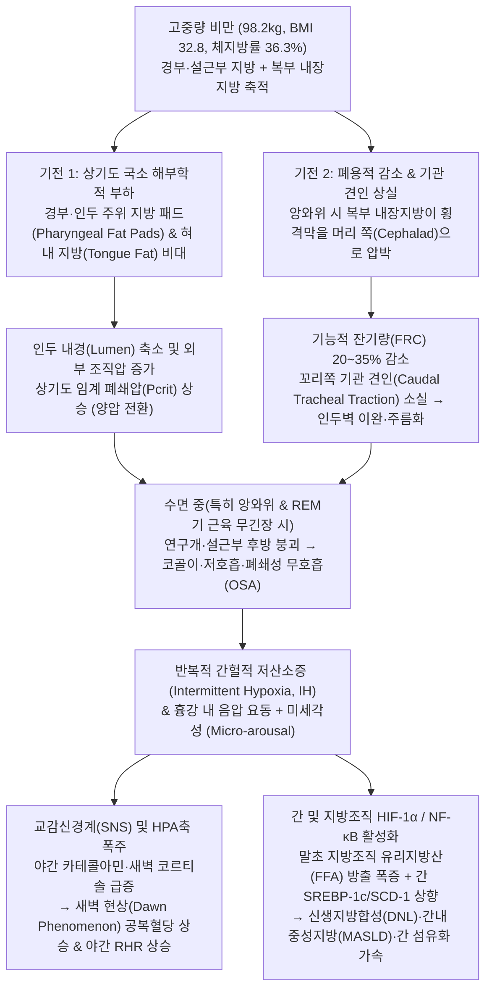
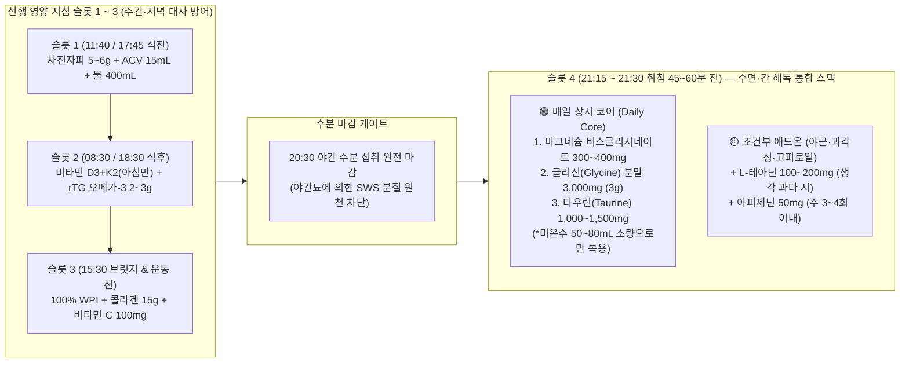

# 고중량 비만(98.2kg·BMI 32.8) 및 3대 대사 질환자의 수면 아키텍처(SWS·REM)·폐쇄성 수면무호흡(OSA)/구강호흡 안전 관리 및 수면 서플리먼트 근거 조사

## 1. 배경 및 핵심 질문 (Why & Question)

- **왜 이 주제를 조사하는가?**:
  - [`Profile`](../profile/overview.md) 기준 현재 **체중 98.2kg(신장 173cm, BMI 32.8, 체지방률 36.3%, 추정 제지방량 ~62.6kg)**의 고중량 비만 상태와 **당뇨 전단계·비알코올성 지방간(MASLD/NAFLD)·고지혈증(이상지질혈증)**의 3대 대사 질환 경고가 공존한다. 비록 기상(`05:30~06:30`)과 취침(`22:00~23:00`)이라는 외형적 7~8시간 수면 스케줄은 안정적이나, **BMI > 30 비만 성인의 50~70% 이상에서 동반되는 잠재적 상기도 협착·코골이·폐쇄성 수면무호흡(OSA) 및 야간 구강호흡**이 존재할 경우 실제 수면의 질적 아키텍처(서파수면 SWS 및 REM 수면)가 심각하게 훼손되어 있을 가능성이 높다.
  - 특히 대중적으로 유행하는 **무분별한 구강 테이핑(Mouth Taping)**을 BMI 32.8의 고중량자나 비강 저항이 있는 사람에게 선행 스크리닝 없이 곧바로 적용할 경우, 구강 내 공기 팽창(**Mouth Puffing**), 간헐적 저산소증 악화, 위식도 역류/질식 위험을 초래할 수 있다(Jau et al., 2023; Lee et al., 2022).
  - 또한 선행 수립된 [`비만 대사 개선 및 체성분 재구성을 위한 영양·식단 아키텍처`](./metabolic-nutrition-recomposition-architecture.md), [`기능적 맨몸 훈련(Functional Calisthenics) 아키텍처`](./functional-calisthenics-architecture.md), [`심폐·대사 개선을 위한 러닝 아키텍처`](./cardio-metabolic-running-architecture.md)가 완벽히 작동하더라도, 수면 아키텍처(SWS·REM)가 무너지면 **동일한 칼로리 적자에서도 체지방 감량분이 55% 급감하고 제지방(근육) 손실이 60% 폭증**(Nedeltcheva et al., 2010)하며, **단 3일간의 서파수면(SWS) 억제만으로도 인슐린 감수성이 25% 급락**(Tasali et al., 2008)하여 3대 대사 질환 역전이 불가능해진다.
- **해결하려는 핵심 질문**:
  1. **고중량 비만(98.2kg·BMI 32.8)의 상기도 생체역학·OSA 병태생리 및 구강 테이핑 안전 프로토콜**: 경부/설근부 지방 패드와 복부 내장지방에 의한 기능적 잔기량(FRC)·꼬리쪽 기관 견인(Caudal tracheal traction) 상실이 어떻게 야간 간헐적 저산소증(IH), 교감신경 폭주, 새벽 고혈당(Dawn Phenomenon), 간 `HIF-1α` 매개 지방간(MASLD) 악화를 유발하는가? 그리고 무분별한 구강 테이핑의 위험을 차단하기 위한 **사전 안전 스크리닝 게이트(STOP-Bang, SpO2/ODI)**와 **1차 비침습 물리적 선행 중재(측와위 위치 요법, 경추 지지 베개, 식염수 비강 세척, 비강 확장 스트립, 조건부 Myotape/세로 부분 테이핑)**는 무엇인가?
  2. **수면 아키텍처(SWS·REM)와 3대 대사 질환·체성분 재구성 및 웨어러블 지표 해석**: 서파수면(SWS)과 REM 수면이 야간 성장호르몬(GH) 펄스, HOMA-IR 인슐린 저항성, 간 신생지방합성(DNL), 렙틴/그렐린 및 전두엽 식욕 통제에 미치는 정량적 근거는 무엇이며, 스마트워치 **골든 수면 지표(수면 효율, 입면 잠복기, SWS/REM 비율, 야간 RHR '해먹 곡선', HRV RMSSD, 호흡수, SpO2)** 판독 기준과 **새벽 `02:00~03:30` 중도 각성의 3대 원인 감별(야간 반응성 저혈당 vs REM기 OSA 무호흡 각성 vs 알코올/야간뇨)** 프로토콜은 어떻게 설계할 것인가?
  3. **수면 서플리먼트 스택의 임상 근거, 지방간/당뇨 안전성 및 선행 Tier 1 영양제와의 통합 설계**: 마그네슘(비스글리시네이트 vs L-트레오네이트), 글리신(Glycine 3g — 심부체온 하강 + 글루타치온 합성을 통한 지방간/인슐린 저항성 개선), L-테아닌, 타우린, 아피제닌의 임상 기전과 외인성 멜라토닌 상시 복용 배제(`MTNR1B` 수용체 및 내당능 저하) 근거는 무엇이며, 간 수치(AST/ALT) 안전성을 보장하면서 선행 영양 지침 **슬롯 4(`21:00~21:30`, 취침 60분 전)**와 무충돌 결합하는 최적 스택은 무엇인가?

---

## 2. 핵심 요약 (TL;DR)

- **고중량 비만(BMI 32.8) 상기도 생체역학 & 구강 테이핑 4단계 안전 게이트**:
  - 경부·설근부·인두 주위 지방 패드(Pharyngeal fat pads)는 상기도 내경을 직접 좁히고, 복부 내장지방은 횡격막을 머리 쪽으로 밀어 올려 **폐 기능적 잔기량(FRC)과 꼬리쪽 기관 견인(Caudal tracheal traction)을 상실**시켜 수면 중 상기도 허탈(OSA)을 유발한다. 이로 인한 **간헐적 저산소증(IH)**과 **미세각성(Micro-arousal)**은 교감신경 폭주·새벽 코르티솔/공복혈당 상승을 일으키고, 간세포 내 **`HIF-1α` 및 `SREBP-1c`를 활성화해 신생지방합성(DNL)과 지방간(MASLD) 섬유화를 직접 가속**한다(Mesarwi et al., 2019; Polotsky et al., 2009).
  - BMI > 30 고중량자에게 수평 전면 구강 테이핑을 무작정 적용하면 비강 저항 시 구강 내로 공기를 내뿜는 **'Mouth Puffing' 현상**(Jau et al., 2023)과 산소포화도 추가 급락·위산 역류 위험이 발생한다. 따라서 **① STOP-Bang 설문 및 스마트워치 야간 최저 SpO2(`<90%` 시 금기) 스크리닝 → ② 측와위 위치 요법(Positional Therapy, 앙와위 대비 AHI 40~50% 감소) 및 경추 베개 정렬 → ③ 취침 전 식염수 비강 세척 + 외부 비강 확장 스트립(비강 밸브 단면적 +20~30% 확장) → ④ 3분 비강 호흡 통과 시에만 비상 배출구가 열린 '세로 1자 부분 테이핑' 또는 입술 주변 탄성 테이프(Myotape) 조건부 적용**의 순차 프로토콜을 강제한다.
- **수면 아키텍처(SWS·REM)의 체성분·대사 결정력 & 웨어러블 골든 지표**:
  - 칼로리 적자 중 수면 시간이 8.5시간에서 5.5시간으로 줄면 **체지방 감량 속도는 55% 감소(`1.4kg → 0.6kg`)하고 제지방(근육) 손실은 60% 증가(`1.5kg → 2.4kg`, 감량 체중의 ~80%가 제지방 손실)**하며(Nedeltcheva et al., 2010), 총 수면 시간을 유지하더라도 **서파수면(SWS)만 3일간 선택적으로 억제하면 인슐린 감수성이 25% 급락**한다(Tasali et al., 2008).
  - 스마트워치 골든 타겟은 **수면 효율 `≥ 85%`, 입면 잠복기 `10~20분`(`<5분`은 수면 부채, `>30분`은 교감신경 과각성), SWS `20~25% (최소 75~90분)`, REM `20~25% (최소 90~110분)`, 야간 RHR '해먹 곡선'(평시 대비 `-5~10 bpm` 하강 및 수면 중반 최저점 도달), 야간 SpO2 평균 `≥ 95%` (최저점 `< 90%` 0회)**이다.
  - **새벽 `02:00~03:30` 중도 각성**은 ① **야간 반응성 저혈당/글리코겐 고갈에 의한 코르티솔·아드레날린 역조절 스파이크**(식은땀·심박 상승 동반 → 메타볼릭 데이 저녁 RS3 통곡물 순탄수 `+25~30g` 보강으로 즉시 해결), ② **수면 후반부 REM기 상기도 근육 무긴장(Atonia)에 의한 OSA 저산소 각성**(입마름·SpO2 딥 동반 → 측와위 고정·비강 스트립 적용), ③ **알코올 아세트알데히드 반동 각성 및 야간뇨**(`20:30` 수분 마감)로 정밀 감별하여 교정한다.
- **대사 질환 친화적 수면 서플리먼트 통합 설계 (`21:30` 슬롯 4 결합)**:
  - 선행 영양 지침 Tier 1의 **마그네슘 비스글리시네이트(원소 마그네슘 `300~400mg`)**에 더해, **글리신(Glycine `3g`, 분말)**을 상시 코어로 결합한다. 글리신 3g은 시교차상핵(SCN) NMDA 수용체를 통해 말초 혈관을 확장시켜 **심부체온(CBT)을 낮추고 입면 시간과 SWS 도달 시간을 단축**할 뿐 아니라(Yamadera et al., 2007; Bannai et al., 2012), **간 내 글루타치온(GSH) 합성의 속도제한 전구체로서 지방간(MASLD) 산화 스트레스를 억제하고 미토콘드리아 지방산 산화 및 인슐린 감수성을 직접 개선**하는 1석 2조의 핵심 성분이다(Rom et al., 2020; Alves et al., 2019).
  - 교감신경 과각성(야근·고강도 훈련) 날에는 **타우린(`1,000~2,000mg`, 담즙산 결합을 통한 LDL-C/지방간 개선 및 야간 RHR 하강)** 또는 **L-테아닌(`100~200mg`, 알파파 유도; 단, REM 반동에 의한 생생한 꿈/악몽 발생 시 제외)**, **아피제닌(`50mg`, GABA_A 조절 및 CD38 억제를 통한 NAD+ 보존)**을 모듈형으로 선택 적용하며, **외인성 멜라토닌 상시 복용은 췌장 `MTNR1B` 수용체 자극에 따른 아침 내당능 저하(당뇨 전단계 악화) 위험으로 상시 스택에서 완전 배제**한다(Garaulet et al., 2020).

---

## 3. 상세 조사 내용 및 메커니즘 (Findings & Evidence)

### 3.1. 고중량 비만(98.2kg·BMI 32.8)의 상기도 생체역학·폐쇄성 수면무호흡(OSA) 위험 및 구강 테이핑 안전 프로토콜

#### 1) 비만(BMI 32.8) 및 내장지방이 유발하는 상기도 폐쇄(OSA)의 이중 생체역학 기전
비만 성인(BMI ≥ 30)에서 폐쇄성 수면무호흡(OSA) 유병률이 정상 체중 대비 4~6배 이상 급증하는 이유는 단순한 목 둘레 증가를 넘어 **상기도 국소 해부학적 압박(Anatomical Load)**과 **흉복부 폐용적 감소에 따른 종축 견인력 상실(Loss of Caudal Tracheal Traction)**이라는 이중 생체역학 기전이 동시에 작동하기 때문이다(Isono, 2012; Dempsey et al., 2010):

1. **상기도 국소 해부학적 부하 — 인두 주위 지방 패드(Pharyngeal Fat Pads)와 설근부 지방(Tongue Fat)**:
   - 체중 증가 시 지방은 피하와 복강뿐 아니라 연구개(Soft palate), 측인두벽(Lateral pharyngeal walls) 외측의 **인두 주위 지방 패드(Parapharyngeal fat pads)**, 그리고 **혀 기저부(Base of the tongue, 혀 부피의 최대 30%까지 지방 침윤 가능)**에 집중 축적된다(Kim et al., 2014; Schwab et al., 2003).
   - 뼈로 둘러싸인 하악골·경추 공간 내부에 지방이 차오르면 연조직 압력(Extraluminal tissue pressure)이 상승하여 인두 기도의 기본 단면적이 원형에서 전후방이 납작한 타원형 슬릿 구조로 좁아지며, 기도가 무너지는 기준 압력인 **상기도 임계 폐쇄압($P_{\text{crit}}$)이 음압에서 양압(`> 0 cmH2O`) 쪽으로 상승**한다.
   - 깨어 있을 때는 상기도 확장근(특히 이설근 Genioglossus)이 반사적으로 과도하게 수축하여 기도를 열어두지만, 수면(특히 NREM 깊어짐 및 REM 수면기의 골격근 무긴장 Atonia)에 진입하면 확장근 긴장도가 급격히 떨어지면서 무거운 설근부와 연구개가 중력 방향으로 무너져 내린다.
2. **복부 내장지방에 의한 기능적 잔기량(FRC) 감소와 꼬리쪽 기관 견인(Caudal Tracheal Traction) 상실**:
   - BMI 32.8의 남성형 중심성 비만에서는 복강 내 내장지방(Visceral adipose tissue)이 높은 복강 내압(Intra-abdominal pressure)을 형성한다. 특히 **천장을 보고 똑바로 눕는 앙와위(Supine position)**를 취하면 복부 지방 덩어리가 중력에 의해 횡격막(Diaphragm)을 흉강 쪽(머리 방향, Cephalad)으로 밀어 올린다.
   - 이로 인해 호흡 후 폐에 남아 있는 공기량인 **기능적 잔기량(Functional Residual Capacity, FRC)과 호기말 폐용적(EELV)이 20~35% 감소**한다(Isono, 2012; Owens et al., 2010).
   - 정상적인 폐용적에서는 폐와 기관지가 아래쪽(발 방향)으로 당겨지면서 상기도 인두벽을 팽팽하게 잡아당겨 단단하게 유지하는 **'꼬리쪽 기관 견인(Caudal Tracheal Traction / Tracheal Tug)'** 효과가 작동한다. 그러나 내장지방이 횡격막을 밀어 올려 FRC가 줄어들면 이 종축 장력이 풀리면서 **인두벽이 텐트 줄이 느슨해진 것처럼 헐거워지고(Pharyngeal wall compliance 증가), 작은 흡기 음압에도 쉽게 안쪽으로 빨려 들어가 폐쇄**된다.
   - 반대로 체중을 10% 감량하면 혀 내부 지방(Tongue fat)과 측인두벽 부피가 유의하게 줄어들고 FRC가 회복되면서 **무호흡-저호흡 지수(AHI)가 약 26~30% 이상 감소**한다는 사실이 MRI 추적 연구로 입증되었다(Wang et al., 2020; Peppard et al., 2000).

#### 2) 간헐적 저산소증(Intermittent Hypoxia) · 미세각성 · 교감신경 폭주가 3대 대사 질환(당뇨 전단계·MASLD·고지혈증)에 미치는 병태생리
수면 중 상기도가 좁아지거나 막히면 **간헐적 저산소증(Intermittent Hypoxia, IH: 혈중 산소포화도의 반복적 하강과 재산소화)**과 기도를 다시 열기 위한 뇌파상의 **미세각성(Micro-arousal — 본인은 깬 줄 모르나 뇌파가 SWS/REM에서 얕은 N1/각성으로 튕겨 올라감)**이 밤새 수십~수백 회 반복된다. 이는 3대 대사 질환을 직접 악화시키는 핵심 분자 스위치로 작동한다:

1. **교감신경 폭주 · 야간 코르티솔 상승 및 당뇨 전단계(새벽 현상 Dawn Phenomenon) 악화**:
   - 무호흡 에피소드 말기에 발생하는 동맥혈 산소포화도($\text{SpO}_2$) 저하와 고탄산혈증($\text{PaCO}_2$ 상승)은 경동맥 소체(Carotid body) 화학수용체를 강력하게 자극하여 **교감신경계(SNS)와 시상하부-뇌하수체-부신(HPA) 축을 폭발적으로 활성화**시킨다(Somers et al., 1995; Dempsey et al., 2010).
   - 그 결과 수면 중에 떨어져야 할 노르에피네프린·에피네프린과 **야간/새벽 코르티솔**이 치솟는다. 이 길항 호르몬들은 간에서 **당신생(Gluconeogenesis)과 글리코겐 분해(Glycogenolysis)**를 강제로 가동시키고 말초 골격근의 `IRS-1/PI3K/Akt` 인슐린 신호 전달을 차단하여, 저녁 식사를 일찍 마쳤음에도 **아침 기상 시 공복혈당(FPG)이 100~125 mg/dL 이상으로 높게 측정되는 '새벽 현상(Dawn Phenomenon)'과 HOMA-IR 상승**을 유발한다(Kent et al., 2015; Pamidi & Tasali, 2012).
2. **`HIF-1α` 매개 간 신생지방합성(DNL) · 유리지방산(FFA) 범람 및 비알코올성 지방간(MASLD)·고지혈증 가속**:
   - 야간 교감신경 흥분은 내장지방 조직의 호르몬 민감성 리파아제(HSL)를 자극하여 밤새 **유리지방산(Free Fatty Acids, FFA)과 글리세롤을 간문맥으로 대량 방출(Adipose tissue lipolysis 폭증)**시킨다(Polotsky et al., 2009; Mesarwi et al., 2019).
   - 동시에 간세포가 겪는 반복적 간헐적 저산소증(IH)은 저산소 유도 인자인 **`HIF-1α` (Hypoxia-Inducible Factor-1 alpha)**와 염증 전사인자 **`NF-κB`**를 안정화·활성화시킨다. 간세포 내 활성화된 `HIF-1α`는 지방 합성 마스터 전사인자인 **`SREBP-1c` 및 스테아로일-CoA 불포화효소-1(`SCD-1`)의 발현을 직접 상향 조절**하여 **간의 신생지방합성(De Novo Lipogenesis, DNL)을 촉진**하고, 반대로 미토콘드리아 $\beta$-산화 효소(`CPT-1`)는 억제한다(Mesarwi et al., 2019; Aron-Wisnewsky et al., 2012).
   - 더욱이 재산소화(Reoxygenation) 과정에서 발생하는 활성산소종(ROS)과 지질과산화는 쿠퍼세포(Kupffer cells)와 간성상세포(Hepatic stellate cells)에서 `TGF-β` 및 콜라겐 유전자 발현을 유도하여, **단순 지방간(Steatosis)을 지방간염(MASH/NASH) 및 간 섬유화로 진행시키는 독립적 인자(비만도와 무관하게 야간 최저 SpO2 및 ODI가 간 효소 AST/ALT 상승 및 섬유화 점수와 직결)**로 작용한다(Musso et al., 2013; Mesarwi et al., 2021).
   - 또한 `HIF-1α`는 간에서 지단백 리파아제(LPL) 억제 단백질인 **`ANGPTL4` (Angiopoietin-like 4)** 발현을 높여 혈중 초저밀도지단백(VLDL) 및 중성지방(TG) 청소율을 떨어뜨림으로써 **공복 및 식후 고중성지방혈증·이상지질혈증을 악화**시킨다(Drager et al., 2012).
3. **야간 구강호흡(Nocturnal Mouth Breathing)의 자체적 기도 폐쇄 가속 기전**:
   - 코로 숨을 쉴 때는 부비동에서 생성된 **산화질소(Nitric Oxide, NO — 강력한 기관지·폐혈관 확장 및 산소 교환 효율 +10~18% 증진 물질)**가 하기도로 유입되고 비강 점막이 공기를 가온·가습하며 일정한 비강 저항이 호기말 양압(Auto-PEEP) 역할을 해 인두 기도를 열어준다(Lundberg et al., 1995).
   - 반면 수면 중 입이 벌어져 **구강호흡(Oral breathing)**으로 전환되면, 하악(아래턱)이 후하방(Posterior-inferior)으로 회전하면서 **설골과 혀 기저부를 인두 후벽 쪽으로 `2 ~ 4 mm` 직접 밀어 넣어 상기도 단면적을 급격히 좁히고 상기도 저항과 $P_{\text{crit}}$를 상승**시킨다(Fitzpatrick et al., 2003; Lee et al., 2015). 또한 차고 건조한 공기가 구강·인두 점막을 말려 점막 표면장력(Surface tension)을 높임으로써 한 번 닫힌 기도가 다시 열리기 어렵게 만들고, 편도·인두 염증과 아침 구강 건조·인후통·구취를 유발한다.

#### 3) 고중량 비만(BMI > 30)에서 무분별한 구강 테이핑(Mouth Taping)의 위험성 및 임상 근거
비강 호흡의 이점 때문에 소셜 미디어 등에서 입 전체를 테이프로 밀봉하는 '구강 테이핑(Mouth Taping)'이 유행하고 있으나, **BMI 32.8의 고중량 비만자나 중등도~중증 OSA 미진단자에게 사전 스크리닝 및 비강 개통 없이 전면 수평 구강 테이핑을 적용하는 것은 임상적으로 위험**하다:

1. **'Mouth Puffing(구강 공기 팽창)' 현상과 역설적 호흡 악화 (Jau et al., 2023)**:
   - 수면 중 입을 벌리는 행위는 단순 습관일 수도 있지만, 비만·OSA 환자에서는 **비강 저항 상승이나 연구개 후방(Velopharynx) 폐쇄로 인해 코로 충분한 산소를 들이마시거나 내쉬지 못할 때 발동하는 생명을 구하기 위한 비상 우회 호흡(Compensatory rescue route)**인 경우가 많다.
   - Jau et al.(2023, *Sleep and Breathing*)은 OSA 환자들에게 구강 테이핑을 적용하고 적외선 비디오 및 구강 팽창 감지기(MPD)로 관찰한 결과, 환자들이 코로만 평온하게 숨 쉬는 것이 아니라 테이프로 막힌 입 안쪽으로 공기를 밀어 넣어 볼이 부풀어 오르거나 테이프 가장자리로 공기를 뿜어내는 **간헐적 구강 퍼핑(Intermittent Mouth Puffing, IMP)** 현상을 보임을 규명했다.
   - 특히 **OSA 중증도(AHI 및 산소포화도 저하 지수 ODI)가 높고 상기도가 좁은 환자일수록 IMP 빈도가 유의하게 높았으며**, 중증 OSA나 비강 폐쇄가 있는 상태에서 입을 강제로 완전 밀봉하면 호기 배출 장애(Expiratory flow limitation), 흉강 내 음압 폭증, 그리고 **일부 환자에서 오히려 무호흡 지수(AHI)와 저산소증이 역설적으로 악화**됨이 확인되었다(Jau et al., 2023; Yang et al., 2024; Rhee et al., 2025).
2. **적용 대상의 한계 (Lee et al., 2022) 및 안전 금기증**:
   - 구강 테이핑이 AHI와 코골이 지수를 약 47% 감소시켰다고 보고한 대표적 임상 연구(Lee et al., 2022, *Healthcare*)조차도 **연구 대상이 평균 BMI `25.1 kg/m²`의 경증(Mild) OSA 환자(`AHI 5~15`)로 엄격히 제한**되어 있었으며, 심각한 비강 폐쇄나 고도 비만 환자는 제외되었다.
   - 따라서 **① 비강 개통 불량(비염·비중격만곡·하비갑개 비후), ② 중등도~중증 OSA(`STOP-Bang ≥ 5점` 또는 야간 최저 `SpO2 < 90%`), ③ 음주 후 또는 위식도 역류(GERD)/구토 가능성**이 있는 상태에서 입술 전체를 덮는 비통기성 수평 테이핑을 하는 것은 질식 및 흡인(Aspiration) 위험 때문에 **절대 금기(Absolute Contraindication)**이다.

#### 4) 구강호흡 및 상기도 안전 관리를 위한 4단계 선행 스크리닝 & 물리적 중재 프로토콜
고중량(98.2kg) 상태에서는 구강 테이핑을 1차 수단으로 쓰지 않고, 반드시 아래 **Step 1(스크리닝) → Step 2(자세·베개 교정) → Step 3(비강 통기도 확장) → Step 4(조건부 안전 테이핑)**의 순서를 지켜야 한다.

| 단계 | 프로토콜 명칭 | 정량 판정 기준 및 구체적 실행 방법 | 임상적 기대 효과 및 안전 근거 |
| :--- | :--- | :--- | :--- |
| **Step 1** | **사전 안전 스크리닝 게이트** (STOP-Bang & 야간 $\text{SpO}_2$ / `3분 비강 호흡 테스트`) | 1) **STOP-Bang 설문 점검**: ① 코골이(Snoring), ② 주간 피로(Tired), ③ 무호흡 목격(Observed), ④ 고혈압(Pressure), ⑤ **BMI > 35**(현재 32.8로 해당 안 됨), ⑥ 연령 > 50세(현재 37세로 해당 안 됨), ⑦ **목둘레 > 40cm**, ⑧ **남성(Male)** → 현재 기본 1~2점 출발. 만약 코골이+주간피로+목둘레>40cm가 겹쳐 **5점 이상이거나 스마트워치 야간 최저 $\text{SpO}_2 < 90\%$가 주 2회 이상 찍히면 수면다원검사(PSG) 대상**이며 구강 밀봉 테이핑 금지 2) **취침 직전 `3분 입 다물고 비강 호흡 테스트`**: 침대에 누운 자세에서 입을 다물고 코로만 3분간 호흡할 때 답답함·심박 상승·숨찬 느낌이 전혀 없어야 함 | 중등도~중증 OSA 및 비강 폐쇄 상태에서 무분별한 구강 테이핑으로 인한 저산소증 악화 원천 차단 |
| **Step 2** | **1차 최우선 중재: 수면 자세 교정 (측와위 위치 요법 Positional Therapy) & 경추 베개 정렬** | 1) **측와위(Lateral Sleeping Position — 왼쪽 또는 오른쪽 옆으로 누워 자기) 의무화**: 앙와위(천장 보고 눕기)는 중력에 의한 설근부 후방 붕괴와 내장지방의 횡격막 압박이 최대화되는 최악의 자세임. 잠들 때 측와위로 시작하고, 무릎 사이에 다리 베개를 끼워 골반·요추 회전을 방지하며, 등 뒤에 바디필로우나 백팩/테니스볼 위치 교정대를 대어 수면 중 앙와위로 뒤집히는 것을 물리적으로 차단 (위식도 역류 방어에는 **좌측 측와위**, 교감신경 안정 및 심장 부담 경감에는 **우측 측와위** 유리) 2) **경추 중립 지지 베개 높이(`8 ~ 11 cm` 측와위 기준)**: 너무 높은 베개는 목을 굴곡(Chin-to-chest)시켜 상기도를 꺾어 막고, 너무 낮은 베개는 입이 벌어지게 함. 옆으로 누웠을 때 코끝-흉골이 바닥과 수평을 이루고 경추가 약간 신전(Slight cervical extension)되어 기도가 열리는 기능성 경추 베개 사용 | 비만·OSA 환자의 50~60%는 앙와위 의존성(Positional OSA)을 보이며, **측와위 전환만으로도 AHI가 40~55% 즉각 감소**하고 산소포화도가 상승함 (Ravesloot et al., 2013; Oksenberg et al., 2000) |
| **Step 3** | **2차 필수 중재: 비강 통기도 확보 (비강 세척 + 외부 비강 확장 스트립)** | 1) **취침 1~2시간 전 생리식염수/약알칼리 비강 세척 (Nasal Saline Irrigation)**: 하루 종일 실내 좌식 근무로 부어오른 하비갑개 점막 부종과 알레르겐·점액을 씻어내어 비강 점막 섬모 운동 회복 2) **외부 비강 확장 스트립 (External Nasal Dilator Strips, 예: 브리즈라이트 등) 또는 내부 비강 확장기(Nasal Cones)**: 코에서 가장 좁은 병목 구간인 **내비밸브(Internal Nasal Valve — 전체 기도 저항의 50% 이상 차지)** 콧등 위에 탄성 스트립을 부착하여 비강 밸브를 물리적으로 들어 올림 | 비강 확장 스트립 부착 시 **비강 최소 단면적(MCA)이 20~30% 넓어지고 비강 흡기 저항이 유의하게 감소**하여 코골이·구강호흡 전환 빈도와 입마름을 대폭 줄임 (Camacho et al., 2016) |
| **Step 4** | **3차 조건부 보조: 안전 개방형 부분 구강 테이핑 (`Myotape` 또는 세로 1자 슬릿 테이핑)** | - **Step 1~3을 모두 통과하고 `3분 비강 호흡 테스트`가 100% 편안한 날에만 제한적 적용**: - ❌ **입술 전체를 가로로 덮는 밀봉 테이핑 절대 금지** - ⭕ **방법 A (가장 안전 — 입술 둘레 탄성 테이프 `Myotape`)**: 입술 중앙은 완전히 뚫려 있어 언제든 비상 구강 호흡·기침이 가능하고, 입술 주변 근육(구륜근)에만 가벼운 탄성 장력을 주어 무의식적 하악 낙하를 잡아주는 도넛형 테이프 사용 - ⭕ **방법 B (의료용 실리콘 저자극 테이프 `세로 1자 부분 부착`)**: 폭 1~1.5cm 의료용 실리콘 테이프(예: 3M 등, 끝단을 3mm 접어 응급 제거 탭 생성)를 **인중에서 턱 끝 방향으로 입술 정중앙에만 세로로 1줄** 붙여, 양옆 입꼬리(`Left/Right Commissures`)로 언제든 공기가 빠져나갈 수 있게 비상 숨구멍 확보 | 하악 후하방 낙하에 따른 설근부 기도 협착은 막아주되, Mouth Puffing 시 양옆으로 즉각 압력이 배출되어 질식·역류 위험을 0으로 통제 |

---

### 3.2. 수면 아키텍처(SWS·REM)와 3대 대사 질환·체성분 재구성 및 웨어러블 지표 해석

#### 1) 수면 시간 및 서파수면(SWS)·REM 수면이 체성분 재구성(지방 감량 vs 근손실)과 3대 대사 질환에 미치는 정량적 근거
다이어트와 운동을 아무리 엄격하게 수행하더라도 수면 시간이나 수면 구조(특히 NREM 3단계 서파수면 SWS)가 무너지면, 신체는 **'지방은 보존하고 근육(제지방)을 분해하여 포도당으로 바꾸는 이화 상태(Catabolic shift)'**와 **'급성 인슐린 저항성 상태'**로 전환된다.

1. **수면 부족 시 지방 감량 `-55%` 반토막 & 근손실 `+60%` 폭증 (Nedeltcheva et al., 2010, 시카고대 연구)**:
   - Nedeltcheva et al.(2010, *Annals of Internal Medicine*)은 과체중 성인에게 동일한 칼로리 적자 식단을 제공하면서 침대 체류 시간을 **8.5시간(실제 수면 ~7시간 25분)** vs **5.5시간(실제 수면 ~5시간 14분)**으로 제한하는 무작위 교차 임상시험을 수행했다.
   - 2주 후 두 집단의 총 체중 감량 폭(`~3.0 kg`)은 비슷했으나 **감량된 체중의 성분(Body Composition)은 충격적인 차이**를 보였다:

| 수면 조건 (동일 칼로리 적자 식단) | 총 체중 감량 | **체지방(Fat Mass) 감량** | **제지방(Fat-Free Mass, 근육 등) 손실** | 감량 체중 중 **체지방 비율 vs 제지방 손실 비율** | 대사·호르몬 변화 |
| :--- | :--- | :--- | :--- | :--- | :--- |
| **충분한 수면군 (`8.5시간` 기회)** | `-2.9 kg` | **`-1.4 kg`** | `-1.5 kg` | **체지방 `48~50%`** : 제지방 `50~52%` | 정상 지방 산화 유지, 식욕 안정 |
| **수면 부족군 (`5.5시간` 기회)** | `-3.0 kg` | **`-0.6 kg` (`-55% 급감`)** | **`-2.4 kg` (`+60% 폭증`)** | **체지방 `20%` : 제지방 손실 `80%`** | 호흡교환율(RQ) 상승(지방 산화 억제·탄수화물/단백질 산화 증가), **혈중 아실화 그렐린 상승 & 휴식 대사량 하락** |

   - 즉, 수면이 부족한 상태에서 다이어트를 하면 **빠진 살의 80%가 근육과 제지방 조직에서 털려 나가고 체지방은 55%나 덜 빠진다.** 이는 수면 부족 시 야간 교감신경 활성과 코르티솔 상승이 골격근 단백질을 분해해 간 당신생(Gluconeogenesis) 원료로 쓰고, 아디포사이트(지방세포)의 인슐린 신호(`Akt` 인산화)가 30% 둔화되어 지방 분해가 억제되기 때문이다(Broussard et al., 2012).
2. **서파수면(SWS, NREM Stage 3) 선택적 억제와 인슐린 감수성 `-25%` 급락 및 야간 성장호르몬(GH) 펄스 소실 (Tasali et al., 2008; Van Cauter et al., 2000)**:
   - Tasali et al.(2008, *PNAS*)은 건강한 성인의 **총 수면 시간(약 8시간)을 전혀 줄이지 않고**, 뇌파가 서파수면(SWS)에 진입할 때마다 미세 음향 자극을 주어 SWS만 얕은 수면(Stage 2)으로 튕겨내는 실험을 단 3일간 진행했다(비만인의 OSA 미세각성과 완벽히 동일한 모델).
   - 그 결과 총 수면 시간이 그대로였음에도 **단 3일 만에 전신 인슐린 감수성($S_I$)이 약 `25%` 급락**했고, 췌장 베타세포가 이를 보상하기 위해 인슐린을 더 분비하지 못해 **포도당 처분 지수(Disposition Index, 당뇨병 진행 핵심 지표)가 `20%` 하락**하여 내당능 장애(당뇨 전단계) 수준으로 떨어졌다.
   - **야간 성장호르몬(GH) 펄스 기전**: 성인 남성에서 일일 총 **성장호르몬(Growth Hormone) 분비량의 `60 ~ 70%`는 입면 후 첫 1~2번째 수면 주기(`22:30 ~ 01:30` 사이)에 나타나는 가장 깊은 서파수면(SWS) 구간에서 단일 대형 펄스로 방출**된다(Van Cauter et al., 2000). 이 야간 GH 펄스는 ① 칼리스데닉스·러닝으로 손상된 **근섬유 및 건(Tendon)·인대 콜라겐의 야간 복구**를 주도하고, ② 야간 단식 중 **지방조직의 지방 분해(Lipolysis)를 촉진**하며 골격근 단백질을 보존한다. 늦은 식사(`19:00` 이후), 음주, 또는 수면 초반 OSA 미세각성으로 인해 전반부 SWS가 깨지면 이 GH 펄스가 소실되어 회복과 지방 연소가 동시에 멈춘다.
3. **식욕 조절 호르몬(렙틴 `-18%` / 그렐린 `+28%`) 역전과 전두엽 통제 마비 (Spiegel et al., 2004; Greer et al., 2013)**:
   - Spiegel et al.(2004, *Annals of Internal Medicine*)은 수면 제한 시 포만 호르몬인 **렙틴(Leptin)이 `18%` 감소**하고 공복·갈망 호르몬인 **그렐린(Ghrelin)이 `28%` 급증**하며, 주관적 배고픔이 `24%`, 특히 **고탄수화물·고지방·짠 배달음식에 대한 갈망이 `33 ~ 45%` 폭증**함을 입증했다.
   - 더욱이 fMRI 뇌영상 연구(Greer et al., 2013, *Nature Communications*)에 따르면, 수면 부족(특히 수면 후반부 **REM 수면** 결핍)은 이성적 절제와 충동 억제를 담당하는 **전전두엽 피질(Prefrontal Cortex, PFC)의 활성을 마비**시키고, 보상·쾌락 중추인 **편도체(Amygdala)와 선조체(Striatum)의 고열량 정크푸드 반응성을 60% 이상 증폭**시켜 다음 날 오후/야간 평균 **`+300 ~ 550 kcal`의 잉여 칼로리 섭취**(Al Khatib et al., 2017)를 유발한다.
4. **글림프 시스템(Glymphatic System) 뇌 노폐물 청소**:
   - 서파수면(SWS) 중에는 뇌 노르아드레날린 수치가 최저로 떨어지면서 신경교세포(Astrocyte)의 수분 통로인 `AQP4`를 통해 뇌 세포 간 공간이 **60% 확장**되어, 낮 동안의 고강도 웹 개발 코딩·인지 노동으로 쌓인 대사 노폐물(아데노신, 베타-아밀로이드, 타우 단백질)을 뇌척수액(CSF)으로 씻어낸다(Xie et al., 2013). 이 과정은 **측와위(Lateral position)로 잘 때 앙와위나 복와위보다 청소 효율이 가장 높다**(Lee et al., 2015, *Journal of Neuroscience*).

#### 2) 스마트워치 기반 7대 골든 수면 생체 지표(Wearable Golden Sleep Metrics) 정량 기준 및 판독 매트릭스
`05:30~06:30 기상 / 22:00~23:00 취침` 리듬에서 매일 아침 스마트워치(Apple Watch, Garmin, Galaxy Watch, Oura/Whoop 등)로 점검해야 할 7대 객관적 지표와 대사적 의미는 다음과 같다:

| 지표 구분 | 🟢 최적 골든 타겟 (Optimal) | 🟡 주의 / 경계 (Warning) | 🔴 위험 / 즉각 개입 (Red Flag) | 생리학적 해석 및 교정 액션 |
| :--- | :--- | :--- | :--- | :--- |
| **1. 총 수면 시간 (TST) & 침대 체류 시간 (TIB)** | **실제 수면 `7시간 00분 ~ 7시간 45분`** (TIB `7.5 ~ 8.2시간`) | 실제 수면 `6시간 15분 ~ 6시간 50분` | 실제 수면 **`< 6시간 00분`** | Nedeltcheva(2010) 근거: 실제 수면 7시간 확보를 위해 88~90% 수면 효율 감안 시 **최소 7.5~8시간의 침대 체류 시간(`22:15~06:00`)** 확보 필수 |
| **2. 수면 효율 (Sleep Efficiency, SE)** | **`≥ 85%` (이상적 `88 ~ 93%`)** | `80 ~ 84%` (수면 중 각성 WASO 30~45분) | **`< 80%`** (WASO `> 45~60분`, 심각한 수면 분절) | `SE = (실제 수면 시간 / 침대 체류 시간) × 100`. 85% 미만은 OSA 미세각성, 야간 저혈당, 또는 늦은 식사/수분에 의한 각성 시사 |
| **3. 입면 잠복기 (Sleep Onset Latency, SOL)** | **`10 ~ 20분`** | `20 ~ 30분` 또는 `5 ~ 9분` | - **`> 30분`**: 교감신경 과각성·심부체온 미하강 - **`< 5분`**: **심각한 만성 수면 부채(Sleep Debt) 또는 OSA 주간 과다졸림** | 베개에 머리 대자마자 **5분 이내에 기절하듯 잠드는 것은 '건강한 숙면'이 아니라 극심한 수면 박탈/무호흡 피로 신호**임 (정상 뇌는 각성에서 N1으로 내려가는 데 10~20분 소요) |
| **4. 서파수면 (SWS, Deep Sleep) 비율 & 시간** | **총 수면의 `18 ~ 25%`** (**최소 `75 ~ 105분`**, 전반부 `22:30~01:30` 집중) | `12 ~ 17%` (`50 ~ 70분`) | **`< 12%` (`< 50분`)** | 성장호르몬(GH) 펄스 및 익일 인슐린 감수성(HOMA-IR) 결정 지표. SWS 저하 시 **① `18:30~19:00` 식사 마감 엄수, ② 취침 90분 전 온욕(심부체온 하강), ③ 글리신 3g + 마그네슘** 투입 |
| **5. REM 수면 (REM Sleep) 비율 & 시간** | **총 수면의 `20 ~ 25%`** (**최소 `90 ~ 115분`**, 후반부 `02:30~06:00` 집중) | `15 ~ 19%` (`65 ~ 85분`) | **`< 15%` (`< 60분`)** | 전두엽 식욕 통제·기억 공고화 지표. REM은 알코올, 수면 후반부 OSA(근육 무긴장기 기도 폐쇄), 또는 너무 이른 강제 기상 시 가장 먼저 잘려 나감 |
| **6. 야간 안정시 심박수 (Nocturnal RHR) 하강 곡선 & HRV (RMSSD)** | - **RHR**: 주간/취침 전 대비 **`-5 ~ -10 bpm` 이상 하강**, 수면 중반부(`02:00~03:30`) 최저점 도달 (**'해먹 곡선' Hammock Curve**) - **HRV (RMSSD)**: 본인 7일 이동평균 기준선 유지 또는 상승 추세 | - RHR이 기상 직전에야 최저점에 도달 (**'하향 경사/램프 곡선' Downward Slope**) - RHR 평시 대비 `+3 ~ 4 bpm` 상승 / HRV `-10~15%` 하락 | - 밤새 RHR이 떨어지지 않고 평탄하거나 고원 형태 (**'고원/산봉우리 곡선'**) - **RHR 평시 대비 `≥ +5 bpm` 급등 & HRV `-20%` 이상 급락** | - **해먹 곡선(정상)**: 소화 종료 및 미주신경 우위로 수면 중반에 심장이 완전히 휴식함 - **램프 곡선(경고)**: **늦은 저녁 식사(`19:30` 이후), 과식, 늦은 고강도 운동(`20:30` 이후), 또는 알코올 대사**로 인해 새벽 내내 심장이 초과 근무를 한 전형적 패턴 |
| **7. 야간 혈중 산소포화도 ($\text{SpO}_2$) & 호흡수 (Respiratory Rate)** | - **평균 $\text{SpO}_2$**: **`95 ~ 98%`** - **최저(Nadir) $\text{SpO}_2$**: **`≥ 92%`** (`< 90%` 떨어지는 구간 0회) - **호흡수**: **`12 ~ 16회/분`** (일일 변동 `< ±1.5회/분`) | - 최저 $\text{SpO}_2$가 간헐적으로 `90 ~ 91%`까지 하강 - 호흡수 변동성 증가 | - **야간 최저 $\text{SpO}_2 < 90\%$ 딥(Dip) 반복 발생** - 호흡수 급변 또는 무호흡 직후 빈호흡 스파이크 | 최저 $\text{SpO}_2 < 90\%$는 상기도 폐쇄(OSA)에 의한 간헐적 저산소증의 직접 증거임 → 즉시 **측와위 고정 + 비강 확장 스트립** 적용 및 지속 시 수면다원검사 권고 |

#### 3) 새벽 `02:00 ~ 03:30` 중도 각성(Middle-of-the-Night Awakening)의 3대 생리학적 감별 진단 및 즉각 해결 매트릭스
다이어트와 시간제한 섭식(eTRF)을 수행하는 대사 질환자에서 가장 빈번하게 보고되는 수면 장애는 입면 장애가 아니라 **새벽 `02:00 ~ 03:30`경 갑자기 눈이 떠져 다시 잠들기 어려운 중도 각성**이다. 이는 원인이 전혀 다른 3가지 생리 현상 중 하나로 발생하므로 아침 증상과 워치 데이터로 즉시 감별하여 처방해야 한다:

| 감별 유형 | 핵심 발생 기전 (Pathophysiology) | 기상 직후 신체 징후 & 스마트워치 시그니처 | 즉각 해결 프로토콜 (Actionable Fix) |
| :--- | :--- | :--- | :--- |
| **유형 1: 야간 반응성 저혈당 & 간 글리코겐 고갈에 의한 코르티솔/아드레날린 역조절 스파이크** *(다이어터 최다 원인)* | - 당뇨 전단계(인슐린 저항성) 상태에서 저녁 탄수화물을 지나치게 극단적으로 제한(`< 15~20g`)하거나 칼로리 적자가 과도할 때, 새벽 02~03시경 간 글리코겐이 고갈됨 - 뇌로 가는 포도당 공급을 사수하기 위해 부신이 비상벨을 울려 **코르티솔과 에피네프린(아드레날린)을 급격히 분비(Counter-regulatory surge)** → 혈당은 올리지만 교감신경이 폭발해 뇌를 강제로 깨움 | - **눈이 번쩍 떠지며 정신이 또렷함(재입면 30분 이상 소요)** - 가슴 두근거림(심계항진), 미세한 식은땀, 속 쓰림 또는 공복감 동반 - **워치 시그니처**: $\text{SpO}_2$는 정상(`≥94%`)인데, 각성 직전 **심박수(HR)만 갑자기 `+10~20 bpm` 스파이크** 치솟음 | 1) **영양 지침 신호등 🟡 Yellow(경고 B) 즉시 발동**: **월·수·금·일 메타볼릭 데이 저녁 식사(`18:00~18:30`)에 RS3 식힌 통곡물 잡곡밥을 순탄수 `+25 ~ 30 g` (밥 반 공기 분량) 증량**하여 야간 간 글리코겐 저장고 확보 2) 저녁 식사 시 불포화지방(`15g`, 들기름/EVOO)과 단백질(`40g`)을 충분히 섭취해 위 배출 속도 완충 3) 새벽 각성 당시 침대에서 20분 이상 잠이 안 오면 **미온수 반 컵 + 소금 한 꼬집(코르티솔 억제)** 섭취 |
| **유형 2: REM 수면기 상기도 근육 무긴장(Atonia)에 의한 OSA 저산소/질식 각성** *(고중량 BMI 32.8 특이 원인)* | - 수면 후반부(`02:00 ~ 05:30`)는 REM 수면 주기가 길어지는 시간대임. REM 수면 중에는 꿈을 행동으로 옮기지 못하도록 뇌간에서 전신 골격근(상기도 확장근 포함)을 마비시키는 **REM 무긴장(REM Atonia)**이 발생함 - 이때 혀와 연구개가 완전히 무너져 **수면 중 가장 길고 심각한 무호흡(REM-related OSA)**이 발생하며, 산소포화도가 급락하자 뇌가 질식을 막기 위해 비상 각성시킴 | - **깨어났을 때 입안과 목구멍이 바짝 말라 있음(구강호흡 증거)** - 아침 기상 시 전두부/측두부 묵직한 두통, 7~8시간 자고도 전혀 개운하지 않음 - **워치 시그니처**: 각성 시점 직전에 **REM 수면 구간 + $\text{SpO}_2$ 급락 딥(`< 90~92%`) + 호흡수 요동**이 동시에 관찰됨 | 1) **앙와위(천장 보고 눕기) 즉시 차단**: 깨어났을 때 자신이 천장을 보고 누워 있었는지 확인 → 등 뒤 바디필로우/위치 교정대로 **측와위(옆으로 누워 자기) 강제 고정** 2) 취침 전 **식염수 비강 세척 + 외부 비강 확장 스트립** 의무 부착 3) 침실 습도 `50~55%` 유지 및 조건부 `Myotape`/세로 부분 테이핑 적용 |
| **유형 3: 알코올 대사 반동 각성(Glutamate Rebound) 또는 야간뇨(Nocturia) 각성** | - **알코올**: 취침 전 음주는 초반에는 GABA를 자극해 빨리 잠들게 하나, 3~4시간 뒤 간에서 에탄올이 **아세트알데히드**로 대사되면서 흥분성 신경전달물질인 **글루타메이트(Glutamate) 반동과 교감신경 폭주**를 일으켜 새벽 02~03시에 잠을 깨우고 REM 수면을 파괴함 - **야간뇨**: 늦은 수분 섭취 또는 **수면무호흡(OSA) 시 흉강 내 강한 음압이 심방을 잡아당겨 심방나트륨이뇨펩타이드(ANP)가 분비**되어 밤사이 소변 생성을 폭증시킴 | - 소변 마려움으로 깨어나 화장실을 1~2회 이상 감 - 음주 시 갈증·열감·높은 야간 RHR(`+8~15 bpm` 고원 곡선) - **워치 시그니처**: 수면 전반부 RHR이 전혀 내려가지 않는 램프/고원 곡선 | 1) **[`영양 지침`](./metabolic-nutrition-recomposition-architecture.md)의 `20:30 수분 마감 규칙` 엄수**: 취침 2시간 전부터 물 섭취 중단 (마그네슘 복용 시 `50~100mL`만 허용) 2) 저녁 식사 시 국물 나트륨 배제 및 평일 금주 원칙 고수 3) `20:30` 수분 마감을 지켰는데도 야간뇨가 지속되면 **OSA에 의한 ANP 분비 신호**이므로 유형 2(측와위·비강 확장) 처방 병행 |

---

### 3.3. 수면 서플리먼트 스택의 임상 근거, 대사 질환(지방간·당뇨 전단계) 안전성 및 선행 Tier 1 영양제와의 통합 설계

#### 1) 후보 수면 서플리먼트 6종의 분자 기전 · 임상 근거 · 3대 대사 질환 시너지 및 간 안전성(AST/ALT) 비교 검증
지방간(MASLD)과 당뇨 전단계, 고지혈증을 가진 상태에서는 수면 보충제 하나를 고를 때도 **① 간 대사 부담(AST/ALT 간독성 위험 여부), ② 혈당·인슐린 수용체 및 간 지방 대사에 미치는 영향, ③ 선행 영양 지침 Tier 1 서플리먼트와의 중복/간섭 여부**를 엄격히 따져야 한다.

| 성분명 및 권장 정량 | 수면 아키텍처 작용 기전 & 임상 근거 | 3대 대사 질환(당뇨 전단계·MASLD·고지혈증) 시너지 효과 | 간 안전성(AST/ALT) 및 부작용·제외 기준 | 채택 등급 |
| :--- | :--- | :--- | :--- | :--- |
| **1. 마그네슘 비스글리시네이트** (Magnesium Bisglycinate) **원소 마그네슘 `300 ~ 400 mg`** *(선행 Tier 1 베이스)* *vs 마그네슘 L-트레오네이트 (Magtein)* | - **기전**: 억제성 신경전달물질인 $\text{GABA}_A$ 수용체 작용제 역할 및 흥분성 NMDA 수용체 칼슘 유입 차단 → 신경계 과각성 종료, 야간 코르티솔 억제, **서파수면(SWS) 시간 연장**(Held et al., 2002; Abbasi et al., 2012) - **비스글리시네이트 vs L-트레오네이트 비교**: L-트레오네이트(Magtein)는 뇌혈관장벽(BBB) 통과율이 높아 주간 인지 기능·REM/SWS 개선에 유효하나(Hausenblas et al., 2024), 원소 마그네슘 함량이 낮고(`~144mg`) 가격이 3~4배 비쌈. 반면 **비스글리시네이트는 마그네슘 1분자에 글리신 2분자가 킬레이트 결합되어 장 흡수율이 높고 설사 부작용이 없으며, 약 `1.8~2.2g`의 글리신을 부수적으로 공급하면서 말초 근육 이완과 인슐린 감수성 회복을 동시에 달성**하므로 고중량 대사 질환자의 1차 베이스로 압도적 우위 | - 인슐린 수용체 티로신 키나아제(Tyrosine kinase)의 필수 보조인자로 작동하여 **공복혈당 및 HOMA-IR 유의 감소**(Veronese et al., 2016) - 혈관 평활근 이완 및 야간 혈압 강하 | - **간 독성 없음** (신장 배설, 정상 신기능에서 안전 상한 충족) - 저가 산화마그네슘(MgO)이나 구연산마그네슘 과량 복용 시 삼투성 설사 유발 가능하므로 반드시 **100% 킬레이트 비스글리시네이트** 선택 | **Tier 1 상시 코어** (선행 영양 지침 슬롯 4 고정) |
| **2. 글리신 (Glycine)** **취침 30~60분 전 `3,000 mg (3 g)`** *(분말 형태 설하/소량 물 용해)* | - **기전**: 뇌 시교차상핵(SCN)의 NMDA 수용체에 작용하여 손발 말초 피부 혈관을 확장(Peripheral vasodilation)시키고 열 발산을 유도해 **수면 진입의 핵심 스위치인 심부체온(Core Body Temperature)을 자연스럽게 `-0.3 ~ -0.5°C` 낮춤**(Kawai et al., 2015) - **임상 근거**: 취침 전 글리신 `3g` 복용 시 정상 수면 구조를 해치지 않으면서 **입면 잠복기(SOL)와 서파수면(SWS) 도달 잠복기를 유의하게 단축**하고, 수면 시간이 `5.5시간`으로 제한된 날에도 익일 주간 피로도와 전두엽 인지 저하를 유의하게 개선함(Yamadera et al., 2007; Bannai et al., 2012) | - **비알코올성 지방간(MASLD) & 당뇨 전단계 환자에게 가장 강력한 대사 시너지 성분**:   ① 지방간·비만·인슐린 저항성 환자는 혈중 글리신이 만성적으로 고갈되어 있음(Alves et al., 2019)   ② 글리신은 간 내 최강 항산화제인 **글루타치온(Glutathione, GSH: 글루탐산-시스테인-글리신 삼중펩타이드) 합성의 속도제한 전구체**로서, 간세포 미토콘드리아 산화 스트레스를 제거하고 **지방산 $\beta$-산화를 촉진하여 간내 지방(IHTG) 축적과 AST/ALT 상승을 직접 방어**함(Rom et al., 2020)   ③ 야간 성장호르몬(GH) 분비 보조 및 콜라겐 삼중나선의 33% 구성 아미노산으로 건 회복 시너지 | - **간 독성 없음 (오히려 간세포 보호·AST/ALT 개선 작용)** - 맛 자체가 은은한 단맛(설탕의 ~70% 감미도이나 혈당·인슐린 반응 0)을 지녀 **분말 3g(티스푼 1스푼)을 입안에 녹여 먹거나 물 50mL에 타 먹으면 `20:30` 수분 마감 규칙을 전혀 해치지 않음** | **Tier 1 상시 코어 승격** (마그네슘과 함께 매일 밤 고정) |
| **3. 타우린 (Taurine)** **취침 60분 전 `1,000 ~ 2,000 mg`** | - **기전**: 뇌 내 **$\text{GABA}_A$ 수용체 및 글리신 수용체의 부분 작용제(Partial agonist)**로 작동하며, 글루타메이트 흥분독성을 억제하고 미주신경(부교감신경) 긴장도를 높여 **야간 안정시 심박수(RHR)를 빠르게 낮추고 깊은 수면을 유도**함(Jia et al., 2008) | - **고지혈증 & 지방간 2중 치료 기전**: 간에서 콜레스테롤을 담즙산으로 전환하는 속도제한 효소(`CYP7A1`)를 활성화하고 **타우로콜산(Taurocholic acid) 담즙산 포합(Conjugation)을 촉진**하여 혈중 **LDL-C·중성지방(TG)을 낮추고 담즙 정체(감량기 담석 위험)와 간 지방 축적을 예방**함(Murakami, 2015; Gentile et al., 2011) | - **간 독성 없음 (간 담즙 배설 및 해독 효소 보호)** - 일 `3,000mg`까지 EFSA/임상 안전성 확립. 공복 위산 과다 시 저녁 식후(`18:30`) 또는 취침 전 분복 가능 | **Tier 1.5 준코어 / 고지혈증·RHR 안정 모듈** |
| **4. L-테아닌 (L-Theanine)** **`100 ~ 200 mg`** *(카페인 없는 녹차 유래 아미노산)* | - **기전**: 뇌혈관장벽(BBB)을 30~40분 내에 통과하여 뇌파를 각성 베타파(Beta)에서 이완 **알파파(Alpha wave, 8~12Hz)**로 전환시키고, 글루타메이트 수용체(AMPA/Kainate)를 길항하여 **늦은 밤 코딩·업무 후 멈추지 않는 생각(Racing thoughts)을 끄고 입면 잠복기와 수면 효율을 개선**함(Hidese et al., 2019; Lyon et al., 2011) | - 야간 교감신경 과항진 및 스트레스성 코르티솔 상승을 완충하여 간접적으로 새벽 혈당 스파이크 억제 | - **간 독성 없음** (단, 고농축 카테킨/EGCG 추출물이 아닌 **순수 L-Theanine 단일 성분(Suntheanine 등)**으로 선택 필수) - ⚠️ **개인차 주의사항**: 일부 사용자(약 10~15%)에서 취침 직전 복용 시 아세틸콜린/수면 구조 상호작용으로 **수면 후반부 REM 꿈이 지나치게 생생해지거나(Vivid dreams) 중도 각성**을 겪을 수 있음 → 발생 시 즉시 취침 전 복용을 중단하고 오후 `15:30` 브릿지 시간대로 옮기거나 스택에서 제외 | **Tier 2 조건부 모듈** (야간 인지 과각성 시 선택) |
| **5. 아피제닌 (Apigenin)** **`50 mg`** *(캐모마일 추출 플라보노이드)* | - **기전**: 뇌 벤조디아제핀 결합 부위와 유사한 $\text{GABA}_A$ 수용체 알로스테릭 조절을 통해 진정·수면 유도 효과를 내며, 동시에 세포 내 염소 이온($\text{Cl}^-$) 유입을 높여 신경 흥분을 낮춤(Viola et al., 1995; Salehi et al., 2019) | - 노화·비만 시 활성화되어 세포 내 $\text{NAD}^+$를 고갈시키는 효소인 **`CD38`을 강력하게 억제하여 간과 근육의 세포 내 $\text{NAD}^+$ 농도와 `SIRT1`/`SIRT3` 미토콘드리아 활성을 보존**하고 지방간 염증을 완화함(Escande et al., 2013) | - `50mg` 저용량은 안전하나, 고용량(`>100~200mg`) 장기 복용 시 간 `CYP2C9`/`CYP1A2` 효소 간섭 가능성 및 에스트로겐/호르몬 신호 간섭 논의가 있으므로 **야근·고스트레스 날 주 3~4회 간헐적 모듈(또는 저녁 캐모마일 티 1잔)**로 활용 권장 | **Tier 2 조건부 모듈** (간헐적 이완 보조) |
| **6. 외인성 멜라토닌 (Exogenous Melatonin)** *vs 트립토판/타트체리* | - 시차 적응(Jet lag)이나 교대근무자의 일주기 위상 이동(Phase shifting)에는 `0.3~0.5mg` 극저용량이 유효하나, **이미 `22:00~23:00 취침 / 05:30~06:30 기상`의 규칙적 일주기 리듬을 가진 사람에게는 서파수면(SWS) 증진 효과가 미미**함 | - ❌ **당뇨 전단계 환자 상시 복용 배제 근거 (`MTNR1B` 수용체 충돌)**:   ① 외인성 멜라토닌 보충제(특히 시중 `3~10mg` 고용량)를 복용하면 생리적 농도의 10~50배에 달하는 혈중 멜라토닌이 **다음 날 아침 기상 후(`06:00~09:00`)까지 잔류(Hangover spillover)**함   ② 잔류 멜라토닌이 췌장 베타세포의 **`MTNR1B` 수용체에 결합하여 아침 첫 끼(`08:00`) 섭취 시 인슐린 분비를 억제하고 포도당 내성(Glucose tolerance)을 유의하게 악화**시킴(Garaulet et al., 2020; Rubio-Sastre et al., 2014; Tuomi et al., 2016)   ③ 타트체리 주스 농축액 역시 액상 과당/당류(`15~25g`) 함량이 높아 야간 단식(`18:30` 마감)과 지방간 DNL 억제를 깨뜨리므로 배제함 | - 아침 브레인 포그(Grogginess), 생생한 악몽, 그리고 **당뇨 전단계 아침 고혈당 유발 위험**으로 인해 **상시 수면 스택에서 완전 배제(Red Flag)** (해외 출장 시차 적응 시에만 `0.3~0.5mg` 3일 이내 단기 사용) | **🔴 상시 복용 배제 (Excluded)** |

#### 2) 선행 영양 지침 Tier 1 서플리먼트 `슬롯 4 (21:00 ~ 21:30)`와의 무충돌 통합 아키텍처
선행 [`영양·식단 아키텍처`](./metabolic-nutrition-recomposition-architecture.md)에서 확정된 4슬롯 타임라인 및 **`20:30` 수분 마감 규칙**과 100% 호환되도록, 취침 60분 전인 **`슬롯 4 (21:00 ~ 21:30)`**를 **기본 상시 코어 스택(Core Stack)**과 당일 컨디션(`Recovery Module`)에 따른 **선택적 애드온 모듈(On-Demand Add-on)**로 이원화하여 운영한다.

1. **시간대 분리 및 상호작용 완전 차단 원칙**:
   - **차전자피 흡착 간섭 0%**: 저녁 식전(`17:45~18:00`)에 복용한 차전자피 식이섬유와 취침 전 수면 서플리먼트(`21:15~21:30`) 사이에 **3.5시간 이상의 간격**이 확보되므로 마그네슘·아미노산 흡수 저해가 전혀 발생하지 않는다.
   - **비타민 D3 및 카페인 간섭 0%**: 멜라토닌 합성을 방해하는 비타민 D3는 아침 첫 끼(`08:30`)에, 카페인은 `12:00 (정오)` 이전에 완전 마감되어 야간 아데노신 및 내인성 멜라토닌 분비(DLMO `19:30~20:30`)가 온전히 보호된다.
   - **야간 단식(`18:30` 마감) 및 `20:30` 수분 마감 보호**: 마그네슘 캡슐과 타우린 캡슐을 **글리신 분말 `3g`을 녹인 미온수 `50 ~ 80 mL` (소주잔 1잔 반 분량)**로 한 번에 삼킨다. 글리신(`3g`, 약 12 kcal)과 타우린은 인슐린을 자극하지 않고 오히려 시교차상핵 NMDA 수용체와 간 글루타치온 합성으로 직행하므로 자가포식·지방 연소 단식 창과 `20:30` 수분 마감(야간뇨 방어)을 모두 침해하지 않는다.
2. **단계별 도입 원칙 (`One-at-a-Time Onboarding` — 스마트워치 N=1 교차 검증)**:
   - 모든 보충제를 첫날 동시에 털어 넣으면 특정 성분이 본인의 수면 구조(예: L-테아닌의 생생한 꿈 반응 등)에 미치는 영향을 분별할 수 없다.
   - 따라서 **1~2주차에는 `마그네슘 비스글리시네이트 300~400mg` 단독 고정** → **3주차에 `글리신 3g` 추가(입면 시간·SWS 비율·아침 개운함 비교)** → **5주차에 `타우린 1,000~1,500mg` 추가(야간 RHR 해먹 곡선 하강 폭 비교)** → 이후 야근/고스트레스 날에만 `L-테아닌` 또는 `아피제닌`을 테스트하는 계단식 도입 규칙을 적용한다.

---

## 4. 나에게 적용할 점 (Personal Application)

- **내 상태([`profile`](../profile/overview.md))와의 적합성 및 핵심 주의사항**:
  1. **BMI 32.8(98.2kg) 상태에서의 최우선 수면 처방은 '비싼 영양제'나 '전면 구강 테이핑'이 아니라 '측와위(옆으로 누워 자기) + 비강 확장 스트립'이다**:
     - 현재 22~23시 취침 / 5:30~6:30 기상이라는 훌륭한 일주기 기본 틀을 가지고 있으므로, 만약 아침에 일어났을 때 입이 말라 있거나 낮에 피로하다면 수면 시간 부족이 아니라 **앙와위(천장 보고 눕기)에서 발생하는 설근부/내장지방 압박에 의한 상기도 저항 및 미세각성** 때문일 확률이 가장 높다.
     - 오늘 밤 당장 **측와위 자세(무릎 사이 베개 + 등 뒤 바디필로우 지지)**와 **취침 전 식염수 비강 세척 + 외부 비강 확장 스트립**을 적용하여 물리적 기도 단면적을 넓히고, 전면 밀봉 구강 테이핑은 절대 피한 채 비강 호흡이 100% 편안해진 뒤에만 `Myotape` 또는 세로 1줄 부분 테이핑을 보조로 사용한다.
  2. **3대 대사 질환(지방간·당뇨 전단계·고지혈증) 역전의 숨은 열쇠 — `글리신 3g + 타우린 1~1.5g + 마그네슘 300~400mg` 야간 트리오**:
     - 취침 1시간 전(`21:15~21:30`) 소량의 물(`50~80mL`)에 **글리신 분말 3g**을 타서 **마그네슘 비스글리시네이트(300~400mg) 및 타우린(1,000~1,500mg)**과 함께 복용하는 루틴은, 심부체온을 낮춰 서파수면(SWS)과 야간 성장호르몬(GH) 펄스를 극대화할 뿐 아니라 **밤사이 간 내 글루타치온(GSH) 합성과 담즙산 포합을 촉진하여 지방간(MASLD)과 LDL 콜레스테롤, 아침 공복혈당을 동시에 낮추는 가장 안전하고 강력한 대사-수면 이중 전략**이다.
  3. **새벽 2~3시 각성 발생 시 원인별 즉각 스위치**:
     - 스마트워치에서 새벽 2~3시에 깼을 때 **산소포화도($\text{SpO}_2$) 저하 없이 심박수만 튀었다면 '야간 저혈당/코르티솔 반동'**이므로 메타볼릭 데이 저녁 식사에 RS3 통곡물밥(순탄수 `+25~30g`)을 즉시 보강하고, **$\text{SpO}_2$가 `<90~92%`로 떨어지며 입이 말랐다면 'REM기 무호흡 각성'**이므로 측와위 고정과 비강 확장을 강화한다.
- **실험해 볼 가설 / 상위 아키텍처 연결**:
  - 본 조사 결과는 티켓 `#21`(조기 크로노타입 빛·체온·신경계 스위치 및 4대 `Recovery Module` 설계 조사)의 결과와 결합되어, 티켓 `#22`에서 영구 참고용 **[`대사 회복 및 체성분 재구성을 위한 수면·일주기 리듬(Sleep & Circadian Architecture) 설계 및 운영 지침`](./sleep-circadian-metabolic-recovery-architecture.md)**으로 통합 확정된다.

---

## 5. 출처 및 참고 자료 (References)

- **내부 연계 지침 (`Research` 아카이브)**:
  - [`비만 대사 개선 및 체성분 재구성을 위한 영양·식단(Metabolic Nutrition & Recomposition) 아키텍처 및 운영 지침`](./metabolic-nutrition-recomposition-architecture.md)
  - [`기능적 맨몸 훈련(Functional Calisthenics) 아키텍처 및 운영 지침`](./functional-calisthenics-architecture.md)
  - [`심폐·대사 개선을 위한 러닝(Cardio-Metabolic Running) 아키텍처 및 운영 지침`](./cardio-metabolic-running-architecture.md)
- **핵심 학술 문헌 및 임상 가이드라인 (Peer-Reviewed Primary Sources)**:
  1. **고중량 비만 상기도 생체역학 · 폐쇄성 수면무호흡(OSA) · 간헐적 저산소증(HIF-1α) 및 구강 테이핑 안전성**:
     - Isono, S. (2012). *Obesity and obstructive sleep apnoea: mechanisms for increased collapsibility of the passive pharyngeal airway*. Respirology, 17(1), 32–42.
     - Dempsey, J. A., Veasey, S. C., Morgan, B. J., & O'Donnell, C. P. (2010). *Pathophysiology of sleep apnea*. Physiological Reviews, 90(1), 47–112.
     - Kim, A. M., Keenan, B. T., Jackson, N., et al. (2014). *Tongue fat and its relationship to obstructive sleep apnea*. Sleep, 37(10), 1639–1648.
     - Wang, S. H., Keenan, B. T., Wiemken, A., et al. (2020). *Effect of Weight Loss on Upper Airway Anatomy and the Apnea–Hypopnea Index: The Importance of Tongue Fat*. American Journal of Respiratory and Critical Care Medicine, 201(6), 718–727.
     - Mesarwi, O. A., Loomba, R., & Malhotra, A. (2019). *Obstructive Sleep Apnea, Hypoxia, and Nonalcoholic Fatty Liver Disease*. American Journal of Respiratory and Critical Care Medicine, 199(7), 830–841.
     - Mesarwi, O. A., Moya, E. A., Zhen, X., et al. (2021). *Hepatocyte HIF-1 and Intermittent Hypoxia Independently Impact Liver Fibrosis in Murine Nonalcoholic Fatty Liver Disease*. American Journal of Respiratory Cell and Molecular Biology, 65(4), 390–402.
     - Polotsky, V. Y., Li, J., Punjabi, N. M., et al. (2009). *Intermittent hypoxia increases insulin resistance in genetically obese mice*. Journal of Physiology, 552(1), 253–264.
     - Fitzpatrick, M. F., McLean, H., Urton, A. M., et al. (2003). *Effect of nasal or oral breathing route on upper airway resistance during sleep*. European Respiratory Journal, 22(5), 827–832.
     - Jau, J. Y., Kuo, T. B. J., Li, L. P. H., et al. (2023). *Mouth puffing phenomena of patients with obstructive sleep apnea when mouth-taped: device's efficacy confirmed with physical video observation*. Sleep and Breathing, 27(1), 153–164.
     - Lee, Y. C., Lu, C. T., Cheng, W. N., & Li, H. Y. (2022). *The Impact of Mouth-Taping in Mouth-Breathers with Mild Obstructive Sleep Apnea: A Preliminary Study*. Healthcare, 10(9), 1755.
     - Ravesloot, M. J. L., van Maanen, J. P., Dun, L., & de Vries, N. (2013). *The undervalued potential of positional therapy in position-dependent snoring and obstructive sleep apnea—a review of the literature*. Sleep and Breathing, 17(1), 39–49.
     - Camacho, M., Malu, O. O., Kram, Y. A., et al. (2016). *Nasal dilators (Breathe Right Strips and NoZovent) for snoring and OSA: a systematic review and meta-analysis*. Pulmonary Medicine, 2016, 4841310.
  2. **수면 아키텍처(SWS·REM) · 체성분 재구성(지방 감량 vs 근손실) · 인슐린 감수성 및 글림프 시스템**:
     - Nedeltcheva, A. V., Kilkus, J. M., Imperial, J., Schoeller, D. A., & Penev, P. D. (2010). *Insufficient sleep undermines dietary efforts to reduce adiposity*. Annals of Internal Medicine, 153(7), 435–441.
     - Tasali, E., Leproult, R., Ehrmann, D. A., & Van Cauter, E. (2008). *Slow-wave sleep and the risk of type 2 diabetes in humans*. Proceedings of the National Academy of Sciences (PNAS), 105(3), 1044–1049.
     - Broussard, J. L., Ehrmann, D. A., Van Cauter, E., Tasali, E., & Brady, M. J. (2012). *Impaired insulin signaling in human adipocytes after experimental sleep restriction: a randomized, crossover study*. Annals of Internal Medicine, 157(8), 549–557.
     - Van Cauter, E., Leproult, R., & Plat, L. (2000). *Age-related changes in slow wave sleep and REM sleep and relationship with growth hormone and cortisol levels in healthy men*. JAMA, 284(7), 861–868.
     - Spiegel, K., Tasali, E., Penev, P., & Van Cauter, E. (2004). *Brief communication: Sleep curtailment in healthy young men is associated with decreased leptin levels, elevated ghrelin levels, and increased hunger and appetite*. Annals of Internal Medicine, 141(11), 846–850.
     - Greer, S. M., Goldstein, A. N., & Walker, M. P. (2013). *The impact of sleep deprivation on food desire in the human brain*. Nature Communications, 4, 2259.
     - Xie, L., Kang, H., Xu, Q., et al. (2013). *Sleep drives metabolite clearance from the adult brain*. Science, 342(6156), 373–377.
     - Lee, H., Xie, L., Yu, M., et al. (2015). *The Effect of Body Posture on Brain Glymphatic Transport*. Journal of Neuroscience, 35(31), 11034–11044.
  3. **수면 서플리먼트(글리신·마그네슘·타우린·테아닌·아피제닌) 및 멜라토닌-내당능(`MTNR1B`) 상호작용**:
     - Yamadera, W., Inagawa, K., Chiba, S., Bannai, M., Takahashi, M., & Nakayama, K. (2007). *Glycine ingestion improves subjective sleep quality in human volunteers, correlating with polysomnographic changes*. Sleep and Biological Rhythms, 5(2), 126–131.
     - Bannai, M., Kawai, N., Ono, K., Nakahara, K., & Murakami, N. (2012). *The effects of glycine on subjective daytime performance in partially sleep-restricted healthy volunteers*. Frontiers in Neurology, 3, 61.
     - Kawai, N., Sakai, N., Okuro, M., et al. (2015). *The sleep-promoting and hypothermic effects of glycine are mediated by NMDA receptors in the suprachiasmatic nucleus*. Neuropsychopharmacology, 40(6), 1405–1416.
     - Rom, O., Liu, Y., Liu, Z., et al. (2020). *Glycine-based treatment ameliorates NAFLD by modulating fatty acid oxidation, glutathione synthesis, and the gut microbiome*. Science Translational Medicine, 12(572), eaaz2841.
     - Alves, A., Bassot, A., Bulteau, A. L., Pirola, L., & Morio, B. (2019). *Glycine Metabolism and Its Alterations in Obesity and Metabolic Diseases*. Nutrients, 11(6), 1356.
     - Held, K., Antonijevic, I. A., Künzel, H., et al. (2002). *Oral $\text{Mg}^{2+}$ supplementation reverses age-related neuroendocrine and sleep EEG changes in humans*. Pharmacopsychiatry, 35(4), 135–143.
     - Abbasi, B., Kimiagar, M., Sadeghniiat, K., et al. (2012). *The effect of magnesium supplementation on primary insomnia in elderly: A double-blind placebo-controlled clinical trial*. Journal of Research in Medical Sciences, 17(12), 1161–1169.
     - Hidese, S., Ogawa, S., Ota, M., et al. (2019). *Effects of L-Theanine Administration on Stress-Related Symptoms and Cognitive Functions in Healthy Adults: A Randomized Controlled Trial*. Nutrients, 11(10), 2362.
     - Murakami, S. (2015). *Role of taurine in the pathogenesis of obesity*. Molecular Nutrition & Food Research, 59(7), 1353–1363.
     - Escande, C., Nin, V., Price, N. L., et al. (2013). *Flavonoid apigenin is an inhibitor of the $\text{NAD}^+$ ase CD38: implications for cellular $\text{NAD}^+$ metabolism, protein acetylation, and treatment of metabolic syndrome*. Diabetes, 62(4), 1084–1093.
     - Garaulet, M., Qian, J., Florez, J. C., Arendt, J., Saxena, R., & Scheer, F. A. J. L. (2020). *Melatonin Effects on Glucose Metabolism: Time To Unlock the Controversy*. Trends in Endocrinology & Metabolism, 31(3), 192–204.
